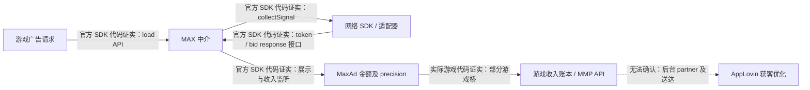
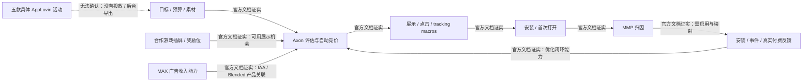

# AppLovin MAX 与 Axon：独立发行包技术分析

2026-11-18。原始 SDK 发行包、POM、SHA256、来源和源码在 [ThirdPartySDKs/CATALOG.json](ThirdPartySDKs/CATALOG.json)；没有初始化 SDK，也未发送广告/安装/收入请求。

## 1. 本轮新增的实证

**【实际游戏代码证实】四款内置核心版本已从 `AppLovinSdk.getVersion()` 原始 DEX 读取：Car13.6.4、Meow13.2.0、Rotate13.6.2、Jewel13.6.3。**已下载 Maven Central 对应 AAR，另保留13.7.0作为新版对照。版本匹配不等于全字节一致；Android R8 会重命名、内联和裁剪。[TP01](EVIDENCE_INDEX.md#tp01) [TP02](EVIDENCE_INDEX.md#tp02)

**【官方 SDK 代码证实】13.6.4 已有可定位的 Axon 客户端事件协议。**`com.applovin.impl.sdk.EventServiceImpl.trackEvent(name,data,options)`：

- 空名称报错；名称在配置 `c5.B0/axon_events` 中，走结构化 Axon 分支；其余走传统 postinstall 分支。
- `c5.B0` 包内默认含 `rewarded_ad_opportunity/ad_view/ad_clicked/level_start/level_complete/level_fail/tutorial_complete/virtual_resource_transaction/purchase/account_linked` 等，**不会因出现在表中就自动触发**。
- 新分支主端点默认 `https://b.applovin.com/v1/app`，由 `c5.s0/eete` 配置构成。仅静态读取，没有访问此生产事件端点。
- payload 包含 `id/name/data/timestamp/app_info/device_info`，可选 `dedupe_id/user_data`；`axon` 中含连接事件 key、SDK版本、平台及 `visitInfo`（首次/最近/当前会话时间、visitCount）。没有读取或使用任何真实 key。
- `user_data` 需配置允许且对象非空；`dedupe_id` 只是可传字段，不证明游戏实现了幂等或服务器恰好一次处理。
- `getTrackedAxonEvents` 的 deque 默认最多20条是本地调试观察缓存，**不是已经证明的离线送达保障**。

原文：`AppLovin/MAX/13.6.4/decompiled/.../EventServiceImpl.java`；`focused/.../c5.java`；原包对应 DEX 方法偏移在 `Embedded/car-race/.../Lcom_applovin_impl_sdk_EventServiceImpl*`。[TP03](EVIDENCE_INDEX.md#tp03)

**【官方 SDK 代码证实】13.2.0 的同类没有上述结构化分支。**已检查 `EventServiceImpl` 使用 `4.0/pix`，顶层名单之外变成 `event=postinstall/sub_event=原名称`，带 event_id、时间戳并交 postback 管理器。13.6.4 仍保留旧路径。这是所检查版本/类的差分，不能推定 Axon 首次上线日期，亦不说明旧 SDK 不能通过 MMP参与获客优化。[TP03](EVIDENCE_INDEX.md#tp03)

## 2. MAX 请求、竞价和收入

**【官方 SDK 代码证实】**官方 `MaxAd` 与适配器源码可直接观察到：

| 数据 | 具体接口/实现 | 解释边界 |
|---|---|---|
| 广告单元、场景、网络 | `getAdUnitId/getPlacement/getNetworkName/getNetworkPlacement` | 变现上下文，非获客 campaign |
| 广告价值与精度 | `getRevenue/getRevenuePrecision` | exact=实时竞价价；estimated=autoCPM；publisher_defined=发布者行项价；undefined=无共享权限；测试等可空 |
| waterfall/耗时 | `getWaterfall/getRequestLatencyMillis`、`MaxNetworkResponseInfo` | 客户端可见响应及延迟，不是 Axon 预测分数 |
| exchange来源 | `getDspName/getDspId` | 展示广告的需求来源信息，不证明当前游戏在哪买量 |
| 竞价信号 | Google adapter `QueryInfo.generate`；Pangle/Vungle token；Meta/Unity/Mintegral等 `collectSignal` | token是网络SDK生成的信号；不能反推出密闭服务端的特征模型 |
| bid响应载入 | adapter load 方法读取 bidding response / server parameters | 不等同本应用主动买这些网络的用户 |
| 收入回调 | `MaxAdRevenueListener.onAdRevenuePaid(MaxAd)` | 业务可转发MMP；调用、送达、后台消费分别证明 |

依据：[TP03](EVIDENCE_INDEX.md#tp03) [TP06](EVIDENCE_INDEX.md#tp06)。尤其不能把所有 `getRevenue()` 都描述成已结算精确现金；需要保留 precision。

图中“实际游戏代码”对应 Car/Rotate等已定位业务，不表示每款所有路径都启用；按产品详见[18](18_游戏与SDK差分分析.md)。

## 3. AppDiscovery / Axon 公开闭环

**【官方文档证实】**当前 AppLovin Ads gaming 页：广告主接 MMP、上传 video/playable、选择目标；平台优化竞价、定向、创意。支持 IAA、IAP、Blended ROAS、CPP、CPE；IAA/Blended 要求 MAX。MAX与获客形成产品关系，但 SDK 集成不是已开 campaign 的证明。[AX01](EVIDENCE_INDEX.md#ax01) [AX02](EVIDENCE_INDEX.md#ax02)

【无法确认】具体 bid 算法、训练数据采样、预测时间窗、价值校准、跨应用 join、模型参数均不在已取得客户端包内。不是下载 SDK 就恢复了 Axon 模型。

## 4. 广告质量数据不是自动的模型输入

**【官方文档证实】**AppLovin 2026-09-16 文章明确声明 Ad Review 在 MAX dashboard 启用后用于广告质量，不建立用户/设备画像，不馈送 Axon；声明也谈到移除用户级细节。它与隐私政策披露的广告个性化数据类别需要分别理解，不能据 SafeDK 字符串推断读取其他网络广告→Axon训练。[AX03](EVIDENCE_INDEX.md#ax03)

【无法确认】这份声明不是对四款实际网络流量的独立审计；本轮没有运行生产SDK。真实投放仍见[13](13_AppLovin真实投放证据.md)。
