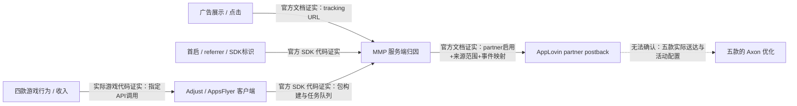

# Adjust / AppsFlyer：客户端归因与服务端回传的分界

2026-11-18。本轮取得游戏匹配的 Adjust5.5.0/5.7.0源码与AAR，AppsFlyer6.14.2/6.17.5 AAR；后者无取得的官方 Maven sources，不把反编译视图叫开源源码。[TP01](EVIDENCE_INDEX.md#tp01) [TP04](EVIDENCE_INDEX.md#tp04) [TP05](EVIDENCE_INDEX.md#tp05)

## 1. 实际客户端做了什么

| 阶段 | Adjust 原始源码 | AppsFlyer 官方发行包 | 游戏对应 |
|---|---|---|---|
| 首启/会话 | `ActivityHandler`→`PackageBuilder.buildSessionPackage`，`/session`参数与设备/环境 | start、conversion listener、session/event任务 | Car/Jewel初始化；Meow/Rotate init/start |
| Install Referrer | referrer读取/包字段，条件化获取广告标识 | 集成Play Referrer，conversion data回调 | 四个有包均有接口/实现证据；具体一次归因未知 |
| 归因结果 | `AdjustAttribution` network/campaign/adgroup/creative | conversion map含media_source/campaign等 | Car缓存campaign；Jewel→AdSourceUtils；Meow/Rotate→业务监听 |
| 事件 | `trackEvent`→buildEventPackage，金额/币种/事件token、partner_params | `AppsFlyerLib.logEvent`→实现类AFa1ySDK→事件任务 | 已定位的关卡/参与/价值事件 |
| 广告收入 | `trackAdRevenue`→`buildAdRevenuePackage`，**`/ad_revenue`** | `logAdRevenue(AFAdRevenueData,Map)`→AFh1lSDK→AFa1tSDK调度→AFf1tSDK载荷 | Car/Jewel Adjust；Rotate AF标准ILRD；Meow配置路由 |
| partner自定义数据 | global+event partner参数合并 | `setPartnerData`公开API | 不自动证明AppLovin partner启用 |

**【官方 SDK 代码证实】**Adjust `PackageBuilder.getAdRevenueParameters`保留 revenue/currency/source、impressions_count、network/unit/placement；`buildEventPackage` 与广告收入不是同一种包。`partner_params` 不等于客户端直接向所有伙伴发 HTTP。[TP04](EVIDENCE_INDEX.md#tp04)

**【官方 SDK 代码证实】**AF6.17.5 `AFf1tSDK` 将数据编码为 `monetization_network/event_revenue_currency/mediation_network/event_revenue`，事件名 `adrevenue_sdk`。`MediationNetwork.APPLOVIN_MAX("applovinmax")` 指广告变现中介；不是获客来源 `applovin_int`。`AFa1ySDK.logAdRevenue`检查数据有效性、stopped/相关状态后才提交任务；API调用不能无条件写成送达。[TP05](EVIDENCE_INDEX.md#tp05)

## 2. 缓存、重试、去重边界

**【官方 SDK 代码证实】**Adjust5.7.0 `PackageHandler.addI`入队并写盘；`sendFirstI`检查暂停及原子isSending；发送附retry_count；失败由BackoffStrategy计算等待，成功/关闭队首后更新磁盘队列。它证明有持久异步发送，不证明所有业务事件都入队或端到端恰好一次。[TP04](EVIDENCE_INDEX.md#tp04)

**【官方 SDK 代码证实】**AF6.14.2 `AFb1iSDK`有`AFRequestCache`；6.17.5 `AFc1vSDK`有cache版本迁移、ConversionsCache/AttrCache/OtherCache、分类限额、写文件、读取/删除/淘汰；`AFe1bSDK`可见isCachedRequest/timeincache。不是无限缓存，也不是所有类型均支持；混淆/控制流使部分方法反编译不完整，不编造全量重试常数或恰好一次保证。[TP05](EVIDENCE_INDEX.md#tp05)

**【实际游戏代码证实】**Meow once标记、Rotate本地触发标记、Jewel发出后更新AdWorth账本，与SDK排队是不同层；业务先写once后进程中断，不能由库有缓存推定永不丢事件。已有[M04–M05](EVIDENCE_INDEX.md#m04)、[R04–R05](EVIDENCE_INDEX.md#r04)、[D05](EVIDENCE_INDEX.md#d05)证据继续有效。

## 3. AppLovin partner postback 发生在哪里

**【官方文档证实】**AppLovin要求在MMP后台启用合作伙伴、填对应应用配置、选择共享范围、映射事件；可共享全部媒体及organic，或只共享AppLovin归因用户。Adjust的未映射事件不会共享；AppLovin当前AF指导将appopen映射landing，其他行为映射postinstall。后台配置不必存在APK内。[AX01](EVIDENCE_INDEX.md#ax01)

【官方文档证实】Adjust Axon partner说明可传广告ID/IP/match_type/partner_parameters/revenue_usd等配置字段；会话在页面不同段有默认与非自动的措辞，故本报告按“需核对配置的可选共享”处理，不作无条件默认结论。AF文档推荐ALL-installs来源；这是通用合作关系，不是已投放证明。[AX01](EVIDENCE_INDEX.md#ax01)

## 4. 不能把代理价值当 checkout

**【官方文档证实】**AppLovin的Adjust/AF集成指南明确排除：广告展示收入、预测收入/LTV、推荐佣金等进入purchase/checkout的收入路径；只接收用户直接支付。AF当前指南对其他postinstall事件要求无values/revenue。因此：

- 【合理推断】Car/Meow/Rotate关卡、分钟事件可申请映射行为目标；是否启用需要后台。
- 【无法确认】Car Firebase-only国家阈值事件到AppLovin没有已建立路由。
- 【无法确认】Rotate AF收入/自定义价值到AppLovin的具体共享配置未知；不能把广告收入purchase别名自动当合法IAP优化金额。
- 【实际游戏代码证实】Jewel有Meta代理purchase；**不能将Meta路径当AppLovin路径**，也不建议照抄其语义用于AppLovincheckout。

## 5. 身份关联不是默认跨应用

**【官方 SDK 代码证实】**Adjust打包`gps_adid/tracking_enabled/google_app_set_id/external_device_id`，广告ID缺失时有条件fallback；AF支持CUID、AFUID、标识限制和共享过滤API。只有游戏调用的字段才可列为业务证据，官方接口存在不说明生产开启。[TP04](EVIDENCE_INDEX.md#tp04) [TP05](EVIDENCE_INDEX.md#tp05)

【无法确认】服务器归因匹配算法、反作弊、跨应用join、AppLovin实际postback开关和训练目标均未取得；未访问任何后台或提交伪造事件。
