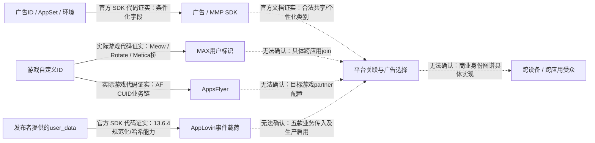

# SDK 身份标识、匹配与受众能力

2026-11-18。本轮只检查静态代码及公开文档，不读取真实广告ID、账户或手机文件，不执行任何SDK。

## 1. 最重要的新证据与边界

**【官方 SDK 代码证实】AppLovin13.6.4有直接用户匹配数据接口。**`AppLovinUserData`及`com.applovin.impl.r7.a`处理user_id/email/phone，邮箱会规范大小写、空白，对Gmail/Googlemail进行去点/去加号后缀的规范化，再有SHA-256路径；也接受已满足64位十六进制格式的输入。电话有国家码/数字规范化。`EventServiceImpl.a()`需`send_user_data`配置允许且对象非空才加入载荷。[TP07](EVIDENCE_INDEX.md#tp07)

**【无法确认】这不是目标游戏向AppLovin提供邮箱/电话的证明。**本轮主DEX相关调用扫描未建立目标游戏业务→`AppLovinUserData/setUserData`链；没有以SDK能力替代业务证据，也不据此排除native、远程或服务端集成。[TP02](EVIDENCE_INDEX.md#tp02) [TP08](EVIDENCE_INDEX.md#tp08)

**【实际游戏代码证实】单应用ID联结比“身份图谱”证据更实在。**

| 游戏 | 具体可达调用 | 意味着什么 / 不意味着什么 |
|---|---|---|
| Car Race | Metica `ApplovinInitializer.initializeSdkInternal(key,userId)`→MAX `setUserIdentifier(str2)` | 包装器能向MAX提供自定义ID；参数最终值与跨app命名空间未证明 |
| Meowdoku | `MaxInitHelper$MaxInit.init`链中`userJourney`→`AdUuid.getUuid`→`setUserIdentifier` | MAX使用广告框架ID；不能未经追踪就认定与AF CUID或账户ID完全相同 |
| Rotate Rings | `w6.e.i`读取`GlDataManager$thinking.distinctId`→MAX `setUserIdentifier` | 同应用MAX与ThinkingData ID显式联结；既有AF CUID/ta_distinct_id链可辅助核对，但不证明跨产品账户体系 |
| Jewel Coloring | 原有DeviceIdUtils→共享文件fallback→GTUser | 有跨应用共享意图的代码分支；现代Android能否读写、另一应用是否共享、服务器是否合并均未知 |
| Amaze GO! | 无包体 | 不从Oakever归属推定与Meow共用ID |

来源：[TP08](EVIDENCE_INDEX.md#tp08)、[I02–I07](EVIDENCE_INDEX.md#i02)。`setUserIdentifier`单独不等于商业身份图谱。

## 2. 各类SDK能力分层

| 组件 | 独立SDK/公开代码可证 | 游戏实际使用边界 |
|---|---|---|
| AppLovin | 【官方 SDK 代码证实】collector有广告ID、dnt/dnt_code、条件化AppSet/`idfv_scope`、country、cuid等；user_data另有用户提供字段 | 四款MAX存在；三款ID桥可定位；联系方式匹配未证实 |
| Adjust5.5/5.7 | 【官方 SDK 代码证实】GAID/tracking_enabled/AppSet、可选external_device_id、广告ID缺失时fallback；partner_params序列化 | Car Adid/campaign、Jewel归因业务已证；externalDeviceId业务链未证 |
| AppsFlyer6.14/6.17 | 【官方 SDK 代码证实】CUID、AFUID、setPartnerData、共享过滤/隐私控制API | Meow本地UUID→AF；Rotate统一分析ID→AF；服务端跨应用合并未知 |
| Meta | 【官方 SDK 代码证实】官方core含UserDataStore/AppEventsLogger/队列代码，具备匹配字段与事件能力 | Jewel/Meow实际AppEvents路径与现有规则区分；后台custom/lookalike受众未取得 |
| TikTok1.6.1/1.7.1 | 【官方 SDK 代码证实】TTIdentifierFactory取得广告ID及限制状态、缓存；TTRequestBuilder/日志队列；【官方文档证实】支持MAI/AEO/VBO和AppActivity受众 | Car/Rotate收入调用；Meow部分自动能力被关闭、路由依配置；不推定实际受众活动 |
| InMobi11.1.1 | 【官方 SDK 代码证实】`InMobiUnifiedIdService.push/fetch/reset`；fetch受SignalsConfig enabled、初始化/隐私条件检查 | 标准库能力；未建立业务提交用户数据/生产开关证据 |
| Meevii UID2 bridge | 【实际游戏代码证实】可选桥反射目标plugin；当前DEX无对应实现且未建立游戏注册调用 | 不称已启用UID2，不把bridge名称当服务端身份供应商证据 |
| Firebase | 【官方 SDK 代码证实】Analytics/UserID接口与RemoteConfig；RC可取配置 | user_id是同应用分析字段，不自动广播给AppLovin或成为身份图谱 |
| Google Ads/Unity/Pangle/Mintegral/Moloco/Vungle | 【官方 SDK 代码证实】已收集各发行包及适配器，能观察隐私/信号/广告接口 | 网络侧能力与目标游戏实际受众操作分离；本轮没有各家完整图谱恢复证据 |

依据：[TP04–TP07](EVIDENCE_INDEX.md#tp04)、[I03–I08](EVIDENCE_INDEX.md#i03)、[P06–P07](EVIDENCE_INDEX.md#p06)。Google AppSet的作用域不是任意跨发行商的统一账号，哈希联系方式仍可能是可关联数据，不应描述成匿名化保证。

## 3. 数据关联关系图

图中的官方能力箭头不是目标游戏开关。确定性哈希匹配、设备归因、概率归因、相似人群预测是不同技术，不能相互代替证明。

## 4. 政策能证到哪里

**【官方文档证实】**AppLovin披露跨应用/设备数据、MMP和派生分析使用；Oakever既有政策披露集团共享与custom/lookalike目的。**【无法确认】**没有五款实际跨应用关系、共享字段、受众导出或匹配成功记录；客户端未找到也不能证明服务端没有。[AX03](EVIDENCE_INDEX.md#ax03) [P06](EVIDENCE_INDEX.md#p06)

【合理推断】当前最可借鉴的是合规的单应用事件关联和真实收入账本，不应为了复制国家阈值/GRT/AdWorth额外采集联系方式或建立跨应用图谱；这些价值规则本身并不依赖已证明的跨应用身份。
