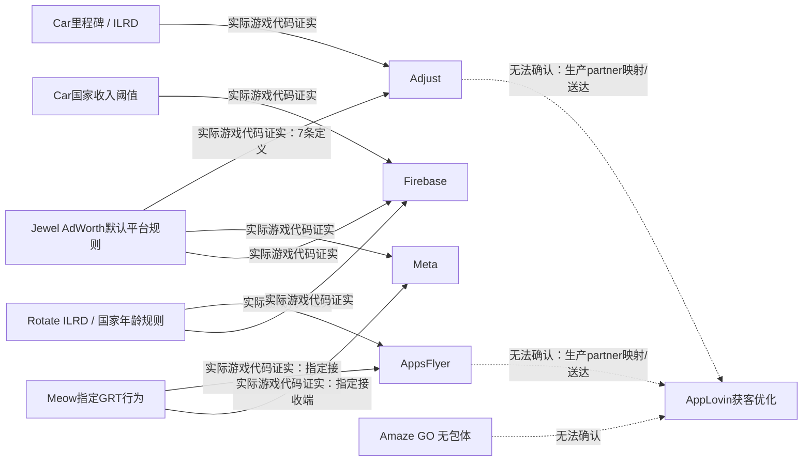

# 游戏集成与独立SDK差分：原生能力和开发商逻辑

2026-11-18。**比较层级：版本、选定API声明、原始DEX方法体、业务调用、官方发行包实现。没有将整个R8后的DEX与JAR做语义等价证明。**[TP02](EVIDENCE_INDEX.md#tp02)

## 1. 核心版本与API核对

| 游戏 | MAX核心 | 归因核心 | 官方发行包匹配 |
|---|---:|---|---|
| Car Race1.348.2 | 13.6.4 | Adjust5.5.0 | getVersion/CLIENT_SDK原DEX字段与同版本AAR对应 |
| Meowdoku1.25.1 | 13.2.0 | AF6.14.2 | 同版本AAR；AppsFlyer原DEX版本签名字符串 |
| Rotate Rings1.2.4 | 13.6.2 | AF6.17.5 | 同版本AAR；不是包装器fallback6.2.3 |
| Jewel1.24.1 | 13.6.3 | Adjust5.7.0 | getVersion/CLIENT_SDK原DEX与AAR对应 |
| Amaze GO! | 未知 | 未知 | 无样本，不推定 |

**【实际游戏代码证实】【官方 SDK 代码证实】**选定183个方法声明/descriptor均在对应官方JAR中存在（去除空格后的DEX descriptor与javap descriptor比对）。这只证明选定接口对应，**不证明183个方法体相同、更不证明整个SDK未修改**。每个结果可定位到DEX方法及官方API声明，见[API_COMPARISON.json](ThirdPartySDKs/API_COMPARISON.json)。导出文件以descriptor哈希区分重载，避免同名方法覆盖。[TP02](EVIDENCE_INDEX.md#tp02)

【无法确认】游戏内被裁剪、内联、混淆的私有函数未做全量语义比对；SDK核心的行为差别也可能来自服务器配置。未发现证据支持宣称开发商修改了AppLovin/Adjust/AF官方内部算法。

## 2. 四款实际增加了什么

| 游戏 | 官方SDK负责 | 游戏/封装层实际增加 | 到AppLovin状态 |
|---|---|---|---|
| Car | MAX广告、Adjust归因/队列/收入API | Zego生命周期；关卡/激励次数；Firebase国家收入缓存阈值；Metica广告编排 | 【无法确认】Adjust partner及国家事件路由；Metica有generic trackEvent桥，不证明具体价值事件 |
| Meow | MAX、AF、Firebase/Meta/TikTok API | UniKit/Godot桥、Learnings分析/隐私门控、GRT时间窗+关卡/分钟、规则接收端 | 【实际游戏代码证实】`MediaSourceTag.APPLOVIN_INT`识别枚举；【无法确认】真实归因/partner映射 |
| Rotate | MAX收入、AF广告收入接口 | Hurelax wrapper、国家×安装年龄、活跃+收入资格、关闭名单、循环档位 | 【无法确认】AF到AppLovin实际postback；`APPLOVIN_MAX`不算获客证据 |
| Jewel | Adjust归因/收入、Firebase/Meta API | Bulldog AdSource/AdWorth条件树、账本、权重、平台分发和本地状态 | 【无法确认】Adjust7默认规则到AppLovin映射；Meta/Firebase不自动转发 |

**【实际游戏代码证实】**依据：[C01–C06](EVIDENCE_INDEX.md#c01)、[M01–M05](EVIDENCE_INDEX.md#m01)、[R01–R06](EVIDENCE_INDEX.md#r01)、[D01–D07](EVIDENCE_INDEX.md#d01)、[TP08](EVIDENCE_INDEX.md#tp08)。Learnings/Meevii和Bulldog属于开发商接入的额外框架层，但仅凭包名不能判定法律上的自研所有权或商业供应合同。

## 3. 新追出的桥接证据

**【实际游戏代码证实】**Car：`com.metica.unity_bridge.UnityBridge.trackEvent`→`MeticaApplovinFunctions.trackEvent`→`ApplovinFunctions.trackEvent`→`AppLovinEventService.trackEvent`；后者要求mediation type为MAX、事件名非空。当前只建立Unity桥到SDK入口，没有证明Zego关卡或taichi事件实际调用它。原生/Unity入口的具体事件需另有callsite。[TP08](EVIDENCE_INDEX.md#tp08)

**【官方 SDK 代码证实】**独立Metica2.5.4下载成功，官方文档给出`com.metica:metica-sdk`，说明内部管理AppLovin且提供SmartFloors用户组。**【无法确认】**本轮尚未确认Car内部Metica核心版本与2.5.4完全相同；该包只作外部参照，不将最新发布版覆盖成游戏版本。之前search.maven.org未返回记录不是没有官方发行包，直达官方给出的Maven坐标已取得。[TP09](EVIDENCE_INDEX.md#tp09)

**【实际游戏代码证实】**Meow `APPLOVIN_INT` 是普通来源枚举，不是已发生的归因回调；`userJourney`给MAX设AdUuid。Rotate直接将ThinkingData distinct ID设MAX用户ID。这些是更具体的客户端联结能力，仍不等于跨应用受众。[TP08](EVIDENCE_INDEX.md#tp08)

## 4. 历史与归因含义

- **【实际游戏代码证实】**Rotate1.2.2→1.2.4的已有方法差分显示国家×安装day0–6收入门槛新增；不是证明广告媒体转投AppLovin。[H01](EVIDENCE_INDEX.md#h01)
- **【官方 SDK 代码证实】**MAX13.2→13.6.4事件服务新增结构化Axon分支，不能倒推出Meow开始投放日期，也不能推定它不具备MMP获客闭环。[TP03](EVIDENCE_INDEX.md#tp03)
- **【无法确认】**Jewel缺历史原包；90条默认规则和31张表只证明当前包默认。默认来源权重表没有被90条规则引用，不能写成生产AppLovin用户被放大若干倍。[D01](EVIDENCE_INDEX.md#d01) [D08](EVIDENCE_INDEX.md#d08)

## 5. 已证实的数据回传图

“规则定义/可达调用”不是每次运行都触发，也不是服务器确认接收。图没有把Firebase-only或Meta事件接到AppLovin，因为缺少这条游戏链证据。
