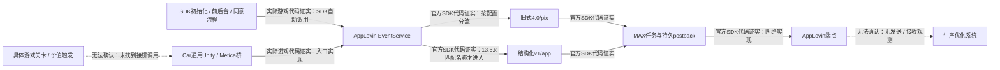
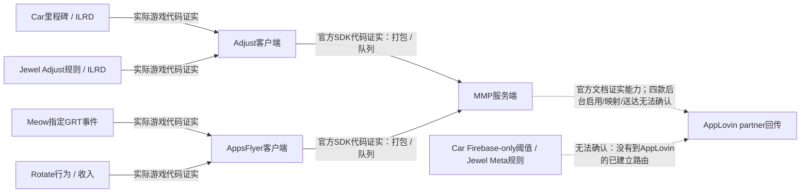

# Axon 实际事件调用链：直接发送与 MMP 回传分开证明

2026-11-18。本轮复用已有四款原包和 SDK，未下载 SDK、未运行 SDK、未访问手机或生产事件接口。

## 结论先行

**【实际游戏代码证实】四款原包都包含 SDK 自己产生并交给 AppLovin 直发链的生命周期/隐私/异常事件。**例如 SDK 初始化后的 `landing`、前后台切换的 `paused/resumed`。这些属于 SDK 自动事件，不能写成“游戏把关卡、收入或 AdWorth 直接发给 Axon”。

**【无法确认】目前仍没有建立任何一款“具体游戏关卡/活跃价值/广告收入规则 → MAX EventService → 结构化 Axon `v1/app`”的完整显式业务链。**Car 有两套可用的通用 Unity 桥，但未证明游戏调用它们发送特定事件；Meow/Rotate/Jewel 的所查 DEX 没有 SDK 外部对 EventService 的显式业务调用。不能把该扫描结论扩大成“绝无 native、反射或服务端路径”。[XD01](EVIDENCE_INDEX.md#xd01) [XD02](EVIDENCE_INDEX.md#xd02)

**【官方 SDK 代码证实】结构化协议在 Rotate13.6.2、Jewel13.6.3、Car13.6.4 都存在；Meow13.2.0没有该分支。**但默认 `landing/paused/resumed` 走旧式 `4.0/pix`；默认表里有 `level_complete/purchase` 不等于 SDK 自动观察到游戏行为。[XD03](EVIDENCE_INDEX.md#xd03)

## 1. 本轮检查范围与原始位置

| 游戏 | 原包版本 / MAX | 实际扫描 | 原始调用清单 |
|---|---|---|---|
| Car Race | 1.348.2 / 13.6.4 | 15个DEX、87,678个类 | [Car calls](axon/deep/games/car-race/calls.json) |
| Meowdoku | 1.25.1 / 13.2.0 | 8个DEX、77,413个类 | [Meow calls](axon/deep/games/meowdoku/calls.json) |
| Rotate Rings | 1.2.4 / 13.6.2 | 14个DEX、78,807个类 | [Rotate calls](axon/deep/games/rotate-rings/calls.json) |
| Jewel Coloring | 1.24.1 / 13.6.3 | 12个DEX、72,128个类 | [Jewel calls](axon/deep/games/jewel-coloring/calls.json) |

扫描所有命名空间，包含 SDK 内部、桥接、调用和相关配置字面量；不是上一轮排除 vendor 的候选筛选。每条记录保存 APK entry、DEX SHA256、class/method/descriptor、指令字节偏移及原始方法文件。62条事件相关调用指令含重载转发，**不是62种业务事件或62次实际发送**。[调用CSV](axon/deep/event-callsite-catalog.csv) [扫描汇总](axon/deep/game-scan-summary.json)

## 2. 事件分类及触发条件

以下均为【实际游戏代码证实】的包内实现，并与匹配【官方 SDK 代码证实】对照；没有运行期送达证明。[XD01](EVIDENCE_INDEX.md#xd01) [XD03](EVIDENCE_INDEX.md#xd03)

| 类别 / 事件 | 调用方与条件 | 进入 EventService 后的默认路径 | 尚不能证明 |
|---|---|---|---|
| 初始化 `landing` | 初始化任务 Meow `q5.run`、Rotate `e6.run`、Jewel/Car `h6.run` → `maybeTrackAppOpenEvent`；AtomicBoolean compareAndSet防重复 | `trackEvent("landing")` →旧式顶层事件 | 是否实际初始化成功、该次HTTP被接收 |
| `paused/resumed` | `SessionTracker.d/c`，前后台状态、忽略标志、上次时间与cooldown条件 | 旧式顶层事件 | 不是每次状态变化都无条件发送；默认cooldown90分钟 |
| 崩溃前 `paused` | `AppLovinExceptionHandler.uncaughtException` → `trackEventSynchronously` | 直接构建旧式包并交postback manager | 同步入口不等于服务端送达；不把它叫新的结构化行为事件 |
| 隐私变化 `huc/dns` | `AppLovinSdk.reinitialize(Boolean,Boolean)`，对应参数非空 | 默认旧式 `postinstall/sub_event` | 不证明用户接受、拒绝或实际触发次数 |
| 同意流程 `cf_start`、状态配置事件 | 新版 `a1`、Meow `u0` 同意流程状态机；EVENT状态取名称/参数，附flow_type | 按生效名称和配置分流；固定cf_start默认旧式 | 动态状态名不可自动当游戏关卡/价值；同意流程是否出现未知 |
| Meow `ref/rdf` | 网络实现 `m0.a`、`m0$c.a`，编码/解码等诊断分支有上下文map才上报 | 默认旧式顶层诊断 | 不是用户付费/广告价值事件 |
| `trackCheckout/trackInAppPurchase` | EventService公有方法可包装 `checkout/iap` | 默认旧式顶层事件 | 四款未建立这两个API的具体游戏购买调用方 |
| `level_complete/purchase/ad_view/...` | 只在新版默认`axon_events`注册表出现，或作为可调用入口 | **只有实际trackEvent且名称匹配才走v1/app** | 名称存在不证明触发、金额、收入回传或优化启用 |

默认配置可被更新，故“默认走旧协议”不等于永远如此。SDK生命周期事件也不能证明 AppLovin 为该游戏付费导量。

## 3. 四款显式业务调用逐一核实

### Car Race：桥存在，但具体游戏触发仍未证明

**【实际游戏代码证实】**

| 链路 | 原始位置 / 触发条件 | 证据边界 |
|---|---|---|
| `MaxUnityPlugin.trackEvent` → `MaxUnityAdManager.trackEvent` → `AppLovinEventService.trackEvent` | `classes5.dex` → `classes.dex`；JNI/Unity传入eventName和参数JSON | 通用MAX Unity插件，不是已发现的游戏显式调用 |
| `UnityBridge.trackEvent` → `MeticaSdk.getAds().getMax()` → `MeticaApplovinFunctions.trackEvent` → `ApplovinFunctions.trackEvent` → EventService | `classes10.dex` → `classes8.dex`；需初始化可取Ads、MAX mediation类型、非空事件名；解析参数JSON，异常捕获 | 没有已证实的Car关卡/taichi/激励次数事件调用此桥 |
| 原生SDK方法清单 | 已索引的Metica.SDK/MaxSdk.Scripts托管方法无对应TrackEvent出口 | 支持“桥入口未接到已识别业务”，不能排除动态构造JNI调用 |

**避免一个新误判：**原版metadata确实有 `trackEvent` 字面量，但本轮原始ARM定位到 `AdjustSdk.AdjustAndroid.TrackEvent` RVA **0xDE7BF0**。该字面量不能当作Car直发MAX的证据。原生SDK索引与字面量/ARM交叉证据见[XD02](EVIDENCE_INDEX.md#xd02)。未把生成的托管stub当恢复的逻辑。

### Meowdoku：所查业务仍走 Learnings/GRT/MMP

**【实际游戏代码证实】**全DEX内对EventService的调用来自SDK自身；GDScript `tracker.gd` → UniKit/GRT → 指定 AF/Meta/Firebase/Learnings 的既有调用链没有新增MAX接收端。`MediaSourceTag.APPLOVIN_INT`只是来源识别，不调用EventService。MAX13.2.0本身无新版结构化Axon分支；其自动事件仍可直发AppLovin旧协议。[XD01](EVIDENCE_INDEX.md#xd01) [M01–M05](EVIDENCE_INDEX.md#m01)

### Rotate Rings：有结构化入口，未发现游戏事件走它

**【实际游戏代码证实】**全DEX调用方为EventService转发、SessionTracker、隐私/初始化/异常SDK类。`SDKManager.handleAdRevenue` → AF `logAdRevenue`及国家/安装年龄/时长规则仍是MMP/其他分析路径。`APPLOVIN_MAX`是变现中介枚举，不是调用MAX EventService。**【无法确认】**未建立`level_complete`等游戏行为直达结构化分支的调用。[XD01](EVIDENCE_INDEX.md#xd01) [R02–R06](EVIDENCE_INDEX.md#r02)

### Jewel Coloring：AdWorth输出没有新增MAX平台

**【实际游戏代码证实】**DEX调用方仍为SDK内部；已恢复的90条默认AdWorth规则路由Firebase/Meta/Adjust，没有AppLovin输出标签。native符号中的AppLovinPoolConfig和MAX广告适配器属于广告池/变现，不是行为事件发送证明。**【无法确认】**没有将native反射/JNI或生产热更全面排除。[XD01](EVIDENCE_INDEX.md#xd01) [D01–D07](EVIDENCE_INDEX.md#d01)

## 4. 每款能够闭合的静态发送链

| 游戏 | 触发→SDK→本地封装→队列→网络实现 | 状态 |
|---|---|---|
| Car13.6.4 | `h6.run`初始化→`maybeTrackAppOpenEvent`→`landing`→旧式Map/event_id/ts→`i6/x6`任务→`network.b`→`PostbackServiceImpl`→`v5`→网络请求 | 【实际游戏代码证实】【官方 SDK 代码证实】静态链可达；实际发送/接收未观察 |
| Meow13.2.0 | `q5.run`→同上landing→旧式Map→`r5/f6`任务→`network.b`→PostbackService→`e5`→网络请求 | 同上；不是v1/app |
| Rotate13.6.2 | `e6.run`→landing→旧式Map→`f6/u6`任务→`network.b`→PostbackService→`s5`→网络请求 | 同上；另有结构化分支但未接到游戏行为 |
| Jewel13.6.3 | `h6.run`→landing→旧式Map→`i6/x6`任务→`network.b`→PostbackService→`v5`→网络请求 | 同上 |

`network.b` 是 SDK 自己的 **PersistentPostbackManager**，和MMP服务端partner postback不是一回事。它检查SDK初始化、URL、in-flight集合、最大尝试数；可将待发包保存到 `persistent_postback_cache.json`，成功回调移除、失败保留待后续重试；有容量与尝试上限，**没有端到端恰好一次证明**。[XD04](EVIDENCE_INDEX.md#xd04)

## 5. MMP路径另画，不连接成MAX直发

既有MMP业务证据继续有效，但客户端调用不等于MMP接收、更不等于AppLovin接收或选为优化目标。[16](16_Adjust_AppsFlyer归因与Postback.md) [AX01](EVIDENCE_INDEX.md#ax01)

## 6. 真实投放记录

**【无法确认】本轮仍未取得四款（及此前Amaze）产品级AppLovin实际导量证据。**新增检查官方博客搜索入口只返回前端搜索壳；Yahoo四个准确目标查询返回500，没有素材/广告主/日期/来源记录。没有绕过访问限制，没有把之前其他产品的库存资源当目标获客案例。[XD08](EVIDENCE_INDEX.md#xd08)

本报告能回答的是“客户端哪些代码会直接交给AppLovin网络层”，不能回答服务器实际收到了什么、与哪个投放campaign关联、是否进入Axon模型。自动生命周期直发与已证实的游戏价值直发是不同结论。
