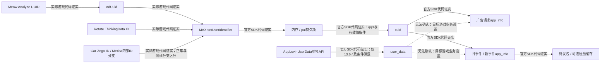

# MAX 用户ID进入哪里：cuid、持久缓存、事件与user_data

2026-11-18。只分析原包与已下载官方SDK；没有读取、计算或上报任何真实用户标识。

## 1. 核心结论

**【实际游戏代码证实】【官方 SDK 代码证实】Meow AdUuid、Rotate分析ID和Car Metica初始化ID进入MAX后，并非只用于日志：它们进入SDK用户ID管理器，在`qq3`允许且值有效时写入`cuid`，参与广告请求和事件封装。**持久化由独立配置`pui`控制，默认true。[XD05](EVIDENCE_INDEX.md#xd05) [XD06](EVIDENCE_INDEX.md#xd06)

**【官方 SDK 代码证实】`cuid`和13.6.4的`user_data`是独立的数据源。**`setUserIdentifier`只改用户ID管理器；不会自动创建AppLovinUserData，也不会自动填邮箱/电话。四款未建立业务调用`setUserData/AppLovinUserData`的证据。SDK提供这些接口，不证明跨应用图谱或联系方式匹配已启用。[XD07](EVIDENCE_INDEX.md#xd07)

## 2. 三款上游ID来源

| 游戏 | 上游→MAX的实际链 | 触发条件与限制 |
|---|---|---|
| Meow | UniKit `AdModule._initInternal`→`AdInitParameter$Builder.build`取`AnalyzeManager.getUUID(application)`→`AdUuid.setUuid`→`adsdk_uuid`/内存→`MaxInitHelper$MaxInit.userJourney`→`setUserIdentifier` | 初始化时try/catch，空值不设置；和已确认的AF CUID同取Analyze UUID，不能继续写成来源完全未知 |
| Rotate | `w6.e.i(Activity,WAdConfig,listener)`→`GlDataManager$thinking.distinctId()`→`AppLovinSdk.getSettings().setUserIdentifier`→MAX初始化 | distinctId非null才设置；是同应用ThinkingData/MAX的联结，不等于跨应用账户 |
| Car | `AdMeticaDefault.get_NextUserId`→初始化用户ID→`MeticaInitConfig`→JSON `userId`→Java Metica初始化→`MeticaAdsImpl.init`携带preservedUserId→`ApplovinInitializer.initializeSdkInternal`→`setUserIdentifier` | 正常来源为Zego本地GUID；Zego测试ID及Metica测试覆盖/空值fallback分支须单列；最终线上值未读取 |

依据：[XD06](EVIDENCE_INDEX.md#xd06)、[I03](EVIDENCE_INDEX.md#i03)、[I06](EVIDENCE_INDEX.md#i06)。

### Meow：补齐上一轮尚未证明的同源关系

**【实际游戏代码证实】**`classes5.dex` 中 `AdInitParameter$Builder.build`直接调用 `AnalyzeManager.getUUID`再调用 `AdUuid.setUuid(context,uuid)`；AdUuid getter优先内存、否则读广告框架 `adsdk_uuid`。AF包装器同取Analyze UUID。因此初始化成功且无异常覆盖的这条链里，MAX和AF CUID使用同源UUID。不能把它扩写为账户`learnings_account_id`、Learnings ID或所有发行商产品统一ID。[原始trace目录索引](axon/deep/bridges/meowdoku/classes5.dex/java/com/meevii/adsdk/AdInitParameter$Builder.java) [I03–I04](EVIDENCE_INDEX.md#i03)

### Car：正常GUID、测试覆盖与中间转发

**【实际游戏代码证实】**

- ARM `ZegoUserUID.get_Value` RVA **0x32F5EC4**：读`zego_user_uid`；为空则`Guid.NewGuid().ToString()`，写回PlayerPrefs并Save；静态缓存复用。不是本轮读取到的实际用户值。
- `AdMeticaDefault.get_NextUserId` RVA **0x32D967C**：正常转到ZegoUserUID；测试分支可选`metica-force-test/metica-force-holdout`，不能把调试值写成真实玩家身份。
- `AdMeticaDefault.Init` RVA **0x32DA628**：返回值经 **0x32E424C** setter、**0x32E42BC** getter转入构造参数；两者访问相同静态类型槽、同一`+8`字段，已用原始指令及slot地址核对；不虚构未恢复的方法名。
- `MeticaInitConfig..ctor` RVA **0x245984C**将第三项保存到`+0x10`，getter对应UserId；`AndroidInitConfigJson.Build` RVA **0x2467C48**输出`userId`。Java `UnityBridge.parseInitConfig`取该字段。
- Java `MeticaInitConfig.internalUserId_delegate$lambda$0`：先测试覆盖；否则消费传入userId；空时生成自己的稳定ID。`MeticaSdk.initialize`取得内部ID并作为`$preservedUserId`交初始化协程，广告层后续使用此值。该路径允许fallback，故不能把所有分支都说成Zego GUID。

新ARM证据来自原包同哈希的lib/metadata，非生成托管stub：[native-car索引](axon/deep/native-car/method-evidence.json)、[中间accessor核验](axon/deep/native-car/user-id-intermediate-check.json)、[Metica Java位置](axon/deep/metica-car-index.json)。

### Jewel的边界

**【无法确认】**本轮全DEX未发现业务向MAX设置用户ID或AppLovinUserData的调用；已有Bulldog共享ID→GTUser不能直接画到MAX。MAX仍可能使用其自身广告标识、随机token与环境信息；它们不是已证明的Bulldog ID转交。[XD01](EVIDENCE_INDEX.md#xd01) [I07](EVIDENCE_INDEX.md#i07)

## 3. MAX内的保存与读取

**【官方 SDK 代码证实】**

| 版本 | Settings转发 | 用户管理器 | 保存/发送开关 |
|---|---|---|---|
| 13.2.0 | `setUserIdentifier`→core `p0().a(id)` | `com.applovin.impl.y6`；getter`c()` | `l4.u3=pui`、`l4.m3=qq3` |
| 13.6.2 | →`y0().a(id)` | `p7`；getter`e()` | `z4.Q3=pui`、`z4.G3=qq3` |
| 13.6.3 | →`y0().a(id)` | `s7`；getter`e()` | `c5.S3=pui`、`c5.I3=qq3` |
| 13.6.4 | →`z0().a(id)` | `t7`；getter`e()` | `c5.V3=pui`、`c5.K3=qq3` |

四版包内默认均true。未attach core时Settings先放暂存字段`f`，attach时转交管理器；管理器写内存`b`，`pui`允许时写`com.applovin.sdk.user_id`。下次构造可恢复；若pui关闭会清旧持久项。**这些是默认与实现，不是生产有效配置实测。**附带的SDK随机token有独立字段，不等于传入用户ID。[XD05](EVIDENCE_INDEX.md#xd05)

## 4. 具体进入哪些载荷

| 下游 | 对应公式/方法 | ID的逻辑位置与条件 |
|---|---|---|
| 广告请求 | 13.2 `j5.g`→collector `k.a(null,false,true)`；13.6.2 `x5.g`、13.6.3/4 `a6.g`→`m.a(null,false,true)` | `app_info.cuid`；qq3允许且ID有效；随后序列化/编码，未观察线上字节 |
| 旧事件 | EventService旧包builder→collector `a(null,z,false)` | 扁平map里的`cuid`，随其他字段按配置进query/body；不是凭空新增user_data |
| 新结构化事件 | 13.6.2 `m.G`、13.6.3/4 `m.H`供EventService payload | `app_info.cuid`，同qq3条件；只有新分支实际触发才会产生该包 |
| 待发/持久队列 | EventService构建map→`network.d`→`network.b`→`network.c`JSON保存 | 封装时已加入的ID可随包缓存；不是只保留一个ID指针，修改当前ID不等于改写所有旧待发包 |
| SDK内部关联 | 管理器setter还通知内部管理对象，供SDK自身标记/调试等消费 | 未证明这一步建立跨应用关系或服务器用户画像 |
| 13.6.4可选user_data | `AppLovinSdk.setUserData`→core单独字段；EventService/`a6.e`取对象→`r7.a` | 独立于cuid，需send_user_data、非空对象且有效字段；能进事件和广告请求 |

依据：[XD05](EVIDENCE_INDEX.md#xd05)、[XD04](EVIDENCE_INDEX.md#xd04)、[XD07](EVIDENCE_INDEX.md#xd07)。`cuid`是预编码逻辑字段，不能据此声称绕过隐私限制或网络一定送达。

## 5. 能否据此证明身份图谱

**不能。**【实际游戏代码证实】单应用ID可以关联该应用广告请求、事件与分析上下文；【官方 SDK 代码证实】SDK支持可选账户/联系方式规范化；【无法确认】跨应用命名空间、服务器join、实际受众同步及Axon使用方式。Car本地GUID、Meow本地UUID与Rotate分析ID并不自动提供跨发行商身份匹配。[17](17_第三方身份图谱技术调查.md)
