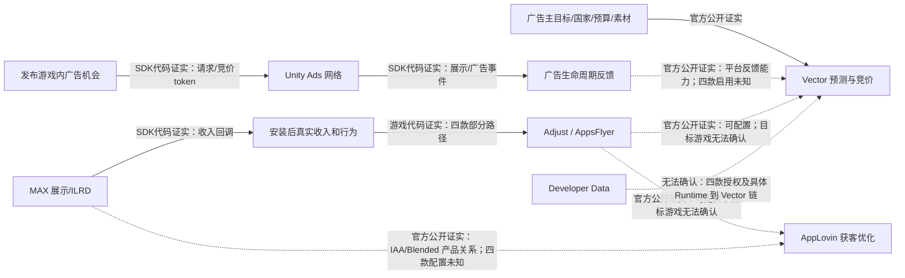

# Unity Vector 与 AppLovin Axon：机制、SDK 和游戏信号

2026-11-18。结论等级按每格证据标注；“平台具备”与“四款已启用”分开。复用既有 MAX、Adjust、AppsFlyer，不重下相同发行包。本轮未启动生产 SDK。

## 1. 十项机制比较

| 维度 | Unity Vector / Unity Ads | AppLovin Axon / AppDiscovery | 可作出的结论 |
|---|---|---|---|
| 展示价值预测 | 【官方公开证实】按预测收入、ROAS 目标动态出价 | 【官方公开证实】自动竞价、定向、ROAS 优化 | 【无法确认】双方单次预测公式、精度及误差谁更小 |
| 玩家与游戏匹配 | 【官方公开证实】Game DNA、玩家行为、生态数据的产品声明 | 【官方公开证实】广告互动、应用/MMP 数据及 AI 个性化声明 | 【无法确认】共同基准下的模型优势；不能把产品宣传当模型审计 |
| D0/D7/D28 IAA | 【官方公开证实】三窗口，D28 文档标 beta | 【官方公开证实】IAA ROAS 产品；已取文档未证同样三窗口的逐项可用性 | 【无法确认】不可据文档缺项宣称 Axon 无长期预测 |
| IAP / Hybrid | 【官方公开证实】IAP、Hybrid 均 D7/D28 | 【官方公开证实】IAP / Blended；IAA 和 Blended 要求 MAX | 真实购买和真实广告收入要分流，不能用代理 purchase 代替 |
| 学习数据量 | 【官方公开证实】IAA 1000 归因安装及正成熟收入等门槛，见下文 | 【无法确认】未取得等口径硬门槛 | Unity 门槛不能套在 Axon 上，也不等于预测模型训练集总量 |
| 收入与代理价值 | 【官方公开证实】postback 将 session/purchase/ad_revenue 分开 | 【官方公开证实】IAA/MAX 与 IAP/checkout 区分，禁止把 IAA/预测 LTV 填 checkout | 游戏的关卡、阈值是候选代理特征，不是现金收入 |
| MMP 回传 | 【官方公开证实】Adjust/AF partner、Game ID、共享范围、事件映射 | 【官方公开证实】Adjust/AF partner 激活/映射；本地 MAX 事件另一路 | 【无法确认】四款实际后台共享、送达、优化选用 |
| 引擎 Runtime | 【官方公开证实】【SDK代码证实】有受控 Developer Data 和 Consent API；Vector 公开宣传生态优势 | 【无法确认】未取得同类 Unity 引擎原生观测链；仍有广告/MMP 上下文 | 这是 Unity 的潜在差异化来源，不是已证明的 ROAS 因果优势 |
| 标识与跨应用 | 【SDK代码证实】隐私门控标识、会话 token；【官方公开证实】Exchange RampID 美加接入 | 【SDK代码证实】cuid/条件化标识/可选 user_data；【官方公开证实】政策数据类别 | 【无法确认】四款启用商业身份图谱；单应用 ID 联结不是跨应用图谱 |
| 竞价、扩量、素材 | 【官方公开证实】动态目标、video/playable、D28 扩展；Exchange 第一价格协议 | 【官方公开证实】自动化竞价/素材及 video/playable 获客产品 | 【无法确认】谁在同国家同素材下边际 ROAS 更高；Exchange 协议不是 Vector 完整拍卖模型 |

来源：[VG03](EVIDENCE_INDEX.md#vg03)–[VG07](EVIDENCE_INDEX.md#vg07)、既有 [AX01](EVIDENCE_INDEX.md#ax01)–[AX05](EVIDENCE_INDEX.md#ax05)、[20](20_Axon实际事件调用链.md)、[22](22_AppLovin事件协议版本差分.md)。

## 2. Unity SDK：实际追到了哪里

【SDK代码证实】本轮针对 Unity Ads **4.17.0、4.18.1**，LevelPlay **9.3.0、9.4.0、9.5.0** 的官方已存发行物进行选类静态分析。9.4.0 实现在 `Dependency-mediation-sdk`，不能因壳包类少就误判 SDK 空缺。五组反编译 exit=0。版本哈希和扫描范围见 [SDK_AUDIT](vector/SDK_AUDIT.json)，下述每个方法的**文件、行号、原文片段和 SHA256**见 [CODE_EVIDENCE](vector/CODE_EVIDENCE.json)。成功反编译不证明整个 SDK 所有路径均已审计。

| 路径 / 类与方法 | 代码实际说明 | 不能据此认定 |
|---|---|---|
| `AndroidGetAdRequest.invoke`，4.17 Kotlin 与 4.18.1 反编译 | sessionCounters、静态/动态设备、opportunityId、placementId、campaignState、TCF、mediationAdUnitId/extras 进入 protobuf AdRequest | campaignState 是 SDK 广告上下文，不自动等于 MMP 用户 campaign 或完整游戏行为 |
| `AndroidBuildHeaderBiddingToken.invoke` / `CommonGetHeaderBiddingToken` | clientInfo、时间、session/limited token、pii、TCF、广告格式/中介信息、wins/starts/seq；token 序列化并以 `2:` 前缀输出 | token 是可观察竞价输入，不是公开模型权重，也不是目标应用已买量 |
| `GetOperativeEventRequest.invoke`，两版本 | eventId/type、trackingToken、机会 ID、additionalData、可选 playerServerId→sid、设备及会话/广告上下文 | additionalData 的存在不证明传入关卡、奖励价值或 Runtime 全量事件 |
| `OperativeEventObserver.invoke` | repository→UniversalRequest→DataSource 持久化→BackgroundWorker；持久化异常时尝试直接发送 | 本地队列不是服务端已收到或“恰好一次”承诺 |
| `OperativeEventJob.doWork` / `UniversalRequestEventSender.invoke` | job 异常 retry；发送前 TTL 检查；GatewayClient.request；特定 GatewayException 终止重发 | 不代表所有错误无限重试，更不代表真实生产送达 |
| `DeviceInfoReaderWithPrivacy.getDeviceInfoData` | `allowedToSendPii` 为真才加广告标识；nonBehavioral 另有条件；新请求共享层也带 developerConsent | 不把旧 reader 的门控当整个新版隐私路径的完整合规证明 |
| `LevelPlayAdInfo` 三版本 getter | revenue、precision、country、auctionId、adNetwork 等可读；LevelPlay 初始化/展示接口与 Unity Ads 网络分开 | ILRD 并非全都精确结算收入；中介也可选择其他网络 |

【SDK代码证实】广告播放器桥 `CommonAdViewerExposedFunctions.sendOperativeEvent` 使用广告对象生成 operative event；SDK 的展示/点击/完成回调是广告生命周期，**不能把奖励完成回调次数直接当美元收入**。实际 ILRD 需中介/收入接口与金额精度；奖励发放属于游戏逻辑。

【无法确认】所扫类/字面量没有找到可识别的 `Vector`、`Day28`、`RuntimeData` 专属公开业务入口。**这只是本轮范围内的未发现，不排除统一协议和服务端配置实现 Vector。**不能靠“无 Vector 类名”否定平台功能，也不能靠 Unity Ads SDK 认定已启用 Vector 获客。

【官方公开证实】LevelPlay 是广告中介，Unity Ads 是网络/获客产品，Vector 是预测优化层。ironSource Ads 网络退役不等于 LevelPlay SDK 退役；取得 9.5.0 正式发行物也是二者必须区分的证据。旧网络迁移的每个客户端字段变化尚无完整前后协议证明，不扩大结论。[VG01](EVIDENCE_INDEX.md#vg01) [VG05](EVIDENCE_INDEX.md#vg05)

## 3. 两条闭环，不混接

MMP partner postback、MAX EventServiceImpl 本地事件、Unity Ads 广告生命周期是不同链。既有研究只证明四款部分 SDK 自动事件及桥接能力，**未证明它们向 Axon 直接发送特定游戏价值事件**，更未证明后台实际用于优化。

## 4. 四款游戏：哪些可以成为输入

| 游戏 | 已证实业务链 | 可用于 Unity IAA / AppLovin IAA 的合适信号 | 不能假设 |
|---|---|---|---|
| Car Race | 【游戏代码证实】MAX/Adjust 收入及里程碑；国家收入阈值走 Firebase | 真实 ILRD 按正确广告收入通道，合规授权后可接两者；关卡/激励次数为独立行为代理 | Firebase-only 阈值没有已建立的 Unity/AppLovin 路由 |
| Meowdoku | 【游戏代码证实】GRT 时间窗、分钟/深度→指定接收端；AF 客户端 | 已被采集的参与行为有候选辅助价值；真实收入需单独确认金额源、去重与生产映射 | GRT 代理事件不等于真实 IAA 收入；不能仅因 MAX 存在就确认送达 |
| Rotate Rings | 【游戏代码证实】MAX ILRD→AF；国家×安装年龄×收入/活跃规则→AF/Firebase | 标准广告收入可配置给两平台；规则事件可独立保留为代理/分层 | 档位事件可能与逐展示金额重复，不能一起累计为收入 |
| Jewel Coloring | 【游戏代码证实】Adjust 收入、AdWorth 90 默认规则 / 31 权重表，Firebase/Meta/Adjust 分发 | 原始真实广告收入可配置；AdWorth 分层单列评估，不伪装现金 | Meta 代理 purchase 不能当 Unity IAP 或 AppLovin checkout；默认未引用权重不证明生产使用 |
| Amaze GO! | 【无法确认】没有可验证包体 | 待取证 | 不能从同发行商推定事件、引擎和投放 |

原始方法与规则见 [18](18_游戏与SDK差分分析.md)、[09](09_AdWorth深度逆向.md)、[10](10_买量优化机制最终对比.md)、[20](20_Axon实际事件调用链.md)。这是**适配资格分析**，不是已取得生产发送证明。

【官方公开证实】Unity 当前 MMP 指南要求正确的 advertiser Game ID、partner 激活、post-install 事件映射及数据授权；**它不同于变现 SDK 的 publisher Game ID**。Adjust 的广告收入共享可能还需对应产品权限。AppLovin 对应 partner 和 MAX 条件也必须满足。文档对共享范围的建议不代替真实隐私授权，本轮未调整任何设置。[VG04](EVIDENCE_INDEX.md#vg04)

【合理推断】关卡深度、安装后分钟、早期广告参与可帮助识别长价值玩家，但要在自有数据中证明增量预测价值；不能从这些厂商规则存在推断 Vector/Axon 接受、训练或优化了它。把来源权重乘出的“价值”作为实际收入，会污染 ROAS 标签。

## 5. 学习与选择

【官方公开证实】Unity 当前门槛：IAA D0 为 1000 归因安装及正 D0 成熟广告收入；IAA D7/D28 为 1000 安装及正 D7 成熟广告收入；IAP D7/D28 为 75 个 D7 成熟独立付费用户；Hybrid 为 1000 安装、正 D7 广告收入、35 个 D7 成熟付费用户。**D28 退出初始学习不要求先等满 28 天，但评价 D28 实际效果必须成熟。**不把这些门槛理解成统一国家/活动层级的保证，须以具体后台状态核实。[VG03](EVIDENCE_INDEX.md#vg03)

【无法确认】没有四款通过 Vector 或 Axon 实际获客的独立证据，也没有同素材、同国家、同成熟期对投数据，因此不能判谁必然更高 ROAS。最有价值的下一步是授权聚合 cohort 实验，协议和可执行离线模型见 [26](26_IAA_ROAS买量经济模型.md)。
