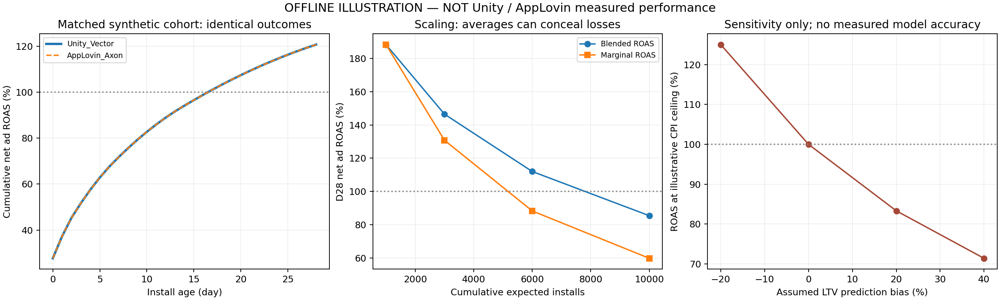

# IAA ROAS 离线经济模型与公平比较方法

2026-11-18。已实际实现并运行，8 项计算/数据校验通过。**所有默认数值都是合成情景，不是 Unity 或 AppLovin 的实际投放、精度或价格。**模型没有网络连接，不发送生产事件，不需要用户标识。

## 1. 可执行产物

- [输入配置](vector/model/inputs.json)：国家、素材、预算、两平台 CPI/收入倍率、日活概率、单位活跃日净广告收入、扩量梯度、预测偏差。
- [模型](vector/model/roas_model.py)、[校验脚本](vector/model/verify_model.py)、[PASS 结果](vector/model/MODEL_VALIDATION.json)。
- [结构化结果](vector/model/output/results.json)、[两组结果 CSV](vector/model/output/arms.csv)、[扩量 CSV](vector/model/output/scaling.csv)、[误差敏感性](vector/model/output/prediction_bias.csv)、[学习规划](vector/model/output/learning.csv)。
- [成熟真实数据导入模板](vector/model/output/daily_actual_template.csv)：默认行仍为合成数据，使用前必须替换。

```powershell
python D:\GrowthResearch\vector\model\roas_model.py
python D:\GrowthResearch\vector\model\verify_model.py
python D:\GrowthResearch\vector\model\roas_model.py --input D:\GrowthResearch\vector\model\inputs.json --actual-daily-csv D:\GrowthResearch\vector\model\actual_daily.csv --output D:\GrowthResearch\vector\model\actual_output
```

【合理推断 / 分析工具】真实 CSV 列为 `arm,day,net_ad_revenue_per_install_usd`，两组每天 D0–D28 都必须齐全。金额以**原始安装数**作分母，不按当天活跃人数；必须是已成熟且已完成可比对账的收入。缺天或重复组/天会报错，不能把未成熟天补零。CPI/预算仍取 JSON，**导入 CSV 不会自动读到真实投放成本**，需同时填入同 cohort 实测成本/安装数；配置保持独立副本即可避免覆盖演示。

## 2. 公式与口径

【合理推断 / 经济恒等式】令 `p_d` 为安装后第 d 天无条件活跃概率（可包括回流，不是假定存活曲线），`r_d` 为每活跃日净广告收入：

`每日安装用户广告收入 = p_d × r_d`

`广告 LTV_D = Σ(d=0..D) 每日每安装用户净广告收入`

`CPI = 同 cohort 广告花费 / 归因安装数`

`ROAS_D = LTV_D / CPI`

`cohort 广告贡献 = 安装数 × LTV_D − 广告花费`

`cohort 回本日 = 首个累计 LTV ≥ CPI 的日龄；D28 内未达到则为未知/截尾`

日历 D0、D7、D28 按示例包含 0..7/0..28；各后台窗口可能不同，导入前先统一。净广告收入需固定中介/网络扣减及币种口径，不把估算 CPM、净 ILRD、最终回款混着累计。结果是广告贡献，尚未扣服务器、研发、税费、素材制作、资金成本等，**不是公司净利润**。cohort 回本也不是结算现金到账或持续投放组合的现金回本。

## 3. 同条件示例：不预设胜者

默认每组 cohort 预算 $3,000、CPI $0.65、同国家同素材、同收入质量；预期安装约 4,615.38 是分析期望值。活跃概率锚点 D0=100%、D1=35%、D3=23%、D7=15%、D14=9%、D28=5%，线性插值；每活跃日净广告收入 $0.18。

| 组 | D0 LTV / ROAS | D7 LTV / ROAS | D28 LTV / ROAS | cohort 回本 |
|---|---|---|---|---|
| Unity_Vector，合成 | $0.1800 / 27.69% | $0.4662 / 71.72% | $0.7848 / 120.74% | D17 |
| AppLovin_Axon，合成 | $0.1800 / 27.69% | $0.4662 / 71.72% | $0.7848 / 120.74% | D17 |

两组完全相同是刻意的公平基线，**没有依据给任一平台加精度、低 CPI 或额外 LTV 红利**。合成 D28 贡献每组约 $622.15。真正比较时替换实际数据，而不是将平台名称当成模型参数。



图已实际生成并检查。左图两组重合；中图说明平均值掩盖边际亏损；右图只是预测偏差敏感性，不是任何平台真实误差。

## 4. 扩量看边际，而不是只看总平均

| 新增安装梯度 | 假定边际 CPI | 边际 D28 ROAS | 累计平均 D28 ROAS | 累计广告贡献 |
|---|---:|---:|---:|---:|
| 首 1,000 | $0.45 | 188.35% | 188.35% | $397.58 |
| 再 2,000 | $0.60 | 130.80% | 146.50% | $767.18 |
| 再 3,000 | $0.80 | 88.29% | 112.00% | $486.14 |
| 再 4,000 | $1.05 | 59.79% | 85.42% | -$1,202.50 |

【合理推断】第三档累计 ROAS 仍大于 100%，但新增用户已经亏损。持续扩量能力应比较同预算增量的成熟净收入/增量花费，以及贡献是否增加。这些供给档位是手填场景，**模型不从平台财报估算真实库存曲线**。

## 5. 预测偏差如何损害回报

【合理推断 / 条件恒等式】只为敏感性分析，设目标 `tROAS`、预测偏差 `b`，若实际获客价恰好等于 `预测 LTV / tROAS` 的示意上限，则：

`实际 ROAS = tROAS / (1+b)`

在 100% 目标下，高估 20% 对应约 83.33%，高估 40% 对应 71.43%；低估 20% 对应 125%。**不是实际竞价公式**：真实拍卖价格、安装概率、探索、预算、竞争和素材都会改变成交与规模。这里只展示过度高估价值可能付出过高成本；低估也可能丢失本来盈利的展示机会。

【无法确认】Unity/Axon 的实际偏差、方差、分国家校准、置信区间没有公开共同数据，不能给两者填不同“测得精度”。

## 6. 学习阶段规划

【官方公开证实】采用 Unity 当前[ROAS 门槛文档](vector/doc-intro-to-roas-campaigns.html)，不是 Axon 门槛：[VG03](EVIDENCE_INDEX.md#vg03)。IAA D7/D28 初始退出条件使用 D7 成熟收入，IAP 需 75 个成熟付费用户，Hybrid 需 35 个加安装/广告收入条件。自然/未归因共享数据可能有帮助，但官方说明不计入所列初始归因安装门槛。

【合理推断 / 规划假设】每天 $500、CPI $0.65 时，约 769.23 安装/天；以付费率 2%、另加 2 天报告滞后：

| Unity 文档门槛场景 | 获取所需规模的期望天数 | 保守加成熟/报告时间 |
|---|---:|---:|
| IAA D0 | 2 | 4 天 |
| IAA D7 / D28 | 2 | 11 天 |
| IAP D7 / D28：75 人÷2%=3750 安装 | 5 | 14 天 |
| Hybrid：max(1000,35÷2%)=1750 安装 | 3 | 12 天 |

这是**恒定 CPI、合格付费率及正成熟广告收入**下的粗略排期，最后一批成熟再加滞后；非平台承诺，也非统计意义的达到门槛概率。D28 真实评估还需完整 D28 和对账延迟。不能把“需要 75 个付费者”误算成 `75×CPI` 预算。

## 7. 用真实实验选择平台

【合理推断 / 建议】在同游戏版本、经济、国家、系统、素材组与日历周期下，预先固定两组预算、窗口、收入精度和归因口径。先校验成本/安装、ILRD 去重、币种、时区、organic 及再归因处理；不得将来源加权代理 purchase 混入真实收入。

两广告平台难以直接共享随机用户分组，也可能竞价重叠。可使用平台允许的实验/地域分块或预注册的交替时段，明确各方法的季节、库存和地域偏差；普通同时投放是观测对比，不能自动声称严格因果 A/B。聚合导出即可，不需要本研究收集个人标识。

在 D28 成熟后比较 cohort LTV、ROAS、广告贡献与回本，再逐档扩预算看边际回报。应按独立日期/地域 cohort 估计不确定性，不要把每个展示当独立玩家样本。学习期与稳定期分开列，但全程费用均计入总收益。模型提供会计和敏感性计算，**没有自动统计检验、因果识别或现金流模拟**。

**当前可交付的是能代入实际数据的比较工具，不能交付一个未经投放证据支持的“Vector 或 Axon 必胜”结论。**
