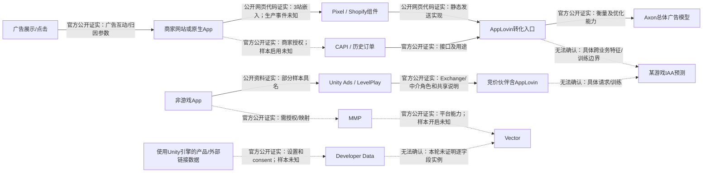

# Unity 与 AppLovin 非游戏数据生态：结论与未知

2026-11-19。入口：[27 样本与来源](27_非游戏数据来源总览.md)、[28 AppLovin技术链](28_AppLovin电商与网站数据链.md)、[29 Unity与合作角色](29_Unity非游戏数据与Runtime.md)。结论只覆盖本轮公开材料和静态样本，不把政策声明当独立生产审计。

## 1. 两家从游戏以外能知道什么

| 场景 | AppLovin可证实入口 | Unity可证实入口 | 比较边界 |
|---|---|---|---|
| 工具/内容/生活服务App里的广告 | 【公开资料证实】Zedge、InShot、DramaBox、Winwalk、WeWard具名；【SDK代码证实】MAX广告/ILRD能力 | 【公开资料证实】ReelShort、Winwalk、WeWard具名；【SDK代码证实】Ads/LevelPlay能力 | 非游戏覆盖已证；具体APK版本、用户数据包和实际规模未知 |
| 非游戏App转化 | 【官方公开证实】【SDK代码证实】独立Axon1.3.4接口、MMP、广告主事件 | 【官方公开证实】MMP postback、Analytics/IAP对应服务 | SDK/API默认能力不证明样本业务调用；自定义事件不等于真实收入 |
| 电商网站浏览→订单 | 【官方公开证实】【公开网页代码证实】Pixel、CAPI、Shopify、历史订单；3站主题嵌入 | 【官方公开证实】引擎/服务内IAP/D2C及可授权外部数据；本轮未取得可对等验证的通用商家Pixel样本 | AppLovin这条可观察链更完整；不能据本轮未取到证据宣称Unity没有其他网站产品 |
| CTV/视频内容 | 【官方公开证实】Wurl节目场景标签、受众/观看行为产品声明与DSP供给 | 【无法确认】本轮没有取得同等Unity CTV观众数据链 | Wurl属于本轮研究的关联公开入口；其数据自动流到Axon尚未证实 |
| 引擎运行/游戏世界上下文 | 【无法确认】没有对应Unity引擎原生采集链；仍有广告/转化数据 | 【官方公开证实】【SDK代码证实】Unity Runtime/DDF/Consent接口，可用于非游戏Unity产品 | 是不同的技术入口，不是已量化的ROAS优势 |
| 广告交易及身份伙伴 | 【官方公开证实】广告互动、合作伙伴/MMP信息、MAX自有win/loss，Pixel存在cookie匹配分支 | 【官方公开证实】Exchange请求、参与DSP、RampID美加接入、具名竞价伙伴 | 不是完整身份图谱，也不能确认具体训练使用 |

依据：[NG01](EVIDENCE_INDEX.md#ng01)–[NG09](EVIDENCE_INDEX.md#ng09)、[VG05](EVIDENCE_INDEX.md#vg05)–[VG07](EVIDENCE_INDEX.md#vg07)。这些样本不能作市场覆盖率或收入贡献估算。

## 2. 真实可解释的数据闭环

实线的“代码证实”指静态实现或嵌入，**不表示本研究观察了生产事件送达**；图中特意保留后台开关与模型用途的缺口。

## 3. 哪些跨场景关联已有官方证据

| 命题 | 判断 |
|---|---|
| AppLovin可将某app/网站动作与其他app/网站行为结合做个性化 | **【官方公开证实】**隐私政策明确如此表述；不再笼统记为“全部未知” |
| 广告主订单历史可用于寻找新的高价值客户 | **【官方公开证实】**order-history文档直接说明；它不是仅用于报表的声明 |
| Axon模型使用广告主自愿提供数据、数字属性互动及MAX win/loss | **【官方公开证实】**官方模型说明；没有揭示具体特征权重/跨任务训练架构 |
| Pixel有cookie匹配与可配置邮箱捕获代码 | **【公开网页代码证实】**原文/字符串表及条件链已保存；未证明商家开关或匹配成功 |
| Unity中介向包括AppLovin的伙伴共享广告相关个人数据的场景 | **【官方公开证实】**政策不仅列名，还说明共享与profile/个性化目的 |
| Unity支持跨项目/应用持续登录ID、Exchange RampID | **【官方公开证实】**分别有政策产品说明/LiveRamp合作公告；不证明两者被合并成广告图谱 |
| WeWard的所有步数/健康/位置/商家购买均进入两家模型 | **【无法确认】**且存在明确用途排除；不能扩大政策字段范围 |
| Wurl观看数据/商家电商数据被用于具体游戏IAA预测 | **【无法确认】**没有逐字段路由、授权配置和模型消融；不能从同集团或同域名推定 |
| Unity Runtime/外部数据已使Vector在非游戏人群上优于Axon | **【无法确认】**缺实例、覆盖率和共同实验 |

## 4. CTV不是“读取用户正在看的所有内容”

【官方公开证实】[Wurl Advertising](https://www.wurl.com/solutions/wurl-advertising/)称其分发/广告基础设施可把节目对话、声音、画面经模型分类为情绪、类型、品牌安全标签，随metadata传给DSP；另有基于观看行为的受众段，并列KERV.ai、IRIS.TV、Peer39等合作能力。

这证明**在合作内容/供给链中的情境和受众产品能力**。场景情绪是节目内容标签，不是摄像头读取观众表情；产品中的“可用展示量”不是实际广告投放量，更不是唯一已识别人数。

【无法确认】Wurl媒体观众政策本轮403，其站点政策明确不涵盖AdPool/ContentDiscovery等观众数据，因此没有用企业网站cookie条款替代CTV用户条款。没有足够证据还原Wurl→Axon逐字段/账户级关联，亦不由品牌链接推定所有关联公司的数据库无条件互通。[NG07](EVIDENCE_INDEX.md#ng07)

## 5. 这些信号为什么可能有价值

【合理推断】真实订单可学习购买概率/客单价与重复购买；新老客户和首次访问时间可避免把再营销误当新增；订阅/参与/留存可表征长期价值；ILRD可校准广告变现；情境与设备/国家可帮助评估当前展示；经授权的匹配标识可提高转化归属率。

但**预测有用、匹配成功、增量销售、游戏IAA价值**是不同命题。高客单价购物者不一定高频观看激励广告；品牌广告带来的CTV关注也不等于安装。不能用这些合理关系宣布跨场景数据必然提高游戏ROAS。

【官方公开证实】AppLovin当前文档区分报告设置与优化设置，D0/D7网站模型窗口与更长报告窗口也不同；授权全量回传不自动解决归因偏差。需要成熟、正确去重的真实收入、合规共享配置和增量/地域holdout数据，而不是只看平台归因ROAS。

## 6. 可借鉴的实现，及还需什么证据

【合理推断 / 建议】我们最值得实现的是：

1. 按用途拆开广告/内容/交易/诊断事件；建立schema与真实金额账本，明确每个接收方。
2. 第一方稳定ID、点击标记与跨Pixel/CAPI的事件去重；不靠额外采集敏感数据弥补链路错误。
3. consent/opt-out贯穿SDK、Pixel、服务器与历史回填；公开资源中有脚本不等于有合法权限执行。
4. 真实收入与代理价值分开；历史订单/阈值事件不能与逐笔收入重复计入。
5. 先验证单应用/单商家闭环，再以明确授权和可测增益评估跨场景建模；不以“竞品有身份图谱”作为理由建立个人图谱。

要证明仍未知的跨场景游戏优化，至少需要：经授权的接收字段/数据字典、产品与用途共享开关、脱敏投放/归因/接收日志、模型数据边界说明，以及同条件消融/增量结果。只有后台报表，也未必足以证明模型训练因果。

## 7. 本轮实际交付与限制

新增4报告、12主样本目录、143条公开抓取记录、静态代码定位、Pixel字符串表与独立Axon发行包/API；证据索引按本轮NG组登记。**抓取数量包含失败和候选，不是143条有效结论。**主样本的2个未具名接入缺口和1个发行商级范围缺口均保留，没有补成“全部集成”。

没有下载/修改游戏原包，没有修改复刻工程、TowerForge、手机、存档或设置。SDK/脚本只静态分析；没有调用生产转化/竞价/身份匹配端点。文件/链接/哈希校验只验证研究产物完整性，不证明数据生产送达或广告绩效。
