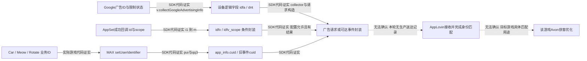
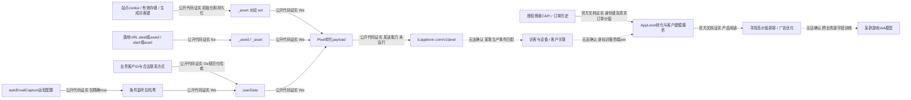
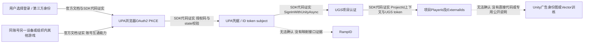
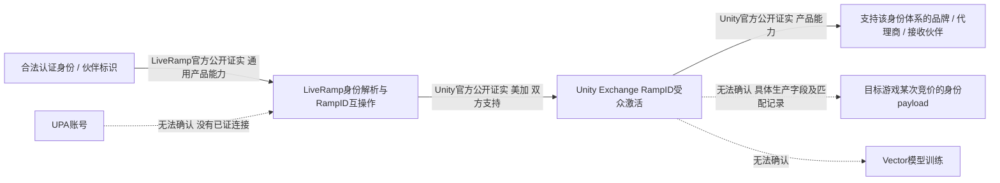

# 跨设备、跨应用、跨网站身份关联：逐边证据与断点

2026-11-19。所有图都区分静态封装、官方产品能力与未证服务端连接。**没有执行任何账号关联或生产身份请求。**

## 1. 证据编号及原始材料

| 编号 | 原始材料与本轮实际工作 |
|---|---|
| IG01 | MAX13.6.4官方classes.jar选定类反编译；追踪Google/Amazon ID、App Set结果、payload、cuid持久化及可选客户资料；原包哈希沿用已下载发行包 |
| IG02 | 独立Axon1.3.4既有官方发行包选定类反编译；`l3`客户键规范化、`g0/k0` App Set与设备字段；不冒充目标游戏集成 |
| IG03 | 复用公开Pixel原文及既有496项字符串表；新增逐段原文偏移、局部别名注释、访客/点击/客户键及配置条件追踪；没有执行JS |
| IG04 | 已取得CAPI、订单历史、转化衡量、隐私/数据共享要求，复核身份输入与高价值获客用途 |
| IG05 | AppLovin隐私政策与Axon说明，分别核实收集/结合范围、训练用途及明确排除项 |
| IG06 | 新取Google App Set/广告ID、苹果IDFV/IDFA JSON及ATT、Google cookie matching文档，限定scope及匹配语义 |
| IG07 | 新取得官方Authentication3.9.0 UPM包并校验registry SHA1；读取OAuth/模型/链接代码；复用Unity Ads4.17.0官方sources.jar及4.18.1反编译隐私路径 |
| IG08 | 新取UPA/Authentication产品、身份管理、Code Link、OIDC和专用隐私文档；修正曾尝试但404的文档路径 |
| IG09 | 复用Unity2026-04-02 RampID公告；新取LiveRamp RampID/身份解析产品资料；不把错误URL/搜索壳当技术证据 |
| IG10 | 取得Unity Exchange bid/privacy Markdown、IAB OpenRTB2.6标准；对照实际字段与缺失的RampID映射说明 |
| IG11 | 复用既有游戏DEX/ARM业务ID调用链和20–22号差分；没有为证明图谱而重复普通SDK清单 |
| IG12 | 采集状态、SHA256、选定类清单、原文摘录和本轮验证结果；失败来源明确保留 |

完整源URL、文件哈希、抓取时间及代码摘录见 [EVIDENCE_INDEX](EVIDENCE_INDEX.md#ig01)、[EVIDENCE_MANIFEST](EVIDENCE_MANIFEST.json)、[代码原段](identity-graph/IDENTITY_CODE_EXCERPTS.json)、[Pixel原段](identity-graph/PIXEL_IDENTITY_EXCERPTS.json)。公开GET成功不等于该页每句营销表述经独立测量；404/403不支持结论。

## 2. 链A：Android MAX设备与发布者标识

原始位置：MAX13.6.4 `v.java:98`、`i1$a.java:11`、`sdk/m.java:884/1343`、`t7.java:78`，以及游戏`MaxInitHelper$MaxInit.userJourney`、`w6.e.i`、Car ARM/Metica Java链。来源[IG01](EVIDENCE_INDEX.md#ig01)、[IG11](EVIDENCE_INDEX.md#ig11)。**同包出现ID使关联成为可能，不证明服务器实际join，也不证明跨设备。**

## 3. 链B：网站访客、广告点击、联系方式与订单

原始位置：Pixel `Ie`偏移14753、`Oe`18091、`Me`20870、`We`23625、配置分支32677；CAPI `user_data`和订单历史“build an accurate model…find new, high-value users”。接收方不同端点不可混写；`dedupe_id`及订单号不是用户ID。来源[IG03](EVIDENCE_INDEX.md#ig03)、[IG04](EVIDENCE_INDEX.md#ig04)。

**跨网站边界：** 第一方cookie不能跨无关域自动共享；共同广告点击标记、合法提供的同客户键/联系方式或匹配服务才可能补上连接。即使两站都嵌入同Pixel，也不能据此声称同访客已匹配。

## 4. 链C：Google cookie matching

静态链为`sessionStorage无_axsid`→生成sid→构造`cm.g.doubleclick.net/pixel?google_nid=aplv&google_cm&cek=...`→Image加载。原文偏移29847；接收方Google广告cookie matching服务。[IG03](EVIDENCE_INDEX.md#ig03)

【官方公开证实】Google文档解释的是广告买方cookie标识映射；【无法确认】本研究未执行、没有响应/匹配表、没有Google登录身份或跨设备匹配记录。**不把cookie同步写成Google账号共享、邮箱图谱或跨设备同人证明。**

## 5. 链D：Unity用户登录及外部身份图

原始位置：Authentication3.9.0 `PlayerAccountServiceInternal.StartSignInAsync/BuildAuthorizationRequestUrl`、`AuthenticationServiceInternal.External.cs`、`AuthenticationNetworkClient.cs:125`，UPA/Authentication token分别定义subject；UPA官方说明组织池。来源[IG07](EVIDENCE_INDEX.md#ig07)、[IG08](EVIDENCE_INDEX.md#ig08)。

**确定性账号连接**的产品/客户端实现已证，但五款目标游戏具体登录启用、服务器生产账户对应关系、进入广告训练均未证。账号持续性不是系统默认给所有匿名安装建立跨设备身份。

## 6. 链E：Unity广告组件间的可选ID桥接

【SDK代码证实】Unity Ads4.17.0：

`LevelPlay提供并缓存的AUID`→`AndroidStaticDeviceInfoDataSource.getAuid`→`AndroidDeviceInfoRepository.getAuidString/getAuidByteString`→`AndroidGetInitializationRequestPayload.auid/auidString`；非空或合法UUID才填相应字段。

`<AppName>.v2.playerprefs/unity.cloud_userid`→`AndroidAnalyticsDataSource.userId`→`analyticsUserId`→初始化payload；另有独立`idfi`及可选`UnityAds.userIdentifier→externalUserIdentifier`。[IG07](EVIDENCE_INDEX.md#ig07)

**【无法确认】没有证据把上述字段都等同于UPA ID、RampID或跨设备玩家账户，也没有每个目标App实际填值/送达/训练记录。** 这条链证明SDK间有标识接口，不证明跨App身份图谱。

## 7. 链F：LiveRamp与Unity Exchange

来源[Unity原始公告](vector/exchange-rampid.txt)、LiveRamp产品页[IG09](EVIDENCE_INDEX.md#ig09)。**官方受众激活正证据已经足够确认商业身份互通，不需要虚构生产`eids`包来增强结论。**

本轮公开Unity bid/privacy字段有`device.ifa/ip/ua`、`user.ext.consent`等，但无RampID映射字段；IAB的`user.eids`标准只作对照，不是Unity实际wire format证明。[IG10](EVIDENCE_INDEX.md#ig10)

## 8. 链G/H：MMP与跨业务训练的两个断点

**MMP路径：** 游戏事件/真实广告收入→Adjust或AppsFlyer的客户端调用已有静态证据；AppLovin/Unity合作伙伴postback属于MMP文档能力。哪些事件、全量还是归因用户、收入是否共享、回溯窗口及授权开关需广告主后台或合法日志。不能用MAX直接事件封装代替postback证明。[16号报告](16_Adjust_AppsFlyer归因与Postback.md) [20号报告](20_Axon实际事件调用链.md)

**跨业务训练路径：** 两家公司公开政策及产品材料都不能用来逐字段证明某电商订单或UPA登录已训练某款游戏的获客模型；也不能据缺少客户端代码断言服务器完全没有身份图谱。[IG05](EVIDENCE_INDEX.md#ig05) [IG08](EVIDENCE_INDEX.md#ig08)

## 9. 尚缺证据与停止边界

| 要再证明的结论 | 最小需要的合法证据 | 本轮状态 |
|---|---|---|
| 某游戏确用AppLovin/Unity获客 | 可核验campaign/广告主/素材记录，或授权MMP归因/花费记录 | 未取得新增证据；不能由SDK反推 |
| 某客户端ID已送达并匹配成功 | 授权沙箱/生产数据控制方的脱敏接收日志、匹配结果及同意状态 | 未取得；未发测试请求 |
| 跨设备图的确定/概率边 | 供应商说明或授权测试结果，包括scope、重置/去重及错误率定义 | 未取得具体实现；未使用真实ID实验 |
| Unity专用RampID wire format | 当前partner集成文档/授权样例与地区、同意条件 | 公开公告已证能力；具体字段未证；不填猜测 |
| UPA或RampID用于Vector | 产品专用数据流/权限文件或合法的实际实现记录 | 未证；总体广告政策不替代 |
| 电商数据改善游戏投放 | 明确训练用途、数据治理边界与受控效果实验 | 未证；不编ROAS/匹配率 |

公开资料403、404、JS壳或搜索页一律保留状态而不绕过；没有继续追求生产凭证。游戏、原始APK、真实账号/存档、设备设置及TowerForge均不在本轮写入范围。
