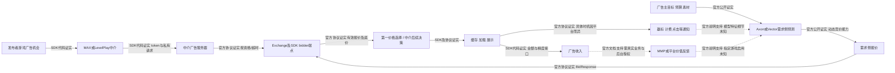

# Unity vs AppLovin：竞价平台架构与证据边界

2026-11-19。**本轮已取得双方有效的OpenRTB请求、响应及通知规范，实际提取字段、核对SDK调用，并运行纯本地竞价实验。没有运行生产SDK或发送广告请求。**

## 1. 最重要的区别是角色，不能先把产品混在一起

| 角色 | AppLovin体系 | Unity体系 | 能证明什么 |
|---|---|---|---|
| 发布者广告中介 | MAX：收集SDK bidder token、请求中介服务器、处理返回的加载/瀑布流 | LevelPlay：候选网络、token/auction请求、返回waterfall与fallback | 【SDK代码证实】发布者接入与生命周期，不是广告主获客模型 |
| 交易所/供给 | AppLovin Exchange：DSP与SDK bidders，统一第一价格机制及合并非竞价需求的公开描述 | Unity Exchange：向DSP端点POST报价请求、验证响应、第一价格拍卖、预缓存/展示 | 【官方协议证实】接口和产品规则，不等于恢复全部服务器调度 |
| 广告主需求及优化 | AppLovin Ads / AppDiscovery及Axon | Unity Ads Acquire及Vector | 【官方公开证实】价值预测、动态竞价和目标优化；权重、预算pacing、用户级分值未知 |
| 结果/价值回传 | 赢输标/展示点击、MAX ILRD、MMP、授权Axon事件/网站转化 | 赢输标/展示点击、LevelPlay/Unity广告事件、MMP、受授权的Runtime等 | 各路的权限、事件和接收方不同；不能把所有SDK回调画成广告主模型已接收 |

来源：[BP01](EVIDENCE_INDEX.md#bp01)–[BP08](EVIDENCE_INDEX.md#bp08)。MAX接入不证明通过AppLovin买量；Unity引擎、LevelPlay接入也不证明使用Vector获客。

图中Exchange内部第一价格拍卖与上游中介最终售出是不同阶段。Unity的`source.ext.fd/header_bidding`明确提示最终决策方及竞价/瀑布流上下文；不能认为交易所赢标必然最终展示。

## 2. 本轮实证：值得更新已有认识的发现

1. **【官方协议证实】默认超时不同，Unity也不是固定200ms。** AppLovin请求表默认500ms；Unity旧响应页写200ms，但当前get-started明确waterfall按DSP seat可配置至1000ms，bidding由中介配置并扣除50ms处理预算，应读每次请求`tmax`。[BP01](EVIDENCE_INDEX.md#bp01) [BP02](EVIDENCE_INDEX.md#bp02)
2. **【官方协议证实】赢标不等于展示或计费，通知时机确有差异。** AppLovin区分load/send阶段`nurl`和render阶段`burl`；Unity描述`nurl`在render/delivery时触发并可作计费计数，`burl/imptrackers`也有要求。不把两路回调各累计一笔支出。[36](36_AppLovin_OpenRTB与竞价协议.md) [37](37_Unity_OpenRTB与竞价协议.md)
3. **【官方协议证实】AppLovin明确USD-only并忽略`cur`；Unity允许配置匹配的其他币种且需`exchange_rate`。** 不能不换算直接比较CPM。[BP01](EVIDENCE_INDEX.md#bp01) [BP02](EVIDENCE_INDEX.md#bp02)
4. **【官方协议证实】AppLovin对SDK与DSP bidder披露不同字段。** token位于SDK bidder专用`user.data.segment.signal`；DSP可有session duration/depth等`imp.metric`。字段目录不是每个买方拿到全部字段。[BP01](EVIDENCE_INDEX.md#bp01)
5. **【SDK代码证实】MAX和Unity Ads的设备→服务器请求不是公开OpenRTB原样透传。** MAX13.6.4 `a6.g/run`组JSON、signal与中介统计；Unity Ads4.17.0组protobuf和`2:`前缀token；LevelPlay9.4.0解析私有auction结果和通知数组。[BP04](EVIDENCE_INDEX.md#bp04)–[BP06](EVIDENCE_INDEX.md#bp06)

## 3. 拍卖与服务器实现：可证明到哪层

| 机制 | AppLovin | Unity | 上限 |
|---|---|---|---|
| 第一价格 | 文档明确最高有效CPM胜出、按报价付费 | Exchange文档明确first-price，`at=1` | 不是第二价格；广告主CPI/ROAS计费界面不等于ExchangeCPM结算 |
| 并发与资格 | 向eligible SDK/DSP端点征价，且有Smart Throttling变更记录 | 向bidding partner端点HTTP POST；资格、合同、同意仍适用 | 未恢复全部DSP路由、QPS、地域限流和实现线程数 |
| 底价 | 明确必须**大于**floor | minimum floor，具体相等分支未明确 | Unity模拟器`>=`为已标注假设；不能暗称服务器边界已证 |
| waterfall | MAX公开说明与非竞价需求合并；SDK处理返回ads/failover | LevelPlay实际有auction→waterfall/fallback；Exchange自身也可处在中介竞价或waterfall | 非竞价eCPM是排名估计/配置，不能当实际DSP承诺价 |
| 创意过滤 | adomain/bundle/category/markup、blocked assets/格式规则 | 规范必填、格式及loss codes包含拒审、空markup、invalid price等 | 未恢复全部审核模型；合规检查不只取最高数值 |
| 缓存 | 某些广告同session最多4小时，`imp.exp=14400`提示 | 赢标后pre-cache，体验时计数；过期loss code | Unity具体TTL未取得；MAX每广告expiration配置也不能统一硬编码4小时 |
| 自动流量分配 | smart throttling存在；具体评分未知 | qualifier、route及budget细节未知 | SDK代码不能恢复服务端出价/分流引擎 |

## 4. 谁掌握更多信息、谁更依赖LTV

**【无法确认】没有共同库存、同意状态与授权条件下的生产字段/覆盖率，因此不能给“谁数据更多”排名。** MAX可见它负责的中介响应与加载统计；LevelPlay也可见自己的中介数据；Exchange能见到发给自己的报价；DSP通常只见自己的请求与通知。AppLovin公告明确Axon不摄入其他bidder用户数据/出价信息，不能把中介操作可见性写成训练可用性。

**【官方公开证实】Axon和Vector都支持收入/ROAS导向，不是一个靠LTV、另一个只靠安装概率。** Vector的D28窗口、Runtime入口与Axon的MAX/广告主反馈是产品差异，但不足以判定LTV依赖谁更大、模型精度谁更高。[39](39_Axon_Vector预测与出价机制.md)

## 5. 交付与实际执行

- [36 AppLovin协议](36_AppLovin_OpenRTB与竞价协议.md)、[37 Unity协议](37_Unity_OpenRTB与竞价协议.md)、[38差分](38_双方竞价字段差分.md)、[39预测](39_Axon_Vector预测与出价机制.md)、[40离线实验](40_竞价经济模型与离线模拟.md)。
- 已提取**444条原始表格行**，含宏、loss codes、隐私/SKAN及辅助表；规范化核心字段234项，其中91项双方文档均列出。**数量不是数据量/平台能力排名。** [原表目录](auction/PROTOCOL_FIELDS.md) [完整差分](auction/FIELD_DIFF.md)
- 模拟器17项检查通过；6个同源合成cohort实验及可重跑脚本，具体结果见40。未用实验结果冒充两家真实投放效果。
- 源文件、来源URL、失败重定向、代码行号、SHA256及校验结果见[证据索引](EVIDENCE_INDEX.md#bp01)。未改游戏、原始APK、设备或真实存档。
