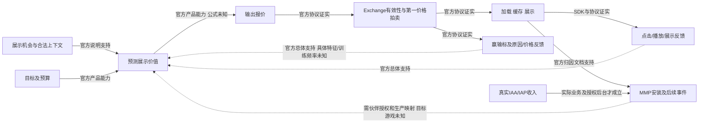

# Axon / Vector：预测如何影响广告出价

2026-11-19。**两者都具备收入/价值导向竞价的官方证据，但没有公开材料允许判断谁更依赖长期价值、谁预测更准。公开Exchange协议接收CPM报价，不传出模型权重或完整用户LTV。**

## 1. 四个不同的“价格”

| 量 | 作用 | 本轮证据 |
|---|---|---|
| 广告主目标CPI/CPE/ROAS/预算 | 广告主优化目标与约束 | 【官方公开证实】两家广告主产品文档；后台计价单位与交易所CPM不是同层 |
| 网络对某展示机会的预测价值 | 对点击/安装/后续收入等价值评估 | 【官方公开证实】Axon说明、Unity revenue bids；数值/模型公式未知 |
| DSP/网络输出的CPM报价 | 参与具体Exchange拍卖 | 【官方协议证实】`bid.price`与floor/currency/tmax/creative约束 |
| 实际计费/发布者收入 | 展示后通知、服务费/收入精度及结算口径 | 【协议/SDK证实】burl/nurl/ILRD；不能把广告主支出、exchange clearing和发布者净收入默认为同值 |

## 2. 官方明确说了什么

**AppLovin。**[Axon AI说明](https://legal.applovin.com/about-applovins-axon-ai/)写明：广告主设return goals；预测算法评估展示以满足ROAS等目标、寻找可能下载/参与产品的用户；按对特定广告主的展示价值竞价；持续学习、数据摄入和工程改进。[BP08](EVIDENCE_INDEX.md#bp08)

【官方公开证实】该说明列设备/网络、用户与应用/广告/其他数字属性互动、伙伴共享信息、自身收到的MAX win/loss、广告主自愿提供数据；明确排除其他bidder用户数据和出价信息、敏感/受保护类别与儿童数据。**不能从MAX掌握多个候选/loaded network统计推断这些竞争者数据必然进入Axon训练。**

【官方公开证实】既有AppLovin gaming产品材料支持IAA/IAP/Blended ROAS及其他目标，IAA/Blended与MAX接入有产品条件；MMP有伙伴、安装/事件/收入映射要求。订单历史文档直接说明客户建模与寻找高价值新客。这些不证明某游戏后台启用了任何目标。[15](15_AppLovin_MAX与Axon技术分析.md) [28](28_AppLovin电商与网站数据链.md)

**Unity。**[Revenue bids](https://docs.unity.com/en-us/grow/acquire/bids/revenue-bids)明确：ROAS策略针对预测会通过IAP或看广告产生收入的用户，使用dynamic bids获取用户；[ROAS文档](vector/doc-intro-to-roas-campaigns.txt)与既有D28材料明确优化窗口及学习条件。[BP08](EVIDENCE_INDEX.md#bp08)

【官方公开证实】既有资料支持IAA D0/D7/D28、IAP及Hybrid D7/D28等，D28文档有beta条件；Runtime数据、Developer Data与Consent有独立接口和权限边界。**不能把UPA、RampID、Runtime或全部MMP事件默认加入每个Vector模型。** [24](24_Unity与AppLovin技术对比.md) [25](25_Unity_Runtime数据优势调查.md) [32](32_Unity身份互通与RampID.md)

【无法确认】双方每次出价的pCTR/pCVR/留存/IAP/IAA分头结构、预测误差、校准、预算pacing、bid shading、在线训练延迟和特征权重均未恢复；没有名叫Vector的客户端类也不意味着未使用服务端Vector。

## 3. 逐项判定

| 要研究的机制 | Axon | Vector | 证据上限 |
|---|---|---|---|
| 安装概率/玩家匹配 | 官方“users most likely to download or engage” | 官方用户匹配/动态收入竞价说明 | 【官方公开证实】预测用途；【无法确认】是否显式独立pInstall head |
| 预期IAA收入 | IAA/Blended ROAS及MAX关联 | IAA ROAS及对应成熟窗口 | 产品能力已证；不是每次bid报文带明文LTV |
| 预期IAP收入 | IAP/Blended及真实购买反馈 | IAP/Hybrid ROAS与postback | 产品能力已证；具体模型分解未知 |
| 长期价值 | 价值/收益目标与优化，未取到所有窗口的同口径定义 | D28产品窗口明确 | 不能据公开窗口差异断言Vector长期权重更大或Axon只看D0 |
| 展示价值与出价 | 明确以广告主价值竞价 | 明确dynamic bids与预测收入 | 官方定性已证；具体公式未知 |
| 底价/有效性/超时 | 公共Exchange规则明确 | 公共Exchange规则明确 | 协议可验；不是模型预测源码 |
| 预算/ROAS约束 | 广告主设置/自动化优化 | 目标/动态竞价及学习条件 | 后台产品有证；每次约束求解/探索策略未知 |
| 反馈与更新 | 官网持续学习及MAX/MMP等输入类别 | 文档ROAS数据回传/学习及产品改进 | 未知每条loss/广告收入何时加入何模型；未证逐展示在线学习 |

## 4. 可解释出价方向的经济近似，不是真实算法

**【合理推断；离线模型定义】**假设按展示购流、用户安装后D28真实IAA/IAP价值可估计，则经济上可用：

`示例CPM = 1000 × P(安装|展示,上下文,素材) × (预测IAA_LTV + 预测IAP_LTV) / 目标ROAS × pacing × shading`

这是教学公式。真实平台可直接预测期望展示收益、多个转化目标或增量价值；不一定先算独立安装概率，也不一定有上式乘法结构。ROAS目标并不是利润，需明确收入口径、抽成、归因窗口与退款等。

固定其他假设：更高预期价值可支持更高报价、更严格ROAS目标压低可承受出价；预算/节奏约束可阻止单次经济上正值的报价。**这些方向性经济关系不能推导某家公司训练权重。**

## 5. 反馈如何闭环，以及哪些不能跳接

SDK本地事件、MMP postback、bid notification和ILRD为不同通路。存在API或相同设备标识不代表任意事件能被自动跨平台接收。

## 6. 四款游戏哪些信号可进入价值优化

复用原始逆向证据：[09](09_AdWorth深度逆向.md)、[10](10_买量优化机制最终对比.md)、[20](20_Axon实际事件调用链.md)、[21](21_MAX用户ID与身份数据流.md)、[24](24_Unity与AppLovin技术对比.md)。

| 游戏 | 已证客户端信号 | 正确用途与限制 |
|---|---|---|
| Car Race | 真实广告收入接口/里程碑、国家阈值走指定分发端 | 收入可作IAA标签需后台共享；国家阈值/关卡是代理；不能假设Firebase-only阈值进入Axon/Vector |
| Meowdoku | 安装后窗口、活跃分钟/关卡深度、AF/MAX框架ID | 可研究早期LTV相关性；不能把GRT分层值当实际美元收入或已用模型特征 |
| Rotate Rings | MAX ILRD→AF，安装年龄/国家/时长/收入规则 | 原始收入与阈值事件必须去重复口径；partner postback仍须启用证明 |
| Jewel Coloring | Adjust收入、AdWorth默认90规则/31权重表及Firebase/Meta/Adjust分发 | AdWorth可为来源/国家/用户价值代理，不是实际IAP；不能由Meta代理purchase推断AppLovin/Unity收到真实购买 |
| Amaze GO! | 无可验证包体 | 保留未知 |

**【无法确认】没有新的独立投放记录或授权后台数据证明这些游戏通过Axon/Vector实际获客，因而不能报告“某事件已经提高其竞价/ROAS”。**

## 7. 谁更依赖长期价值，财报能否回答

不能。两家的收入/财报增速及Vector产品增长已在23号核对；它们反映业务表现，不能区分模型改进、预算迁移、流量结构、产品整合或单用户LTV特征贡献。**【无法确认】没有同国同素材同预算同成熟窗口的对投，亦无模型消融或统一误差指标。**

最可证的结论是：两者都可用价值信号改变需求侧出价，进而影响第一价格获胜、成本与规模；Exchange公开字段说明如何交易，不揭示谁的价值预测更强。
