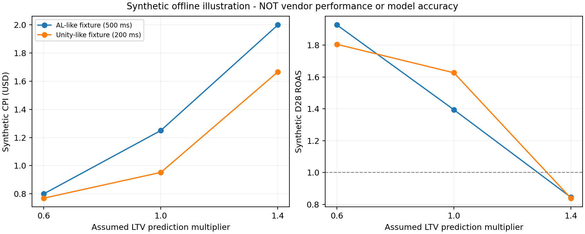

# 竞价经济模型及本地实验结果

2026-11-19。**已实际运行17项检查、6组同源合成cohort实验和一组同tmax控制实验。全部本地、合成数据，无广告网络连接。结果不代表AppLovin/Unity的真实模型、价格、用户或投放表现。**

代码：[auction_model.py](auction/model/auction_model.py)、[run_experiments.py](auction/model/run_experiments.py)、[tests](auction/model/test_auction_model.py)。原始结果：[results.json](auction/model/output/results.json)、[arms.csv](auction/model/output/arms.csv)、[sample_traces.json](auction/model/output/sample_traces.json)、[控制组](auction/model/output/matched_tmax_control.json)。[BP10](EVIDENCE_INDEX.md#bp10)

## 1. 实现了什么，哪些是人为假设

| 环节 | 实现 | 证据/性质 |
|---|---|---|
| 请求/报价 | 两个代表性request JSON、DSP response JSON；Offer及fixture parser | 【模型实现】合成字段子集，不是抓包，不是全规范validator |
| 多DSP | 同一个请求时钟比较各latency，超过当次tmax无资格 | 【协议规则+模型实现】不把多个DSP延迟顺序相加；不运行真实网络线程 |
| 选择 | 有效、通过floor且符合预算的最高CPM | 【协议规则+模型实现】第一价格；相同价按名称排序为本地选择，生产tie-break未知 |
| floor | AppLovin严格大于；Unity采用大于等于 | 前者【官方协议证实】；后者**未证明的边界假设**，显式可替换 |
| 币种 | AL按USD合约解释数值；Unity按配置币种及明确汇率归一比较 | 【协议+模型实现】不模拟真实FX策略/服务费/结算舍入 |
| 资格 | 超时、request/imp错误、空/非法价格、创意字段/域名、block、AL4KB限制等 | 【模型实现】测试关键失败场景，不声称覆盖全部广告审核 |
| 赢/输/计费 | AL load-success win；Unity render win；render时单笔billing；本地保存通知 | 【公开时机+模型实现】通知是内存日志，.invalid URL不会被访问；loss字符串是模型枚举，不假扮厂家数字码 |
| 缓存/展示 | load失败、未render或超过fixture TTL不收费 | 【模型假设】TTL可调；Unity没有被证明默认4小时；不复制真实failover/reauction |
| 去重/预算 | 账本按request/bidder/creative仅收费一次；用Decimal，每次支出CPM/1000；有限预算过滤 | 【模型假设】教学账本不等于供应商财务实现；实际预算pacing未知 |
| 预测/反馈 | 经济示例value_bid；合成cohort实际IAA收入；另给EMA更新示例 | **【人为模型】不是真实Axon/Vector或训练权重** |
| waterfall | 独立JSON说明估计CPM20来源load失败→真实bid15 fallback | 【示例假设】不是MAX/LevelPlay全调度器，不把估计CPM当现金bid |

## 2. 可重跑方式

在`D:\GrowthResearch\auction\model`执行：

```powershell
python -X utf8 -m unittest test_auction_model -v
python -X utf8 run_experiments.py
python -X utf8 plot_results.py
```

没有网络库/SDK初始化/生产请求；示例IP使用文档保留地址192.0.2.10、ID带SYNTHETIC、域名为`.invalid`。API可调整Profile、tmax、floor、币种、pInstall、LTV、ROAS、pacing、shading、候选延迟和预算；需要真实实验时只输入合法脱敏聚合数据，不将本地示例提交给网络。

## 3. 实际检查覆盖

17项检查包括：第一价格按自己的12CPM收费0.012而非次高8CPM；AL floor相等失败；Unity相等为显式假设；shared-clock timeout；tmax可覆盖；load失败/未展示/过期不收费；非法高报价不获胜；预算不足过滤；同通知多次不重复支出；多tracker不多收费；币种配置/换算；通知路由要求；request/response fixture roundtrip；价值/ROAS方向；拒绝同意fixture无ID/IP；AL响应大小。

**PASS只证明离线模型按声明运行，不证明真实平台通知恰好一次、完整隐私实现或拍卖引擎复刻完成。**

## 4. 合成cohort设定

随机seed351940；每组使用同一批10000个展示机会、pInstall、真实D28IAA_LTV、安装抽样、竞争报价与延迟。模型广告主预算20USD，竞争方1000USD；floor3USD CPM；相同经济公式、shading0.8；LTV预测倍数0.6/1.0/1.4。

AL-like fixture设tmax500ms；Unity-like fixture设200ms，**这只是两组接入参数，不是Unity固定限制，更不是模型质量差异**。合成收入成熟比例D0=15%、D7=55%、D28=100%；只含IAA，没有把预测数值报成已发生收入。预算用尽后拒绝，不假设平台真实pacing。

## 5. 已运行结果

下表均为**合成结果**，ROAS为收入/支出百分比；每组安装数仅10–26，有明显抽样不确定性，不据此给供应商排名。

| fixture / tmax | LTV预测倍数 | 已展示获胜 | 安装 | 支出USD | CPI USD | D0 ROAS | D7 ROAS | D28 ROAS |
|---|---:|---:|---:|---:|---:|---:|---:|---:|
| AL-like /500ms | 0.6 | 637 | 25 | 19.9989 | 0.8000 | 28.90% | 105.97% | 192.67% |
| AL-like /500ms | 1.0 | 372 | 16 | 19.9997 | 1.2500 | 20.92% | 76.69% | 139.44% |
| AL-like /500ms | 1.4 | 268 | 10 | 20.0000 | 2.0000 | 12.67% | 46.46% | 84.48% |
| Unity-like /200ms | 0.6 | 670 | 26 | 19.9974 | 0.7691 | 27.08% | 99.28% | 180.51% |
| Unity-like /200ms | 1.0 | 399 | 21 | 19.9950 | 0.9521 | 24.39% | 89.45% | 162.63% |
| Unity-like /200ms | 1.4 | 288 | 12 | 19.9981 | 1.6665 | 12.59% | 46.16% | 83.93% |

本组演示在固定预算、第一价格假设下，高估价值可提高每次报价、加快预算消耗并降低实现ROAS；低估也可能丢失有利的增量流量。**表中0.6效果更高不是“系统性低估最佳”的证据，更不是真实平台精度结论。**



## 6. 去除超时混淆的控制实验

将Unity-like同样设为500ms、LTV倍数1.0，使用同一机会及预算：**372次render、16安装、支出19.999726USD、D28收入27.88847694USD**，与AL-like基准经济结果完全相同；脚本已assert。

这只说明本模拟器中的两组差异来自明确设置的规则/时限，不是偷偷给某家更准确的模型。**不能升级为两家真实系统等价。** 真实库存、bid shading、隐私、FX、审核、费用与预测可能不同，本实验未取得相应生产数据。

## 7. 反馈示例

[feedback.json](auction/model/output/feedback.json)用人为EMA：预测LTV0.8，合成成熟观测1.6，alpha0.5→新预测1.2；pInstall0.02且目标ROAS1时示例CPM从16变24。它演示真实收入反馈可以改变可承受出价；不表示Axon/Vector使用EMA或逐次按该幅度学习。

原始收入、代理行为事件、预测值分别保留，不累计重复的阈值/通知。不连接MMP、广告网络或任何生产收入端点。

## 8. 仍无法模拟为真实平台的内容

用户图谱/特征、pCTR/pCVR/LTV模型、隐私授权实际状态、竞价资格、pacing/throttling、探索、net/gross差价、素材审核、伙伴FX与舍入、网络重试、完整缓存/failover、多seat规则、延迟归因和供应商训练过程均未被恢复。**可验证的是接口与简化机制，生产效果及闭源预测仍是未知。**
