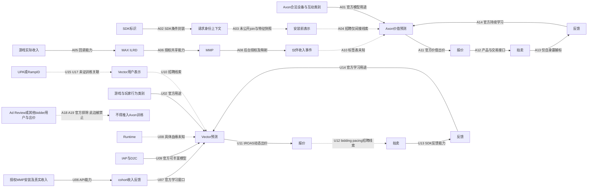

# 身份、行为、价值关联图谱

2026-11-19。实线=在标注范围内的官方用途/API能力；虚线=推断、间接或未知；“官方排除”进入禁止节点，不能误读为训练边。**没有任何边取得独立生产送达/训练日志。**SDK能力实线仍受条件限制。

机器图：[EVIDENCE_GRAPH.json](prediction-system/EVIDENCE_GRAPH.json)；原文含SHA256及行号：[SOURCE_EXCERPTS.json](prediction-system/SOURCE_EXCERPTS.json)。图保存来源时间、证据等级、参与方、权限、生产状态、适用范围和缺失证据。`H1—H5`可按边筛选。

## 逐边证据账本

### AppLovin

| 边与主张 | 提供方→接收方 | 证据/原始位置 | 权限条件 | 生产与断点 |
|---|---|---|---|---|
| A01 设备/网络及应用 广告 其他数字属性互动进入Axon训练优化 | AppLovin与授权伙伴→Axon models | 【官方公开证实】 [S01](nongame/applovin-axon-about.txt):L58 | 合法收集 伙伴权限及隐私选择 | 未独立观察生产；具体逐App联合样本 schema和安装前截断时间 |
| A02 SDK按配置共封装广告ID AppSetID及限制跟踪信息 | MAX collector→AppLovin SDK请求接收层 | 【SDK代码证实】 [S32](identity-graph/sdk/max-13.6.4/java/com/applovin/impl/sdk/m.java):L1328 | 可用广告ID AppSet scope 配置开关及隐私限制 | 未独立观察生产；生产启用和服务端join |
| A03 关联历史可能形成安装前用户特征 | AppLovin授权数据处理→未公开特征管线 | 【合理推断】 [S01](nongame/applovin-axon-about.txt):L58；[S04](nongame/applovin-policy-direct.txt):L124；[S25](prediction-system/applovin-job-4712559006-clean.txt):L6 | 标识有效 scope合法 时间点早于出价 | 未独立观察生产；join键 时效 去重 快照schema |
| A04 用户表示 多任务和特征服务为招聘中的工程方向 | AppLovin ML团队→广告推荐系统 | 【间接技术线索】 [S25](prediction-system/applovin-job-4712559006-clean.txt):L6；[S26](prediction-system/applovin-job-4716524006-clean.txt):L8 | 公司级招聘范围 不等于Axon部署 | 未独立观察生产；Axon模型版本 特征登记和真实推断trace |
| A05 展示收入可通过onAdRevenuePaid与precision返回 | MAX及变现网络→游戏收入回调 | 【SDK代码证实】 [S06](axon/max-ilrd.txt):L124；[S07](axon/max-ilrd.txt):L188 | 监听注册 有效展示 非测试 金额精度按字段解释 | 未独立观察生产；目标单展示送达及最终结算 |
| A06 ILRD可共享给MMP | MAX/游戏→获授权MMP | 【官方公开证实】 [S06](axon/max-ilrd.txt):L124 | MMP集成和共享配置 | 未独立观察生产；目标游戏生产接收日志 |
| A07 真实用户付费通过purchase收入链 | 广告主/游戏→Adjust或AppsFlyer | 【官方公开证实】 [S08](axon/doc-in-app-purchase-revenue-sharing.txt):L14；[S09](axon/doc-adjust.txt):L39；[S10](axon/doc-appsflyer.txt):L177 | 真实支付 正确币种金额 授权 | 未独立观察生产；验单 退款 回调幂等及到账日志 |
| A08 MMP按伙伴授权映射事件/收入到AppLovin | 授权MMP→AppLovin partner integration | 【官方公开证实】 [S09](axon/doc-adjust.txt):L39；[S10](axon/doc-appsflyer.txt):L177 | partner启用 来源范围 事件映射 Lifetime窗口按指南 | 未独立观察生产；五款游戏后台开关与送达ACK；IAA不是checkout |
| A09 MAX与IAA ROAS产品有明确关联 但未公开标签内部表 | 广告主授权MAX变现数据→AppLovin Ads Ad ROAS | 【官方公开证实】 [S05](axon/gaming-apps.txt):L71；[S06](axon/max-ilrd.txt):L124 | live app MAX MMP 目标及素材 | 未独立观察生产；ILRD进训练表的逐字段映射 精度过滤及成熟窗口 |
| A10 收入记录如何构造成具体训练标签仍未公开 | AppLovin收入事件管线→Axon训练任务 | 【无法确认】 [S01](nongame/applovin-axon-about.txt):L58；[S05](axon/gaming-apps.txt):L71；[S08](axon/doc-in-app-purchase-revenue-sharing.txt):L14 | 区分IAA IAP 代理及预测值；授权 | 未独立观察生产；label schema loss 退款 时区 延迟和缺失处理 |
| A11 按特定广告主展示价值及return goals出价 | Axon预测→AppLovin bidder | 【官方公开证实】 [S02](nongame/applovin-axon-about.txt):L54 | 有广告主目标和可参与库存 | 未独立观察生产；实际数值函数 出价校准 pacing/shading |
| A12 CPM报价参与拍卖；协议证明交易接口 | AppLovin bidder→可参与的广告库存 | 【官方公开证实】 [S02](nongame/applovin-axon-about.txt):L54 | 满足隐私 创意 底价 超时及预算；协议复用35—40 | 未独立观察生产；具体库存选择 每次真实报价和赢家trace |
| A13 Axon使用自身收到的MAX赢输标通知 | MAX对该bidder的结果通知→AppLovin/Axon | 【官方公开证实】 [S01](nongame/applovin-axon-about.txt):L58 | 仅自身通知；不能扩大成竞争者用户及出价数据 | 未独立观察生产；通知字段的训练用途与更新延迟 |
| A14 官方称持续数据摄入 自学习及工程更新 | 允许的反馈数据→Axon模型系统 | 【官方公开证实】 [S03](nongame/applovin-axon-about.txt):L72 | 允许的数据类别和用途 | 未独立观察生产；在线/离线更新频率 replay/反事实策略 |
| A15 订单历史用于客户建模和寻找高价值新客 | 授权商家→AppLovin ecommerce模型 | 【官方公开证实】 [S11](nongame/doc-order-history.txt):L13 | 商家授权 正确哈希 真实订单及同意 | 未独立观察生产；客户数据实际训练作业或性能归因 |
| A16 电商订单能否默认加入手游IAA标签 | 电商广告主→手游Axon训练任务 | 【无法确认】 [S11](nongame/doc-order-history.txt):L13；[S01](nongame/applovin-axon-about.txt):L58 | 跨业务用途需独立合法授权 | 未独立观察生产；跨业务schema 数据隔离及训练用途文件 |
| A17 客户端共封装不证明统一自然人跨设备图谱 | 设备/发布者标识→未知服务端图谱 | 【无法确认】 [S32](identity-graph/sdk/max-13.6.4/java/com/applovin/impl/sdk/m.java):L1328；[S33](identity-graph/sdk/max-13.6.4/java/com/applovin/impl/t7.java):L1；[S04](nongame/applovin-policy-direct.txt):L124 | AppSet开发者scope ID重置 同意条件 | 未独立观察生产；生产join 命名空间 置信度及误匹配率 |
| A18 Ad Review数据不建用户/设备档案 不进入Axon或其他模型 | Ad Review→Axon/其他AppLovin模型 | 【官方明确排除】 [S24](prediction-system/applovin-excluded-rival-data.txt):L14 | 官方明确否认该用途 | 未独立观察生产；这是官方排除声明 非独立服务端审计 |
| A19 其他竞价者出价及用户数据被官方排除 | 其他bidder→Axon模型 | 【官方明确排除】 [S01](nongame/applovin-axon-about.txt):L58 | 不得由MAX可见字段推定进入训练 | 未独立观察生产；未独立审计；保留官方排除边界 |
| A20 旧专利包含安装应用特征 不能认定现代Axon采用 | 2011/2013专利构想→历史广告选择设计 | 【间接技术线索】 [S31](prediction-system/applovin-historical-patent.txt):L387 | 现代平台权限与用途另行限制 | 未独立观察生产；现代Axon产品连接和启用记录 |

### Unity

| 边与主张 | 提供方→接收方 | 证据/原始位置 | 权限条件 | 生产与断点 |
|---|---|---|---|---|
| U01 请求与token包含设备 会话 广告位等上下文 | Unity Ads SDK→Unity Ads gateway | 【SDK代码证实】 [S34](ThirdPartySDKs/Unity/Ads/4.17.0/sources/com/unity3d/ads/core/data/datasource/AndroidStaticDeviceInfoDataSource.kt):L213；[S35](ThirdPartySDKs/Unity/Ads/4.17.0/sources/com/unity3d/ads/core/data/datasource/AndroidPrivacyDeviceInfoDataSource.kt):L20；[S36](ThirdPartySDKs/Unity/Ads/4.17.0/sources/com/unity3d/ads/core/domain/AndroidGetUniversalRequestSharedData.kt):L19 | PII允许开关 TCF/developerConsent 数据可用 | 未独立观察生产；gateway转码后实际模型特征 |
| U02 官方称游戏DNA 真实玩家行为和生态数据驱动匹配 | Unity允许的数据来源→Vector | 【官方公开证实】 [S12](vector/unity-vector-correct.txt):L10 | 相应权限与产品使用条件 | 未独立观察生产；具体游戏 行为schema 训练集范围及日期 |
| U03 安装ID AUID Analytics/外部ID和隐私状态可进请求 | Ads/LevelPlay或应用设置→Unity Ads请求层 | 【SDK代码证实】 [S34](ThirdPartySDKs/Unity/Ads/4.17.0/sources/com/unity3d/ads/core/data/datasource/AndroidStaticDeviceInfoDataSource.kt):L213；[S35](ThirdPartySDKs/Unity/Ads/4.17.0/sources/com/unity3d/ads/core/data/datasource/AndroidPrivacyDeviceInfoDataSource.kt):L20；[S36](ThirdPartySDKs/Unity/Ads/4.17.0/sources/com/unity3d/ads/core/domain/AndroidGetUniversalRequestSharedData.kt):L19 | 字段可用且隐私允许；安装ID不是跨设备人ID | 未独立观察生产；与MMP join的生产实现 |
| U04 广告请求标识与历史行为形成模型特征的具体映射未公开 | Unity Ads测量→Vector特征任务 | 【合理推断】 [S12](vector/unity-vector-correct.txt):L10；[S18](vector/doc-send-postbacks.txt):L28；[S34](ThirdPartySDKs/Unity/Ads/4.17.0/sources/com/unity3d/ads/core/data/datasource/AndroidStaticDeviceInfoDataSource.kt):L213 | 同意 scope 时间一致 | 未独立观察生产；join字典 版本 特征水位和安装前snapshot |
| U05 实际广告收入和购买可由MMP接收 | 游戏/中介/支付→授权MMP | 【官方公开证实】 [S13](vector/unity-vector-correct.txt):L34；[S19](vector/doc-send-postbacks.txt):L91 | 真实事件 正确金额 去重及授权 | 未独立观察生产；目标游戏的送达/结算流水 |
| U06 S2S支持gamer/ad ID campaign install时间 归因标记和金额 | 授权MMP或广告主服务器→Unity Ads secondary events | 【SDK代码证实】 [S18](vector/doc-send-postbacks.txt):L28；[S19](vector/doc-send-postbacks.txt):L91 | 授权配置 正确标识 隐私标记 广告主Game ID | 未独立观察生产；实际接收及幂等 延迟/重归因处理 |
| U07 ROAS学习使用安装后数据与成熟cohort 支持IAA/IAP/Hybrid窗口 | 允许的安装及收入反馈→Unity Ads/Vector ROAS学习 | 【官方公开证实】 [S13](vector/unity-vector-correct.txt):L34；[S15](vector/doc-intro-to-roas-campaigns.txt):L42；[S16](vector/doc-intro-to-roas-campaigns.txt):L79；[S17](vector/doc-intro-to-roas-campaigns.txt):L97；[S22](vector/d28-blog.txt):L21 | MMP配置 选定窗口和学习门槛 | 未独立观察生产；具体loss/标签聚合权重和缺失建模 |
| U08 Runtime全部字段默认训练Vector的连接未证明 | Unity引擎 Developer Data→Vector训练集 | 【无法确认】 [S20](vector/ddf-end-user-consent.txt):L23；[S12](vector/unity-vector-correct.txt):L10 | Collection Usage设置与ads_intent等控制 | 未独立观察生产；native采集schema 生效配置 数据集血缘 |
| U09 官方明确购买数据可帮助丰富Vector寻找未来玩家 | IAP SDK/D2C合法购买数据→Vector | 【官方公开证实】 [S21](vector/unity-2026-keynote.txt):L120 | 适用产品与授权 不能认为每游戏启用 | 未独立观察生产；具体字段覆盖 数据使用设置与训练任务 |
| U10 行为建模与在线推断有Vector招聘支持 | Vector Ads Modeling/Gamer AI团队→Vector推荐推断系统 | 【间接技术线索】 [S29](prediction-system/unity-job-JOBREQ-2615964-clean.txt):L1；[S30](prediction-system/unity-job-JOBREQ-2616596-clean.txt):L1 | 团队描述及招聘职责层证据 | 未独立观察生产；部署模型架构 schema 线上推断日志 |
| U11 预测个人收入潜力 根据tROAS动态出价 | Unity Ads/Vector价值预测→Unity Ads bidder | 【官方公开证实】 [S14](vector/doc-intro-to-roas-campaigns.txt):L22；[S22](vector/d28-blog.txt):L21 | 目标国家 窗口 ROAS设置 可用反馈 | 未独立观察生产；单次CPM函数 校准 预算约束 |
| U12 实时bidding pacing和bid landscape有专项团队线索 | Vector Bidding Science→实时竞价系统 | 【间接技术线索】 [S28](prediction-system/unity-job-JOBREQ-2616286-clean.txt):L1 | 招聘描述 不是公式部署证明 | 未独立观察生产；pacing算法 price分布估计与线上实验 |
| U13 竞价及广告事件可形成反馈 协议复用35—40 | Unity Ads/交易接口→Unity Ads测量层 | 【SDK代码证实】 [S36](ThirdPartySDKs/Unity/Ads/4.17.0/sources/com/unity3d/ads/core/domain/AndroidGetUniversalRequestSharedData.kt):L19 | 回调注册 事件排队 隐私有效 | 未独立观察生产；事件接收与具体Vector训练映射 |
| U14 反馈有助持续学习 官方未给每事件训练延迟 | 允许的行为及cohort反馈→Vector学习 | 【官方公开证实】 [S12](vector/unity-vector-correct.txt):L10；[S16](vector/doc-intro-to-roas-campaigns.txt):L79 | 成熟度和产品配置 | 未独立观察生产；在线更新时间 特征延迟与漂移监测 |
| U15 UPA组织内跨设备账号不证明自动与广告统一 | 用户授权UPA登录→未知广告身份映射 | 【无法确认】 [S38](identity-graph/unity-player-accounts.txt):L18 | 账号用途 同意 组织scope | 未独立观察生产；UPA→Ads/Vector直接接口或服务端join |
| U16 RampID有Exchange美加受众激活官方产品证据 | LiveRamp及授权受众方→支持的Unity Exchange DSP | 【官方公开证实】 [S37](vector/exchange-rampid.txt):L13 | 美加 双方支持 授权受众 隐私 | 未独立观察生产；每请求映射结果与真实成交 |
| U17 RampID是否进入Vector训练未知 | LiveRamp/Exchange→Vector | 【无法确认】 [S37](vector/exchange-rampid.txt):L13 | 独立用途授权 | 未独立观察生产；训练血缘 产品连接声明和消融实验 |
| U18 UPA RampID Ads统一图未获证 不能画为已建连接 | 多个Unity身份系统→Vector特征层 | 【无法确认】 [S38](identity-graph/unity-player-accounts.txt):L18；[S37](vector/exchange-rampid.txt):L13；[S34](ThirdPartySDKs/Unity/Ads/4.17.0/sources/com/unity3d/ads/core/data/datasource/AndroidStaticDeviceInfoDataSource.kt):L213 | 作用域和授权不能因同属Unity自动合并 | 未独立观察生产；命名空间 key转换 server匹配与用途 |

## 刻意不连接的边

1. MMP收到了游戏事件→MAX EventService：两条独立通路，不能合并。
2. MAX看到了其他网络广告→Axon训练：官方排除Ad Review用途及其他bidder用户/出价数据。
3. UPA登录→RampID→Vector：前后端各有能力不等于连接已证。
4. 电商真实订单→全部手游IAA训练：跨业务用途未证。
5. 身份关联→增量ROAS改善：必须有真实特征消融或合规受控实验。
