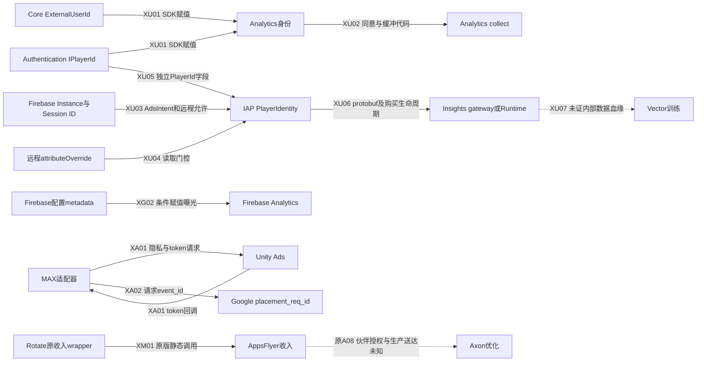

# Axon / Vector客户端系统重建与断点评估

2026-11-19。本轮新增44段可追溯代码证据、15条关系边；证据图现有**48节点、53边、84来源**。[当前JSON](prediction-system/EVIDENCE_GRAPH.json)、[00—46阶段原图快照](cross-sdk/EVIDENCE_GRAPH.before47.json)、[本轮固定快照](cross-sdk/EVIDENCE_GRAPH.after52.json)。旧节点、边和来源保持原对象，未将原unknown边改成已证训练。

## 新增连接与六层证据

| 客户端连接 | SDK能力 | 原版业务 | 请求构造代码 | 成功发送 | 服务器接收 | 用于模型训练 |
|---|---|---|---|---|---|---|
| UGS Authentication/Core→Analytics identity/buffer | 已证 | 目标游戏未证 | 已证 | 未证 | 未证 | 未证 |
| Firebase getters→IAP5.5.1→Insights | 已证且有条件 | 目标游戏该版本未证 | 已证 | 未证 | 未证 | 未证 |
| IAP UGS/分析/交易/价格共封装 | 已证 | SDK内purchase回调已证，非目标游戏实跑 | 已证 | 未证 | 未证 | 未证 |
| Firebase RC→Analytics/ABT assignment | 已证 | 目标游戏该功能未证 | 调Analytics API已证；未重新恢复Google全部传输层 | 未证 | 未证 | 未证 |
| MAX→Unity token/同意、MAX event_id→Google request ID | 已证 | 所选适配器生产调用未证 | 适配器参数/请求代码已证 | 未证 | 未证 | 未证 |
| Facebook Attribution provider→Adjust fb_id | 已证且受开关/签名/可访问性限制 | 目标游戏运行结果未证 | 已证 | 未证 | 未证 | 未证 |
| Rotate原版→AF标准ILRD及额外事件 | 已证 | 原DEX调用已证 | API参数已证，SDK包链复用16号 | 未证 | 未证 | 未证 |

每条新边带SDK版本、原包与文件SHA256、方法/行号、触发条件、六层标记及补充的A/U边；见[代码目录](cross-sdk/CODE_CATALOG.md)及图的`cross_sdk_extension`。

## 哪些输入线索变得更强

**Vector侧：**官方IAP/D2C→Vector总体用途已有S21；本轮补了IAP如何实际读身份、交易阶段、产品价格、安装时间、允许的Firebase/广告标识并构造Insights请求。二者形成更强的拼图，**仍不能跳过Insights→训练集的服务端断点**。尤其PriceMicro为metadata价格，不能未经核对当最终收入标签。

**Axon侧：**确认MAX13.7协议路径延续、适配器请求上下文与隐私转换；MMP业务事件和收入API链继续成立。没有新增四款游戏显式价值规则→MAX EventService的证据，也没有生产MMP partner ACK。MAX→Unity token是媒体竞价信号通路，不是双方互传全部玩家价值/模型训练数据。

## 最关键的反面发现

1. IAP5.4.0存在Firebase字段不代表真正调用getter；Session ID进入内存也不代表被序列化。5.5.1修复有官方说明与源码双证。
2. UUID、交易ID、client cache和HTTP completed都不代表服务器exact-once。UGS Analytics4xx也会清缓存；IAP gateway没有所查方法内持久重试保证。
3. Firebase FID≠Analytics Instance ID，IAP IEngineInstallationId≠已证与Analytics IInstallationId相同；新UGS ID也不能直接等于Unity Ads读的旧PlayerPrefs键。
4. AdWorth/GRT代理值、阈值、paid/fulfilled阶段和原始收入需要分账；不能把其总和当标签。

## 仍须服务端证据解决

【无法确认】生产启用的SDK/编译分支和远程allowlist、事件成功接收、跨通道去重、退款及迟到处理、ID命名空间与join、Insights/MMP数据进入哪些训练任务、实际安装前特征快照、模型标签及出价效果。客户端更多字段不能独自完成这些证明。

## 下一步具体模块

优先 **Unity Services Core1.19.0的`IInstallationId/IEngineInstallationId/IExternalUserId`提供者及新Engine Identifiers桥**，与本轮IAP5.5.1、Analytics6.3.0对照。原因是本轮已发现两个消费者，但尚未证明其安装ID接口是否同源、何时重置、如何受用途设置控制；这是仍可能由公开客户端源码补齐的具体断点。

其后优先Runtime Insights原生接收层的公开绑定/官方schema及正式数据用途文档；若只剩闭源消费者、训练与生产ACK，应停止靠SDK命名拼接，保留未知并寻求授权匿名化血缘/消融案例。
