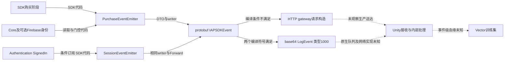

# Unity Insights 事件协议与接收边界

2026-11-19。独立 IAP5.5.1 官方包，SHA256 `cf382958920ef886c51998988153ac55d6682fbd79d79cfb34362d7973ca9403`。Core1.19与Analytics6.3消费者已对照，所有证据为静态；没有初始化SDK或发生产请求。[原包](core-insights/PACKAGE_PROVENANCE.json)、[代码目录](core-insights/CODE_CATALOG.md)。

## 可证实的数据链

【SDK代码证实】购买生命周期→商店服务override→PurchaseEventEmitter→PlayerData→DTO→protobuf writer→**编译时二选一**：HTTP gateway，或 `EngineDiagnostics.LogEvent(1000, base64)`。本轮终点是公开 C#→native 接口或 SDK 的 HTTP 请求构造；没有生产送达、服务端接收或训练血缘证据。[C53S22](core-insights/CODE_CATALOG.md#c53s22)、[C53S23](core-insights/CODE_CATALOG.md#c53s23)、[C53S24](core-insights/CODE_CATALOG.md#c53s24)、[C53S25](core-insights/CODE_CATALOG.md#c53s25)、[C53S44](core-insights/CODE_CATALOG.md#c53s44)。

实线仅代表可读源码连接；虚线为未证生产或内部连接。官方泛化用途与某个字段实际用于训练分开。

## 协议版本与完整字段边界

【SDK代码证实】Gateway设置 `Content-Type/Accept: application/x-protobuf`，`X-Tenant: iapSdk`，`X-Schema-Name: insights.producers.iapsdk.v1alpha1.IAPSDKEvent`，`X-Schema-Version: 1`，`X-Proto-Sdk-Version: 1`，`X-SDK-Release-Version: IAPVersion.Current`。schema namespace的v1alpha1、schema版本、SDK版本、Unity版本均不是Vector模型版本。[C53S23](core-insights/CODE_CATALOG.md#c53s23)。

原包没有注释提到的 `Schemas~/.../*.proto` 文件。本报告与[PROTOCOL_SCHEMA.json](core-insights/PROTOCOL_SCHEMA.json)是**依据实际writer及DTO恢复的发送侧描述**，没有声称取得规范原始proto、服务器reserved/options或接收端校验规则。以下覆盖全部已见68处字段写入（其中oneof分支另列）及Timestamp的2个内层字段。[C53S25](core-insights/CODE_CATALOG.md#c53s25)—[C53S27](core-insights/CODE_CATALOG.md#c53s27)、[C53S47](core-insights/CODE_CATALOG.md#c53s47)—[C53S52](core-insights/CODE_CATALOG.md#c53s52)。

### IAPSDKEvent 顶层

| tag | 字段 | 类型与语义 |
|---|---|---|
| 1 | Timestamp | protobuf.Timestamp；BuildEnvelope时的UTC，不是支付平台结算时间 |
| 2 | EventUuid | string；每次BuildEnvelope新GUID，非玩家ID |
| 3 | SessionId | string；IAP读取unity_connect.session_id |
| 4 | FirebaseSessionId | string；允许时读取Firebase Analytics session |
| 5 / 6 | ProjectId / EnvironmentId | string；Core项目/环境 |
| 7 / 8 | IapSdkVersion / EngineVersion | string；组件版本，不是模型版本 |
| 9 / 10 | AdsIntent / AnalyticsIntent | ConsentState enum；显式转换，不照抄UnityConsent枚举序号 |
| 11 | UnityIdentities | PlayerIdentity message |
| 12 | DeviceInfo | DeviceInfo message |
| 13 | Reporting | Reporting message |
| 14 | InstallationTimestamp | Timestamp；Android firstInstallTime；iOS目录创建时间近似 |
| 15 | Store | Store enum |
| 16 | Order | OrderData message |
| 17 / 18 / 19 / 20 | intent / paid / failed / fulfilled | oneof：空message / StorePayload / failure / StorePayload |
| 21 | ApplicationVersion | string；应用版本 |
| 22 / 23 | auth complete / payment options shown | oneof：空message / options message |
| 24 | ImpressionId | string；**购买旅程ID**，见下文 |
| 100 | FirebaseAppId | string；Firebase application配置ID，不是用户ID |
| 101 | InstallMode | string；Android store/dev_release/adhoc/enterprise/editor等映射，其他平台缺省 |

### 所有嵌套message字段

| message | tag→字段（发送侧类型） |
|---|---|
| PlayerIdentity | 1 UnityInstallationId；2 PlayerId；3 UserId；4 AnalyticsId；5 Idfa；6 Gaid；7 Idfv；8 UnityAdsIdfi；9 AppInstanceId；均string |
| DeviceInfo | 1 SystemLanguage string；2 LocaleList repeated string；3 Model string；4 SystemBootTime string；5 OsVersion string；6 TotalSpace uint64 |
| Reporting | 1 Platform string；2 AppBundleId string |
| OrderData | 1 Sku message；2 StoreTransactionId string |
| Sku | 1 SkuId string；2 ProductType enum；3 LocalizedTitle string；4 LocalizedDescription string；5 LocalizedPriceString string；6 PriceMicro int64可空；7 IsoCurrencyCode string；8 Quantity int64；9 CatalogListingId string；10 UnitySku string |
| paid/fulfilled的StorePayload | oneof：1 AppStorePayload；2 GooglePlayPayload |
| AppStorePayload | 1 AppReceipt；2 JwsRepresentation；3 OriginalTransactionId；4 AppAccountToken，均string；5 OwnershipType enum |
| GooglePlayPayload | 1 OriginalJson string；2 Signature string |
| PurchaseFailed | 1 FailureReason enum；2 FailureMessage string |
| PaymentOptionsShown | 1 OptionsShown repeated enum（writer逐项unpacked写，包含0）；2 OptionsDefaultProvider string |
| Timestamp | 1 seconds int64；2 nanos int32；.NET ticks×100并不代表时钟有纳秒精度 |

完整enum编号如下，来自发行包DTO，不由字段名称推测：

- `ConsentState`：Unspecified=0；Unset=1；Granted=2；Denied=3。

- `DataCollectionMode`：Unspecified=0；Basic=1；Recommended=2。

- `EventType`：Unspecified=0；IapSdk=1000。

- `FailureReason`：Unspecified=0；PurchasingUnavailable=1；ExistingPurchasePending=2；ProductUnavailable=3；SignatureInvalid=4；UserCancelled=5；PaymentDeclined=6；DuplicateTransaction=7；ValidationFailure=8；StoreNotConnected=9；PurchaseMissing=10；Unknown=11；UserNotAuthenticated=12；NotSupported=13；OrderCancelled=14；OrderStateChanged=15。

- `Store`：Unspecified=0；AppStore=1；GooglePlay=2；PaymentProvider=3；Webshop=4。

- `ProductType`：Unspecified=0；Consumable=1；NonConsumable=2；Subscription=3；Unknown=4。

- `OwnershipType`：Unspecified=0；Purchased=1；FamilyShared=2。

- `PaymentOption`：Unspecified=0；Native=1；Stripe=2；Codapay=3；Webshop=4。

除nullable消息/可空PriceMicro及重复enum的特定写法，writer按proto3省略空字符串、默认0和未设置对象；线型仅0(varint)/2(LEN)。6个事件variant互斥；`DataCollectionMode`虽有枚举定义，没有在该顶层writer中序列化。`UnityAdsIdfi`虽有tag8，`MapIdentity`未赋值；源码注释的“Runtime可补”不是已证原生赋值。[C53S24](core-insights/CODE_CATALOG.md#c53s24)、[C53S25](core-insights/CODE_CATALOG.md#c53s25)、[C53S47](core-insights/CODE_CATALOG.md#c53s47)。

## 触发、时间、价格及重复计收风险

| 事件 | 实际SDK触发 | 价值含义 |
|---|---|---|
| intent | Purchase入口→服务override→SendPurchaseIntentStartEvent | 意图；可带商品metadata，不能视为购买收入 |
| paid | PendingOrder→SendPurchasePaidEvent | 支付阶段报告；仍需验单/折扣/退款与去重口径 |
| fulfilled | ConfirmedOrder→SendPurchaseFulfilledEvent | 完成/履约阶段；与paid可能同交易，不能加算第二笔收入 |
| failed | FailedOrder→SendPurchaseFailedEvent | 失败；带价格不代表成交 |
| auth complete | IapCoreInitializeCallback在Auth可用时订阅SignedIn→SessionEventEmitter | 无Store/Order的会话事件，不是仅存在默认事件表中的名称 |
| options shown | PaymentOptionProvider/UITK→SendPaymentOptionsShownEvent | 显示支付选项；不是支付 |

已追踪 GooglePlay 服务与 PurchaseService SDK调用；目标四款游戏是否实际使用5.5.1未证。登录链是本轮新补齐的实际SDK调用，而不是仅schema能力。`IAP_UNITY_AUTH_ENABLED`还受包版本编译条件影响。[C53S22](core-insights/CODE_CATALOG.md#c53s22)、[C53S30](core-insights/CODE_CATALOG.md#c53s30)、[C53S31](core-insights/CODE_CATALOG.md#c53s31)、[C53S34](core-insights/CODE_CATALOG.md#c53s34)、[C53S44](core-insights/CODE_CATALOG.md#c53s44)、[C53S55](core-insights/CODE_CATALOG.md#c53s55)。支付选项调用位置：`Runtime/Purchasing/PaymentOption/PaymentOptionProvider.cs`:L137，`PaymentOptionProviderUITK.cs`:L135（同一IAP原包）。

`BuildSku` 读取所选catalog listing的metadata，`PriceMicro=(long)(localizedPrice×1_000_000m)`，Quantity独立。它没有读取最终税后净额、折扣成交额、退款后收入或预测LTV。事件timestamp在异步取身份**之后**构建，不能当作精确原始点击/商店支付时间。安装时间Android来自PackageInfo.firstInstallTime毫秒转UTC；iOS来自persistentDataPath创建时间，是平台近似。[C53S24](core-insights/CODE_CATALOG.md#c53s24)、[C53S45](core-insights/CODE_CATALOG.md#c53s45)。

**ImpressionId重要纠正：**这里是`ImpressionScope.Shared`基于AsyncLocal的购买旅程GUID。Enter/EnterOrJoin/EnterOutcome/EnterNone限制它在购买链、结果回调、并发操作之间传播；native/UI回调可失去它，fulfilled默认取身份时也未传入旅程ID。它不是MAX/Unity Ads展示ID，更不是跨App用户ID。[C53S32](core-insights/CODE_CATALOG.md#c53s32)、[C53S22](core-insights/CODE_CATALOG.md#c53s22)。订单ID、EventUuid、ImpressionId分别标记订单、事件和购买旅程，不能彼此替代去重。

## 同意、远程允许列表与包要求

【SDK代码证实】广告同意不是整个PurchaseEmitter的总开关。只有AdsIntent为Granted才进入GAID/IDFA/Firebase可选读取分支；还需`ConnectionsSettingsClient.attributeOverride`对应Boolean true。缓存未就绪、缺项目/安装ID、请求失败时fail-closed不读取对应标识；下一次缓存miss可重试配置请求。Apple IDFV在源码中独立读取，不能声称与GAID使用完全同一门控。[C53S21](core-insights/CODE_CATALOG.md#c53s21)、[C53S28](core-insights/CODE_CATALOG.md#c53s28)。

配置请求带projectId、**IEngineInstallationId**、platform、appVersion、editorVersion、sdkVersion。session级共享allowlist有generation复位；Firebase值另有PlayerData实例内缓存。这是采集门控，不是实时模型配置，不证明生产allowlist内容。[C53S20](core-insights/CODE_CATALOG.md#c53s20)、[C53S28](core-insights/CODE_CATALOG.md#c53s28)。

【官方公开证实】IAP隐私说明（2026-11-05）明确：购买事件为运营服务需要，不因consent状态停发；ads consent影响广告及Firebase标识；数据用于IAP服务、交易去重与Dashboard收入报表。文档也说明6000.7+可经Insights模块。[C53S40](core-insights/CODE_CATALOG.md#c53s40)。

IAP声明RequiresInsights的版本门槛是`6000.7.0a7`，并要求`ENABLE_CLOUD_SERVICES_ENGINE_DIAGNOSTICS`。公开Attribute契约明确：包级requirement可在项目Engine Diagnostics设置关闭时仍保留模块并启用该包所需采集；不支持的平台不生效。**项目诊断开关、SDK包级采集要求、广告ID同意是不同层控制。** 这不证明该游戏的构建状态。[C53S33](core-insights/CODE_CATALOG.md#c53s33)、[C53S34](core-insights/CODE_CATALOG.md#c53s34)、[C53S37](core-insights/CODE_CATALOG.md#c53s37)。

## 两条接收路径与ACK边界

| 路径 | 最后可见实现 | 无法继续证明的部分 |
|---|---|---|
| Gateway | UnityWebRequest POST `https://prd.insights.analytics.unity3d.com/v1/ingest/producer`，protobuf及版本头，completed仅Dispose | 此wrapper无响应成功判断、事件级ACK、持久队列/重试；不能证明生产送达或exactly-once。底层HTTP内部行为不在此wrapper中恢复 |
| Runtime | 同一protobuf→Convert.ToBase64String→EngineDiagnostics.LogEvent(1000,...)，默认immediate=false | native原生队列、封装/补字段、重试、过滤、上传、ACK不可见；不把注释当实际接收实现 |

6000.6公开绑定虽有LogEvent/IsEventAllowed，但IAP5.5.1的新ForwardModule分支仍受6000.7.0a7条件限制。6000.7固定提交额外可见native推送blocked event types、managed helper及thread-safe LogEvent；IAP wrapper没有调用`IsEventAllowed/IsInitialized`，不能把managed capture hook的过滤自动解释成这个IAP调用已在C#层过滤。[C53S23](core-insights/CODE_CATALOG.md#c53s23)、[C53S35](core-insights/CODE_CATALOG.md#c53s35)、[C53S39](core-insights/CODE_CATALOG.md#c53s39)。

UUID旁注“重试需保持相同”不是已实现重试证据；不同BuildEnvelope会生成新UUID。ConnectionsSettings的“失败后下次读取重取”仅属于配置请求，不能借给事件传输。UGS Analytics Buffer/Dispatcher是另一条路径，不能拿其缓存和ACK实现填补IAP缺口。

## Insights与Vector：明确连接及断点

【官方公开证实】2026-07-21 Unity keynote说D2C及IAP SDK采集的购买数据“can help enrich Unity Vector models to find future players”。原句：[S21本地位置](vector/unity-2026-keynote.txt):L120、[官方页面](https://unity.com/blog/unite-seoul-keynote-2026-recap)。这证明官方公开的产品用途关联，**没有识别该protobuf生产者、字段、授权项目、处理后标签、训练任务或实际覆盖率**。

【无法确认】`Insights ingest/LogEvent → 服务端标准化 → 身份join → 去重/退款 → Vector feature/label` 的逐事件血缘；也未证IAP全部默认数据跨业务用于广告训练。IAP隐私页面证实的运营/报表用途不能替代这条证据。研究已到公开客户端末端，停止靠“Insights/Vector/身份字段”命名猜测模型。

进一步只接受授权且匿名化的：生产build/schema路由、接收ACK与payload映射、package requirement/同意配置快照、identity join契约、交易去重及退款规则、训练dataset列血缘/成熟窗口，以及特征或标签消融。无需生产测试事件，也不需要真实用户标识。
