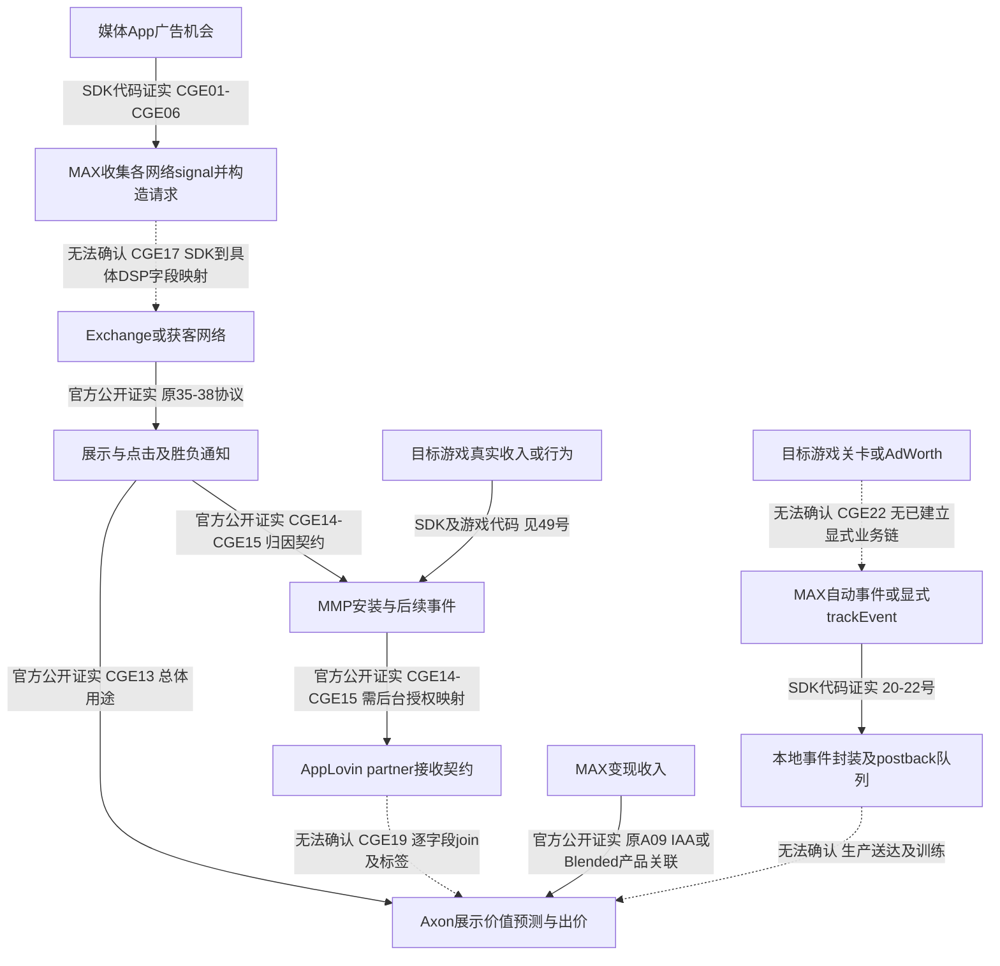
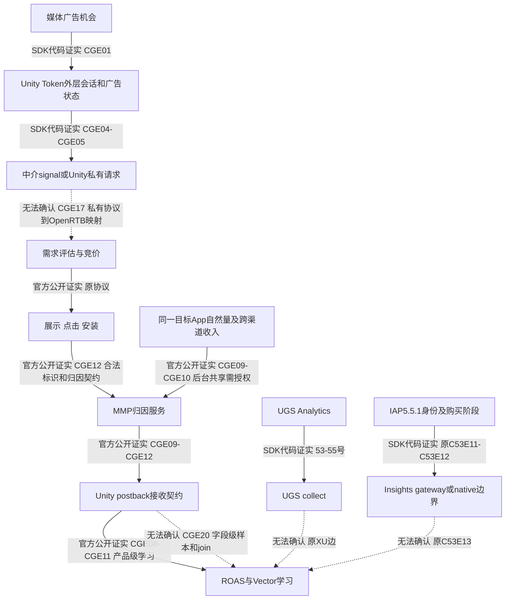

# Axon / Vector完整买量反馈闭环

2026-11-19。本报告区分**可见代码路径、官方产品契约、目标游戏实际启用、生产送达和模型训练**。实线仅代表所标范围有证据，不代表观察到线上成功。原始位置、版本、文件/原包SHA256见[CGS目录](client-growth/SOURCE_CATALOG.md)；逐字段见[安装前血缘](client-growth/PREBID_FIELD_LINEAGE.json)。历史图的未知边全部保留。

## 1. Axon：三种传输路径不能合并

- 【SDK代码证实】MAX `MediationServiceImpl.collectSignal`先查可配置TTL缓存；Unity适配器调用`UnityAds.getToken(TokenConfiguration(format))`；Google适配器调用`QueryInfo.generate`。MAX `a6.g/i/run`将`signal_data`写入POST构造并调度。**媒体变现请求不等于Axon需求侧最终报价**。[CGS23–CGS34](client-growth/SOURCE_CATALOG.md#cgs23)
- 【官方公开证实】Axon声明使用设备/网络、应用/广告等互动、自己收到的MAX胜负通知和广告主选择共享的数据，按对特定广告主的展示价值出价；排除竞争者报价、竞争者用户数据和敏感/受保护数据。[CGS51](client-growth/SOURCE_CATALOG.md#cgs51)
- 【官方公开证实】MMP可分享同一目标App的全部来源含自然量；AppLovin `landing/checkout/postinstall`是partner映射契约，**不是客户端MAX trackEvent自动路由**。`checkout`只允许真实用户支付，不能放IAA或预测LTV。[CGS49–CGS52](client-growth/SOURCE_CATALOG.md#cgs49)
- 【SDK代码证实】20—22号已恢复SDK自动`landing/paused/resumed`、条件化`axon_events`与旧`4.0/pix`/新`v1/app`。Meow13.2无结构化分支；其他三款包含它，但尚无具体游戏价值事件→该分支的已建立链。自动事件、原始广告收入、MMP事件各自独立。[20](20_Axon实际事件调用链.md)、[22](22_AppLovin事件协议版本差分.md)

【无法确认】MMP里的真实IAA到AppLovin必须有正确专用通道/产品配置；不能拿`checkout`映射补出这条边。MAX与IAA/Blended的产品关联已证，不等于恢复了AppLovin内部收入训练表。静态构包也不是成功HTTP、服务端入库或训练证明。

## 2. Vector：广告SDK、MMP和Insights是不同入口

【SDK代码证实】Unity4.17/4.18的Token有当前会话计数、HB seq/wins/starts、已加载/展示campaign状态；可选PII受AllowedPii控制。`fid`在所查Android桥中实际取**Firebase Analytics App Instance ID**，不是FID安装ID。计数/状态是明确历史线索；没有恢复内层`campaign.data/sessionToken`语义，也没有证明可跨App持久合并。[CGS01–CGS22](client-growth/SOURCE_CATALOG.md#cgs01)

【官方公开证实】Unity明确支持安装/会话/购买/广告收入的attributed与unattributed postback，后者包括其他网络与自然量。预启动至少两周的SDK数据及对应未归因事件有助训练，但不计入退出学习阈值。D28产品使用D7成熟门槛不表示D28收入已观测完整。[CGS42–CGS48](client-growth/SOURCE_CATALOG.md#cgs42)、[CGS53](client-growth/SOURCE_CATALOG.md#cgs53)

【无法确认】“Unity SDK data”没有给出本轮每个Token字段→Vector训练feature的映射；IAP Insights接收→具体训练标签也仍未知。UGS Analytics已经构包不能证明自动成为Vector输入。官方产品级训练用途与具体字段生产血缘分别保存，不互相替代。

## 3. 身份join：找到契约，仍未得到成功匹配事实

| 连接 | 已证内容 | 条件及断点 |
|---|---|---|
| Unity私有Token上下文 | tokenId/tokenNumber、sessionToken、受限广告ID/AppSet/App Instance ID与会话状态同包 | 【SDK代码证实】同包不等于后台统一身份；tokenId是机会相关ID，不是玩家ID |
| Unity MMP→postback | gamer_id/aid/ifa、campaign_id、advertiser game_id、install_ts、事件时间、归因标记与金额 | 【官方公开证实】字段契约；实际受隐私/可用性限制。不能把publisher Game ID当advertiser Game ID；未得匹配ACK |
| MAX用户ID | Meow AdUuid、Rotate分析ID、Car Metica用户ID可入MAX既有路径 | 【SDK代码证实/既有游戏代码】单应用链；不是GAID等价关系，也不是跨发行商自然人身份；可选user_data另受对象/开关控制 |
| IAP与Analytics | Core安装提供者、Authentication PlayerId、外部ID及可选Firebase getter已追踪 | 【SDK代码证实】提供者和读取条件；相同接口≠相同跨应用ID；不证明Vector join |
| 两平台训练样本join | 需要广告机会、点击、安装、后续收入和可用时间/同意的关联表 | 【无法确认】没有脱敏生产匹配率、错误率、键作用域、受限流量fallback或数据集版本 |

原始依据：[21](21_MAX用户ID与身份数据流.md)、[48](48_跨SDK身份关联与字段映射.md)、[55](55_跨SDK身份价值血缘最终核验.md)、CGS10–CGS16/CGS34/CGS48。App Set、App Instance、安装/玩家/会话ID不能凭同名互换。

## 4. 时间与金额必须保持隔离

1. **安装前**仅用当前机会Token生成前已存在的媒体App状态，以及有合法关联契约且此前已可用的历史。预加载Token时间≠最终bid_time；SDK计数也可能被服务器更新或重置。未经服务器快照证据，不声称已经验证严格as-of。
2. **安装后**目标App的收入是反馈/标签候选，不得倒灌到同次安装前特征；D0行为只能用于安装后更新或后续可用历史。自然量共享能改善训练，不让新用户未来收入提前可见。
3. `was_conversion_attributed=0`是未归因给Unity，不等于无来源，也不计作Unity付费安装。ALL-source扩大样本，不能扩大付费ROAS分子而不改分母。
4. IAA按经济展示去重，保留币种、时间、收入precision和估值版本；不同SDK收到同回调不重复计收。IAP验单/退款及paid/fulfilled去重；商品metadata价格不是必然成交额。
5. GRT/AdWorth/国家阈值属于代理或达标事件，不能与实际IAA/IAP相加，也不能伪装checkout。端上once、event UUID和去重参数不证明服务端幂等或已训练。

1–3依据CGS01/CGS16/CGS28–CGS31/CGS43/CGS48；4–5依据[49](49_行为价值事件端到端调用链.md)、[54](54_Unity_Insights事件协议与接收边界.md)、CGS52。具体会计要求为独立验证规范，不冒充平台已公开实现。

## 5. 四款游戏现在真正能接到哪里

| 游戏 | 【游戏代码证实】的末端 | 到Axon/Vector尚缺什么 |
|---|---|---|
| Car Race | ILRD到Adjust/Firebase/TikTok；关卡/会话到Adjust；国家累计阈值已定位路径为Firebase-only | MAX generic桥无已证特定价值触发；Firebase-only阈值不能直接画到两平台；需partner开启/事件映射/送达 |
| Meowdoku | tracker的安装时间窗、活跃/深度→UniKit/GRT→指定AF/Meta/Firebase/Learnings端 | GRT线上规则、收入通道、partner共享和选用未知；MAX13.2自动事件不是GRT直发Axon |
| Rotate Rings | MAX收入callback→业务分发→AFAdRevenueData(APPLOVIN_MAX,USD,double)；另有ad_revenue2/4和国家/安装年龄门槛 | 多路是否重复、MMP入库及partner专用收入共享需授权核对；不把三路相加 |
| Jewel Coloring | AdWorth默认90规则/31权重表及账本/系数→Firebase/Meta/Adjust | 默认来源权重表未被90规则引用；线上覆盖未知；Meta代理purchase不是实际IAP，更不是AppLovin收到 |

原始位置复用[C03](EVIDENCE_INDEX.md#c03)、[M01](EVIDENCE_INDEX.md#m01)、[R02](EVIDENCE_INDEX.md#r02)、[D01–D07](EVIDENCE_INDEX.md#d01)、[XS43](EVIDENCE_INDEX.md#xs43)、[XD01–XD02](EVIDENCE_INDEX.md#xd01)。**四款没有一项特定价值事件取得“Axon/Vector实际接收并训练”的证明。Amaze无可核验样本。**

## 6. 已补齐与仍未知

本轮补齐：客户端广告历史写入→Token外层→适配器→MAX构包；Firebase Analytics getter到Unity PII的明确赋值；自然/跨渠道postback的来源范围、学习用途和授权条件。没有补齐：不透明Token内层、私有请求→DSP字段映射、目标游戏后台启用、生产送达、身份join结果、去重/延迟/退款处理、字段级训练数据集、预测值→CPM函数。

机器图新增CGE边对旧A/U边作**补充而非替换**，所有生产送达/训练观察标记保持false。[关系图](prediction-system/EVIDENCE_GRAPH.json) / [本轮边目录](client-growth/EDGE_CATALOG.md)。
