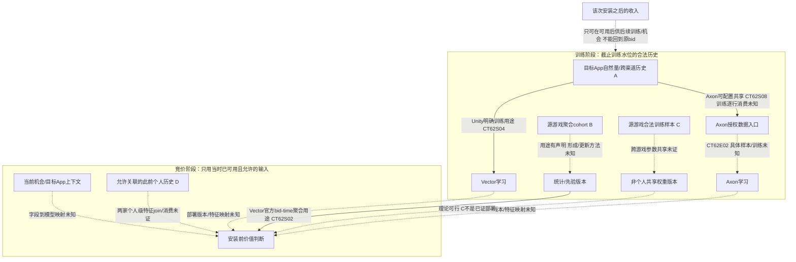

# Axon / Vector跨游戏知识迁移与冷启动机制

2026-11-19。**完全没有跨App个人身份关联，仍然可能通过合法的同App历史样本、跨游戏聚合统计或共享非个人模型参数帮助新活动/新游戏买量。个人级跨游戏历史不是这些机制的逻辑前提。** 但“理论上不需要”不等于已证Axon或Vector使用某种共享网络，更不等于刚上线、无自身数据的游戏立即能准确找出高价值玩家。

本轮最强证据分别是：**Axon的同App全来源共享契约＋允许的广告互动/自愿数据持续学习声明；Vector的同App预启动学习契约＋明确的跨游戏模式/聚合cohort在bid-time用途陈述。** 两家都没有公开到足以唯一确定跨游戏参数、聚合表和个人历史各自贡献的生产实现。停止在此断点，不用招聘或SDK同包ID补齐。

来源与作者溯源：[本轮目录](model-architecture/round62/SOURCE_CATALOG.md)、[AUTHOR_TRACE](model-architecture/round62/AUTHOR_TRACE.json)、[四机制矩阵CSV](model-architecture/round62/FOUR_MECHANISMS.csv)。复用56—61及63，不重复SDK清单、收入标签通用知识或报价公式。证据等级：**官方公开证实**指厂商声明/契约；**间接技术线索**不当作部署；可行性和实验设计标**合理推断**；内部断点保留**无法确认**。

## 1. 先区分究竟哪种“新游戏/冷启动”

| 情形 | 已有目标App样本吗 | 可能的帮助 | 不能偷换成什么 |
|---|---|---|---|
| 已运营App首次接入某平台/新建ROAS活动 | 可能已有自然量和其他渠道成熟样本 | A可在本平台大量付费安装出现前提供目标App学习信号 | 新活动≠新App零数据；organic不计成本也不变成该平台归因安装 |
| 真正新上线App，没有自身成熟收入 | 没有或极少 | B/C有理论上的共享先验价值；D若合法且可用可能补充用户历史 | A不能凭空提供不存在的目标App历史；B/C/D部署和效果未证 |
| 新玩家在新机会中无可关联跨App身份 | 可能只有当前上下文 | A训练出的同App规律、B聚合先验、C非个人共享参数仍可能推断 | 不得为补D绕过隐私，或把缺GAID当完全无关联的证明 |

这些是研究者划分，不是两家正式产品分组。最常见的表面矛盾——“没买多少本平台安装却已有价值预测”——**只用第一行的A就可能解释，根本不必假定跨App个人图谱。** 若是第二行，A不足，必须把B/C/D分别作为待验证来源，而非宣称已有高精度。

## 2. 从Vector原文追到作者与关联材料

**【官方公开证实】**核心原文为2026-06-25 *D7 or D28 IAP ROAS campaigns? The answer is both*。HTML正文与JSON-LD均指向Daniel Godley；正文职务为**Senior Content Marketing Manager**。没有可见作者工程主页链接，也没有论文/GDC/模型白皮书引用。职务不否定技术主张，但这是一篇官方产品解释，不是生产网络结构的工程审计。[CT62S01](model-architecture/round62/SOURCE_CATALOG.md#ct62s01)

原文L214明确：用attributed/unattributed数据，包括**cross-game behavioral patterns和aggregate cohort insights**，在**moment of bid decision**区分玩家类型。这比泛泛“有Runtime数据”具体；可以确认为**B所述聚合洞察的产品用途**，但仍未给表结构/聚合粒度，不能由此唯一选择B、C或D作为实现。[CT62S02](model-architecture/round62/SOURCE_CATALOG.md#ct62s02)

文章链接的相关一手材料只有Vector产品页和D28 IAP发布说明。后者为2026-03-06，作者Danielle Shevchuk，**Senior Product Marketing Manager**；它明确说明数据准备/验证、Learning状态及达标后Live。正式ROAS文档另写可直接启动ROAS，**无需先跑Install campaign**。两者合起来只能证明直接开户与学习流程，不能证明数据要求消失。[CT62S03/05](model-architecture/round62/SOURCE_CATALOG.md#ct62s03)

本轮沿这两条相关链接没有找到共享参数、模型结构或个人历史join的工程材料。文章38%统计源自2024-04—2025-02，发布说明Homa结果源自2025年cohort，**都不是本轮B/C/D的消融实验**。新版产品页仍是生态数据和匹配用途，没有新增可分辨结构。[获取/溯源台账](model-architecture/round62/TRACE_LEDGER.json)

**语境不能串接：**MMP文档中的unattributed指**同一目标App来自其他广告网络或自然量**；不是“跨游戏个人历史”的字段别名。原产品文章把cross-game模式举作unattributed数据的例子，也没有提供二者逐字段映射。[CT62S06](model-architecture/round62/SOURCE_CATALOG.md#ct62s06)

## 3. 四机制比较矩阵：训练与推断分开

下表中的“可以”均为**理论可行性**；具体厂商证据在第4、5节单列。

| 机制 | 必要数据 | 训练时输入/形成的知识 | 竞价时输入 | 是否必须跨App个人ID | 授权/隐私条件 | 冷启动潜在作用 |
|---|---|---|---|---|---|---|
| **A 同App自然/跨渠道历史** | 目标App自身先前安装、行为/收入及来源；正确数据用途/可用时间 | 学目标App的人群/上下文与未来价值关系，可提供目标App校准 | 合法的当前机会特征；可应用已学群体规律，不必查这个人玩过别的App | **不必须**；同App收入/安装关联或MMP内部归因仍需正确，不等于跨App个人画像 | 广告主partner开关/事件映射及用户用途授权；organic不是无授权数据 | “新网络/新活动”已有同App样本时最直接；真正新App无历史则不能凭空产生 |
| **B 聚合cohort/相似游戏先验** | 合法跨游戏分组统计/足够覆盖、游戏元数据、历史时间范围 | 形成按游戏/群体的先验或汇总特征；共享的是统计规律 | 可用游戏/场景/群组上下文及已发布统计版本；不必跨App查个人 | **不必须**；群体键不能暗中变为个人标识/细粒度指纹 | 原始数据用途与聚合/共享契约合法；“aggregate”本身不保证匿名、可训练或可跨业务用 | 新App自身样本少时给群体先验；与既有游戏相差太大可能负迁移 |
| **C 共享参数/表示/迁移** | 合法源游戏训练样本、游戏上下文和可共享模型目标/参数 | 先学跨游戏可迁移规律，再按目标App条件化或适配 | 共享权重/版本、目标App上下文和允许的当前机会特征 | **不必须**；限定共享非个人表示。若推断查全局用户embedding，就额外包含D | 训练来源/模型用途、个人数据与模型治理条件；不能用参数共享规避原数据限制 | 减少每个新App从零拟合的需求；需要相似性/校准，不保证稀有付费/新玩法外推准确 |
| **D 合法个人级跨游戏历史** | 合法作用域的跨App关联键、权限、此前个人行为与已可用的join | 可学个人历史和价值的关系；也可与B/C同用 | 该机会合法关联的个人历史特征/用户表示，必须在bid前可读 | **需要可关联个人/设备键或等效机制**，不必叫GAID，但本质不能说是无关联 | 跨App/来源的有效用途/平台限制，不能由一个App同意自动扩到其他App；受限时不强行补标识 | 若历史覆盖且与目标相关，可提供个体差异；覆盖/偏差/匹配错误可能抵消增益 |

**重要区别：**B的“相似游戏先验”是通用可行实现；Vector只直接提聚合cohort洞察和cross-game patterns，未明确披露nearest-game或游戏相似度检索。C的“表示学习”也不等于个人embedding；D的个人表示如果在bid-time被查读，不能重命名成C以绕过关联条件。

## 4. Axon：最直接支持A，跨游戏知识实现仍未定

| 机制 | 直接支持 | 间接线索 | 相反证据/未证生产环节 |
|---|---|---|---|
| A | **【官方公开证实】**Adjust Axon partner可选all attribution sources或Axon-only；session/revenue/event另配置；AppsFlyer亦有all-source/organic契约 | 官方说广告主自愿共享数据可能帮助优化 | 这证明可配置的目标App样本入口，不证明四款已启用、样本入库/成熟或冷启动效果；未映射事件不共享。[CT62S08](model-architecture/round62/SOURCE_CATALOG.md#ct62s08)、MA60S03 |
| B | 缓存官方说明称设备/广告/App互动、自身MAX胜负和广告主自愿数据持续训练；更多广告主数据/洞察使模型改善 | 广泛互动数据与之相容 | **【无法确认】**没有明确跨游戏cohort表、相似游戏先验或按游戏迁移契约；这份总体声明不能唯一支持B。[CT62S07](model-architecture/round62/SOURCE_CATALOG.md#ct62s07) |
| C | 无新的跨游戏共享参数/生产表示直接证据 | MA60S06/07用户表示、多任务和feature serving研发职责 | 招聘没有指定Axon共享层、源/目标游戏或已部署参数；整体模型改进也可由数据质量/独立模型更新造成。保留C而不选定 |
| D | 官方允许的互动/广告主数据及隐私披露与合法关联可能性相容 | 同包ID或用户表示研发不补特征join | **无目标游戏实际cross-App特征消费证据**；Ad Review明确不建画像/不训练Axon，排除此来源补D。竞争者bid/user数据、受保护/敏感/儿童数据也被排除。[CT62S11](model-architecture/round62/SOURCE_CATALOG.md#ct62s11)、MA60S02 |

2025-10-01 CEO文中“更多广告主数据将改善游戏伙伴表现”使用**will/believe**，只支持前瞻方向；另一份官方缓存说明用现在时描述“更多广告主→额外数据/洞察→模型改善”，支持**系统级学习用途**，但二者都没有给跨游戏训练/推断接口。**不能把它们与表示岗位拼成“已证统一用户embedding模型”。**[CT62S07/09](model-architecture/round62/SOURCE_CATALOG.md#ct62s07)

本轮重取Axon legal页面遇403即停止，未绕过；上述判断引用已保存、哈希核验的旧官方快照，不伪称本轮重新验证了页面当前内容。**Axon最有证据的冷启动解释是A可提供同App非本平台样本，结合平台已有一般预测能力；B/C/D具体迁移实现与实际效果仍未知。**

## 5. Vector：A的训练契约直接，B有用途声明，C/D继续并列

| 机制 | 直接支持 | 间接线索 | 相反证据/未证生产环节 |
|---|---|---|---|
| A | **【官方公开证实】**活动前至少两周SDK+对应unattributed数据帮助训练，不计入学习退出门槛；全来源包括organic | 正式post-install文档说明数据inform models | 对新活动充分相容，对全新无历史App不足；不证明自动历史回填/所有样本权重。[CT62S04/06](model-architecture/round62/SOURCE_CATALOG.md#ct62s04) |
| B | **【官方公开证实】**aggregate cohort insights和cross-game behavioral patterns用于bid-time玩家区分 | game DNA/生态数据产品陈述相容 | 无聚合schema/来源/隐私粒度/已知游戏相似性/增益；不证明B独立足够解释匹配。[CT62S02](model-architecture/round62/SOURCE_CATALOG.md#ct62s02) |
| C | 无共享层/迁移学习的生产结构直接材料 | 玩家/游戏关联及Vector建模岗位相容 | 与B同样能解释产品措辞；岗位/训练方法泛称不证明跨游戏共享权重。保留C，不推具体网络 |
| D | cross-game模式和合法标识能力与D相容 | 仅有身份共封装/接口并不能证明特征消费 | 无个人级join、时间/作用域/隐私fallback和实际推断路径；Developer Data广告用途受门控，不可默认为全量个人历史。[CT62S10](model-architecture/round62/SOURCE_CATALOG.md#ct62s10) |

因此**A是最明确的训练数据冷启动契约，B是最具体的跨游戏用途披露**。新活动不必先跑Install campaign，但仍须数据验证并经过Learning；不能把“直接启动”或cohort门槛理解成“无需数据就已精准”。

## 6. 训练阶段/竞价阶段分离的证据链

图中实线仅表示所标范围的官方用途；虚线是未证实现或理论可行路径。训练出的规律与竞价时查询个人历史是两条不同连接。

该图不能理解为B一定只用离线预计算或C一定只输出权重；这些是区分机制的研究表达，平台实际可能混合。机器可读边记录产品范围、证据和未知：[EVIDENCE_GRAPH](prediction-system/EVIDENCE_GRAPH.json)、[本轮新增边](model-architecture/round62/NEW_EDGES.json)。

## 7. 安装前可用时间：逐条排除泄漏

| 路径 | 在本次bid前必须成立 | 常见错误与核验上限 |
|---|---|---|
| A训练 | 先前目标App样本已经发生且已送达/可用；模型训练截止与部署完成均早于本次机会 | 新用户未来D28不能提前存在；旧样本已发生也不代表迟到数据当时可用。Lifetime窗口不等于自动补发 |
| B统计 | 源样本及汇总版本在bid前已可用，且用途允许 | 用当天结束/未来cohort完整统计解释当天早期bid会泄漏；“聚合”不消除时间问题 |
| C参数 | 训练数据水位、权重版本、部署/缓存时间均能证明早于bid | 用事后训练的模型重放旧bid不能当当时生产可识别；共享参数不自动满足as-of |
| D个人特征 | 其他游戏历史发生/到达、合法join及feature更新时间均早于bid；权限作用域覆盖该用途 | 历史事件时间早不代表join已可用；同包多个ID不代表成功关联；不能用本次安装后收入充当同次机会历史 |
| SDK预取/缓存 | token或请求上下文只说明构造时已有状态；最终服务器bid时间/刷新可另在之后 | 56号已核对缓存和会话上下文，未取得模型server快照。不得当严格同毫秒bid-time特征证明 |

该表是**研究者必要条件与验证规范**，不是公开恢复了平台的时间水位实现。旧游戏历史收入在后来的新机会中可能是合法历史标签/特征；这与把本次广告带来的未来收入倒灌回原机会完全不同。

## 8. 隐私限制下不需要个人图谱的路径与实际反证

**【合理推断】**一个模型可以只学习“某类游戏/场景/群体过去总体表现”，在新游戏上应用已学统计或非个人参数；推断时没有必要知道当前用户在另一App的身份。A也可以训练同目标App的群体规律，而不查询这个人的外App历史。**这给出A/B/C不以D为前提的逻辑解释，并不是两家具体算法。**

但**不需要跨App个人ID≠不需要数据授权≠没有隐私风险**。B的训练原料、C的参数用途、A的MMP共享仍需合法；小群组/细粒度键也不能自动视为匿名。Developer Data `ads_intent=denied`等门控对相应用途有明确限制；不能把一切标成aggregate后继续用受限个人数据。[CT62S10](model-architecture/round62/SOURCE_CATALOG.md#ct62s10)

如果**确实完全没有任何合法可关联的跨App个人键/特征**，D按定义不可用；A/B/C理论上仍可行。**只缺GAID或IDFA则不足以证明D全无**，因为是否还有其他合法键需证据；本轮不推断IP指纹fallback，也不尝试构建关系。

能排除的是具体过度主张，而不是B/C/D全局三选一：

- “unattributed就是跨游戏个人历史”被官方同App归因定义否定；“新平台没付费样本所以不能有目标App训练样本”被全来源契约否定。
- “可直接启动ROAS，所以零数据无需Learning”被官方数据验证/学习门槛否定；“A能解决从未有历史的全新App”在逻辑上不成立。
- “Ad Review跨网络用户输出就是Axon个人历史训练源”被官方用途排除否定；不能顺推所有合法D都不存在。
- “个人历史默认全部可用”被用途/隐私门控限制；“无个人ID一定无法做知识迁移”在理论上不成立。
- 目前**不能**排除两家使用部分合法D、共享C或聚合B，亦不能确认各自份额和增量；继续保留三个实现假设。

## 9. 最小可辨识实验：目前未执行

均只在有授权的模型/数据环境中进行；客户端静态研究不能自行完成。不采集个人原值、不调用生产广告端点。

| 要识别的机制 | 最小对照 | 必须控制/区分 |
|---|---|---|
| A的增量 | 同目标App/模型家族，额外合法自然/跨渠道历史加入与不加入；在本平台paid样本量相同时比较新活动时间外预测 | 固定B/C/D、标签成熟、训练预算和来源覆盖；A可与其他机制共存 |
| B的增量 | 固定C权重和D禁用，聚合cohort特征/先验可用与不可用 | 同机会/模型/预算；若B参与训练而非仅查询，需要训练级开关，不可只清推断缓存 |
| C的增量 | 禁用D，固定B统计与数据量/训练预算，比较跨游戏共享参数与不共享/仅目标App训练 | 无法把模型容量/更多训练数据/训练时间差误当“迁移”独立增益；记录对新App/no-history的leave-game-out结果 |
| D的增量 | 固定B/C和当前上下文，只在同一合法可用覆盖群中启用/屏蔽个人历史 | 不将有ID/无ID两类天然不同流量直接比较；记录join质量/可用时间与隐私条件；用完全去标识的授权特征开关 |

预测指标本身不能证明盈利扩量；若要归因到投放效果，还需固定库存/素材/预算等授权对照。该项已在63号讨论，本轮不重复推竞价公式。

## 10. 是否还值得继续公开架构检索

**当前建议停止同类公开架构广搜。**本轮已沿关键Vector原文的作者/相关一手链接追到最后公开产品接口；Axon旧声明、表示岗位与新页面403没有带来跨游戏生产契约。原文没有指向可补B/C/D的工程论文/演讲，继续同义词搜索或SDK字段堆叠的收益很低。

只有出现以下**新的、具体可定位一手材料**才恢复：①厂商署名的生产架构演讲/论文，给出cohort schema、共享层或特征作用域；②官方冷启动/迁移消融，固定数据与个人历史开关；③经授权的训练与推断血缘/模型版本及时间水位，能区分统计、参数和个人查询。公开模型岗位、历史专利和更多增长案例不能替代。

最有价值的授权材料是**一款目标App从接入前到Learning后的数据来源/模型版本/特征开关记录**，或平台提供的去标识模型血缘。仅运营MMP送达可验证A入口，仍不能单独证明C/D或模型因果。若没有上述新材料，保留A的配置契约、Vector B的用途声明与C/D未知就是可诚实交付的上限。

**最终结论：**Axon最有证据的冷启动路径是允许的同App全来源历史和平台一般持续学习；Vector是明确的同App预启动学习加跨游戏模式/聚合cohort用途。A/B/C均不必依赖跨App个人身份，D需要合法关联。现有证据排除一些来源和过度解释，**不支持唯一识别真实跨游戏架构，也不支持四款游戏因两家平台而增长的因果结论**。
