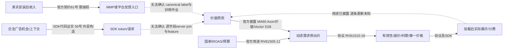

# 预测价值到实时竞价与预算约束

2026-11-19。**本轮将“按价值动态出价”推进到可核验的国家/预算/探索与交付约束；没有恢复Axon或Vector真实报价公式。**Unity正式预算文档提供的行为比招聘线索更直接，但不等于公开pacing控制器源码；Axon也只能确认产品目标及部分预算建议。收入/分布边界见[61号](61_收入标签与价值分布预测.md)。

四层证据严格区分：①官方明确披露的用途/产品行为；②工程招聘等间接线索；③研究者通用理论/独立数学模型；④厂商内部未知。第一层仍是厂商公开陈述，不是本研究观测生产部署。

## 1. 两家的已证决策链和断点

MAX/LevelPlay的媒体变现拍卖、Exchange的DSP接口、Axon/Vector广告主优化是不同层。即使本地看到请求/CPM/胜负，也不能把供给侧价格选择当需求侧LTV模型源码。

## 2. 目标ROAS、国家和预算：哪些已是明确用途

| 环节 | Axon / AppLovin | Vector / Unity | 内部仍未知 |
|---|---|---|---|
| 价值→出价 | 【官方公开证实】对特定广告主的展示价值、return goals、多日价值分布与实时资本配置[MA60S01/02/04](model-architecture/SOURCE_CATALOG.md#ma60s01) | 【官方公开证实】按预测收入和目标ROAS动态竞价；降低目标可提高CPI及量，不能保证达标[原ROAS文档](vector/doc-intro-to-roas-campaigns.txt) | pInstall/LTV是否拆分，系数、目标约束求解、价格上限、收入净额/税费口径 |
| 国家/campaign | 官方建议支持的国家、合乎盈利目标的goal，以及跨国global预算[RV61S12](model-architecture/round61-63/SOURCE_CATALOG.md#rv61s12) | 按国家设ROAS goal，campaign设置类型/窗口/预算/归因[RV61S10](model-architecture/round61-63/SOURCE_CATALOG.md#rv61s10) | 目标游戏配置、国家预算是否改变训练权重或表示、模型选择 |
| 预算层级 | 有global预算和足够目标转化的运营建议，未取得完整Axon控制器说明 | **组织余额为0暂停；campaign/日预算分层；日预算平均目标并throttle**[RV61S05](model-architecture/round61-63/SOURCE_CATALOG.md#rv61s05) | Axon实际pacing；Unity每bid概率门控/乘子/控制频率；不是所有预算硬保证 |
| ROAS自动竞价 | 未取得同口径细则，不能照搬Unity | **CPI计费ROAS活动自动使用Automated bidding**；按日调节/周级补偿，预算改变约7日适应[RV61S07](model-architecture/round61-63/SOURCE_CATALOG.md#rv61s07) | 不能把安装量最大化描述直接套到全部ROAS目标；也不能外推全部计费模式同一控制器 |
| pacing | return goal及预算建议不证明分布风险控制 | **7日滚动预算**，超支/欠支后续补偿，并非严格日cap；国家组实时按赢标/转化分配[RV61S06/09](model-architecture/round61-63/SOURCE_CATALOG.md#rv61s06) | 7日是预算管理窗口，不是D7收入标签；UTC日状态和周级管理不是同一时间概念 |
| 探索/冷启动 | 至少15–20目标转化/日是稳定表现建议，非模型训练阈值[RV61S12](model-architecture/round61-63/SOURCE_CATALOG.md#rv61s12) | 正式文档说探索campaign/creatives，建议campaign预算至少日预算5倍；另有预启动全来源训练[RV61S08](model-architecture/round61-63/SOURCE_CATALOG.md#rv61s08)、MA60S14 | UCB/Thompson/RL、初始模型、exploration rate、分布不确定性是否驱动探索 |

**文档边界和歧义也保留：**Unity budget intro称campaign/day预算可选，而best practices称启用日预算需设置campaign预算；应按实际dashboard/计费条件核对，不能自编统一规则。intro一方面解释达到Daily/Geo Cap暂停，另一方面允许超支；因此“有capped状态”不等于“发票绝不超过目标”。[RV61S05–09](model-architecture/round61-63/SOURCE_CATALOG.md#rv61s05)

## 3. 第一价格、bid shading、频控、时延和不确定性

| 机制 | 层级①官方用途/协议 | 层级②间接线索 | 层级③理论可能性 | 层级④内部未知 |
|---|---|---|---|---|
| 第一价格 | MAX统一拍卖及Unity Exchange公开first-price；有效报价/底价/创意/timeout影响资格[RV61S15/16](model-architecture/round61-63/SOURCE_CATALOG.md#rv61s15) | — | 先过滤再在有效集合选赢家 | 不代表每次Axon/Vector请求都走同一Exchange路径或同一fee/净价算法 |
| bid shading | 无取得两家实际shading算法的直接披露 | Vector岗位bid landscape forecasting、survival analysis方向[MA60S20](model-architecture/SOURCE_CATALOG.md#ma60s20) | 第一价格可优化报价而非总报完整估值 | 不可由第一价格反推已shading；赢标价反馈也不证明Axon摄入竞争者报价 |
| 时延 | Unity Exchange：waterfall seat TMAX最高1000ms，bidding由mediation配置并扣50ms；当次请求预算为准[RV61S16](model-architecture/round61-63/SOURCE_CATALOG.md#rv61s16) | Vector Gamer AI招聘低延迟online inference[MA60S18](model-architecture/SOURCE_CATALOG.md#ma60s18) | timeout下可能少候选或fallback | 该tmax不是Vector模型推断SLA，不能扣完即称模型有950ms；未得线上P99/feature-fetch预算 |
| 频次 | 客户端会话/展示计数和token状态已证；不构成获客频控策略[56号](56_安装前竞价信号与Token血缘.md) | 无能补齐实际策略的新材料 | 可限制用户/广告/时间窗内重复曝光 | 未取得Axon/Vector特定frequency cap、重置键、状态范围或与价值调价的连接 |
| 不确定性 | Axon distributions措辞，无方差/分位数；Vector无本轮取得的显式不确定性决策说明 | 强化学习等岗位技能不够 | 风险折扣、置信下界或探索上界均可 | 没证据唯一选风险厌恶、风险中性、risk-seeking或UCB；A4仍未知 |
| 冷启动fallback | Unity预启动数据/学习阶段与探索资金有文档 | Axon表示研发、Vector建模职责 | population prior/context模型/迁移等 | 没公开新App/新创意/无广告ID时选哪模型、共享哪些权重 |

**第一价格≠第二价；预算pacing≠bid shading；市场价格预测≠玩家LTV预测；时延约束≠某种模型架构。**Axon排除竞争者bid/user数据、Ad Review不入模型的官方边界仍有效；不因为Exchange宏/中介可见性就升级训练用途。[MA60S02/08](model-architecture/SOURCE_CATALOG.md#ma60s02)

## 4. 独立数学候选：只说明可行机制

**本节全部公式、参数和结果均为研究者独立构造，不是Axon/Vector报价公式，也不是平台精度/ROAS实验。**

设一次展示的安装概率为`p`，安装后窗口真实收入条件均值预测为`mu`，目标ROAS为`tau > 0`。在“收入必须经该次可归因安装产生、统一收支口径、忽略费用/退款不确定性”的理想假设下：

`v_impression = p × mu`

`示例可承受CPM = 1000 × p × mu / tau`

它来自期望价值与目标比值，不证明平台真的拆成p和mu。真实系统可直接预测展示价值，也可能有其他转化路径。**`tau`是目标值，不是保证实际ROI；广告主CPI计费、交易所CPM、发布者净ILRD也不是一笔相同的价格。**

合成算例：`p=0.02, mu=$0.80, tau=1.20`，每展示预测价值$0.016，示例CPM上限$13.333。若只有`mu`增至$1.00，同样假设下变$16.667；若目标提高至1.50且mu仍0.80，则降为$10.667。更高估值可能赢更多库存，**不保证真实收入兑现或成本不同比例上涨**。[可运行算术](model-architecture/round61-63/math_examples.py)

**另一个研究者构造的竞价问题：**选择报价`b_i`以最大化一段时间内`sum(P(win|b_i,x_i) × E[value|x_i])`，同时满足总期望花费≤预算、目标ROAS和资格/时限/频次约束。第一价格简化支出可写`P(win|b_i,x_i) × b_i/1000`，但真实费用、计费及结算口径另定。这个候选问题能容纳shading/pacing/探索，**并不能证明两家实际求解它或具有某种risk项**。

均值相同而尾部不同的两个分布可得到相同风险中性估值；要证明H-A4，必须看到“固定均值改变不确定性→实际改价”的授权生产接口或对照，不可从宏观预算平滑反推风险模型。

## 5. Vector四个竞争假设

| 假设 | 必要条件 | 支持证据 | 反证/无法区分处 | 下一份关键材料 |
|---|---|---|---|---|
| H-V1 同游戏历史学习 | 同广告主App收入/安装/事件，时间与来源明确 | 预启动unattributed/organic/跨渠道共享帮助训练是直接官方用途MA60S14 | 支持V1存在，不说明它足以解释全部表现；无标签数据集/权重 | 同App训练样本字典和cold-start holdout |
| H-V2 跨游戏聚合统计迁移 | 跨游戏分组/统计/合法用途契约；不必个人级ID | MA60S17明确cross-game patterns和aggregate cohort insights用于bid-time | supports用途而非实施公式；无法区分只统计迁移、参数共享或二者 | cohort/聚合表schema、覆盖、时间和禁用统计消融 |
| H-V3 跨游戏共享表示 | 跨游戏共享参数/embedding/训练任务/应用条件 | 玩家/游戏关联文案、rich data建模岗位与之相容 | **无直接生产共享网络证据**；V2或单游戏条件模型也能符合文案 | 模型图、共享层/版本和跨游戏迁移消融 |
| H-V4 合法个人级历史关联 | 允许跨应用作用域的标识/授权join、事件时序、门控、特征路径 | 合法广告ID/受限PII及跨游戏行为用途与之相容 | 同包ID不等于匹配；AppInstance/AppSet/账号scope不同；aggregate机制不需要个人图谱；未证该特征进入Vector | 去标识数据血缘、join作用域与匹配质量、禁用个人历史对照及隐私fallback |

V1—V4可能共存。**当前证据不能唯一选择V2/V3/V4，也不能声称个人图谱是Vector优势前提。**同游戏跨来源、共享统计、共享参数和共享个人历史分别记录；不把Unity链条推成Axon实现。[完整八假设](model-architecture/round61-63/COMPETING_HYPOTHESES.md)

## 6. 如何区分数据优势、模型优势和出价策略优势

| 候选优势 | 能辨识的对照 | 不能代替的证据 |
|---|---|---|
| 数据覆盖/质量 | 同一模型版本、出价策略和机会集合，仅合法输入/标签完整性变化；按国家/隐私覆盖/成熟cohort分层 | SDK字段数量、全来源开关存在或更多下载量 |
| 模型 | 固定数据快照/可用时间、任务、机会/验证集/预算，用不同模型做时间外校准、tail/Top-value识别与授权在线对照 | 招聘、参数量营销、预测目标更长、Beta ARPU增加 |
| 出价/预算策略 | 固定预测分数与库存/预算，比较控制器；记录价格、win/timeout、花费时间/国家分配和成熟回报 | 仅看到ROAS改善或国家预算被重新分配 |
| 库存/预算/素材 | 固定上述因素，分层或随机测试素材、市场组合/边际库存 | 增加预算后总收入涨或均值ROAS变化 |
| 归因口径 | 独立收支对账并固定窗口、来源、成熟度；有条件做随机/地域holdout | 归因报表变好不能单独证明新增现金利润 |

这些为【合理推断/实验设计】，本轮未取得真实机会日志/选择概率或实验授权，不报告因果增益、模型准确率或真实平台ROAS。官方测量文章自身也区分归因/MTA/MMM/增量[MA60S27](model-architecture/SOURCE_CATALOG.md#ma60s27)。

## 7. 不改玩法也能越过盈亏线的最有力解释

**【合理推断】**游戏玩法决定部分价值，但获客买到谁、付什么价、收入如何兑现及归因怎么计量也会改变单位经济。更完整的真实收入反馈、较长目标窗口、合法历史样本、对高价值机会更好排序，或预算移向更合适的国家/时段/素材，均可能在玩法不变时改变买入cohort的真实LTV与CPI。若原来接近盈亏线，有限改善足以改变贡献符号。

独立合成例：同口径净D28 LTV=$0.54、CPI=$0.60、其他变动成本暂设0，贡献-$0.06。玩法不变而用户选择使净LTV=$0.66且CPI仍$0.60，或LTV仍$0.54但CPI=$0.48，都会变+$0.06。**只是会计可能性，不是这四款或任何平台实测收益。**更高预测也可能只是过估导致涨价；扩量后的边际人群更贵/价值更低，可能使效果消失。

MAX/LevelPlay提高同类用户的填充/eCPM/展示收益属于变现改善，需与买来更高LTV玩家分开。前后切SDK、换目标、换素材/国家和加预算同时发生的报表，不能区分原因。

四款已有收入/代理事件可提供合法可配置的反馈入口，但Car的Firebase-only阈值、Meow GRT线上规则、Rotate多路收入去重和Jewel AdWorth代理均有断点，不能直接称Axon/Vector输入；也没有新的独立投放/增长因果证据。[49号](49_行为价值事件端到端调用链.md)、[58号](58_Axon_Vector完整买量反馈闭环.md)

## 8. 当前结论与三个真正值得追的断点

1. **标签：**真实IAA/IAP经济事件→去重/验真/退款/零值/成熟标签。最小材料是canonical label规范＋授权脱敏MMP投递与收入cohort对账，不能只给SDK字段。
2. **分布/表示：**Axon serving输出究竟是均值、多个条件预测还是显式分布；Vector跨游戏模式究竟来自统计、共享参数还是合法个人历史。最小材料是官方模型/特征schema及真正消融，不是更多产品介绍。
3. **控制器/效果：**输出如何经预算、风险、探索/频控/时延成为报价；固定分数后的策略对照才能区分模型与出价改善。最小材料是授权决策日志/控制器契约和同预算成熟收益实验。

本轮没有新增生产模型架构、风险调价或bid-shading实现证据；**有新增正式预算/事件契约，所以将“pacing只有招聘线索”收窄为“Unity已有部分行为公开，但具体实现仍未知”**。旧报告保持当时证据状态，不覆盖原文；关系图新增补充边并保留未知边。
