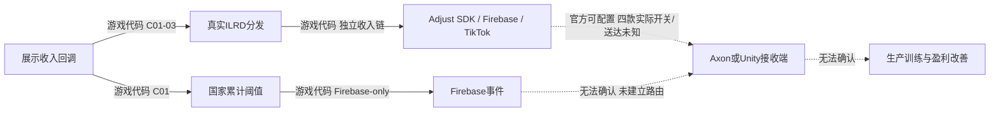
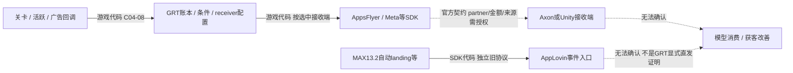
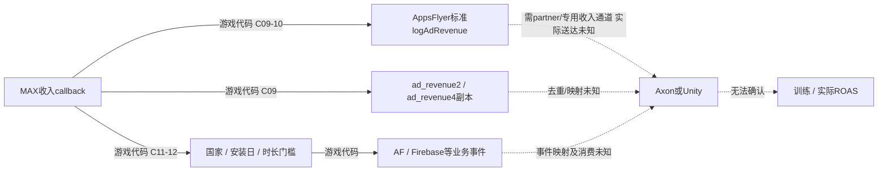

# 普通游戏盈利跃迁：最终机制判断与证据边界

2026-11-19 · 第64号最终综合。研究对象为Car Race、Meowdoku、Rotate Rings和Jewel Coloring的既有授权样本，以及AppLovin Axon/MAX与Unity Vector/LevelPlay的公开资料和SDK。Amaze GO!缺少可验证包体，不加入四款审计。

**最终判断：普通游戏即使不改玩法，也可能因为买到的玩家、获取价格、每名玩家的变现收益和预算分配改变而跨过盈亏线。现有研究证明了这些机制的部分技术入口与官方产品用途，但没有证明这四款游戏确因Axon或Vector获得盈利性扩量，也无法判断两家模型谁更强。**

本轮是00—63号证据的收束，没有新SDK扫描、公开架构广搜、生产请求或真实用户数据采集。下文“已证”只在标明的层级成立。原始来源URL、位置和重新核对的SHA256见[本轮证据目录](model-architecture/final64/SOURCE_CATALOG.md)与[机器可读账本](model-architecture/final64/SOURCE_LEDGER.json)。没有新增生产证据。

## 1. 读懂结论所需的最小技术背景

游戏既可以是**广告主**，付钱获取新玩家，也可以是**媒体**，向已有玩家展示广告赚钱。Axon和Vector的获客优化负责前者；MAX和LevelPlay的中介、竞价及展示收入回调主要负责后者。两者能通过真实收入反馈衔接，但接入变现SDK不等于启用获客投放。Exchange公开拍卖协议也不等于模型或预算控制器源码。[MA60S02/13、RV61S15/16]

**证据六层不可跳级：**①SDK具备能力；②游戏存在实际业务调用；③请求构造实现可追踪；④生产成功发送；⑤接收端确认接收；⑥进入指定生产训练/决策作业。官方产品声明另行记录，可以证明厂商明确披露某用途，不能代替目标游戏④—⑥的观测。本文所有四款游戏的④—⑥均未取得证据。[20号、49号、58号；F64C17/18]

符号约定：链路图实线表示**注明范围内的静态调用或官方契约**，虚线表示尚未连接的生产或因果环节；实线不表示已观测生产送达。安装后的收入只能作为历史样本标签，不能作为同一次安装前广告机会的已知特征；历史聚合、模型版本及个人历史都必须在该次bid发生前已合法可用。[56号、61—63号]

## 2. 统一因果框架：五条能改变单位经济的路径

| 机制 | 已证技术能力与四款实际调用 | 可配置但未证启用的反馈；未知模型消费 | 可能改变什么 | 最强竞争性解释及可推翻证据 |
|---|---|---|---|---|
| **M1 玩家价值排序改善** | 【官方公开证实】Axon按广告主展示价值/return goal出价；Vector预测D7/D28收入、动态竞价。【游戏代码证实】四款产生收入/参与信号，但未证被上述模型消费 | MMP partner、事件/收入映射、来源范围；逐条接收、特征join、校准、训练和真实排序增益未知 | 买入cohort的成熟LTV、CPI、赢标率；预测更高也可能只令出价更贵 | M4变现提高或M5库存/素材变化。固定素材、国家、库存、预算、变现策略后，价值排序无校准/尾部识别/成熟贡献增益，才会削弱该解释；单次无显著不是证明不存在 |
| **M2 同App自然量/跨渠道历史帮助冷启动** | 【官方公开证实】Unity要求预启动至少两周SDK+未归因postback帮助训练；AppLovin有all-source/organic契约及自愿数据用途。四款MMP入口已证 | 四款全来源授权、开始共享时间、历史可用窗口、实际样本和权重未知；Lifetime不等于补发全部历史 | 冷启动等待、早期校准、低效探索成本；自然量分布差异也可能负迁移 | M3共享先验或素材改善。授权开关/投递记录证明当期没有同App历史共享，可排除“这一路输入解释该活动”；合法holdout才可测增量 |
| **M3 跨游戏聚合知识/模型迁移** | 【官方公开证实】Vector称cross-game patterns、aggregate cohort insights用于bid-time区分玩家；Axon称更多广告主数据帮助模型。【无法确认】具体共享参数或个人历史实现 | B聚合、C共享参数、D个人历史不能混为一谈；四款没有明确生产训练连接 | 新游戏/稀疏数据下的初始先验和样本效率；不保证迁移有效 | M2同App样本已足够。生产数据血缘/模型契约明确不含跨游戏统计和共享权重可排除对应实现；仅关个人ID不能排除B/C |
| **M4 MAX/LevelPlay变现收益提高** | 【SDK代码证实】多网络signal/请求、竞价与回调；【游戏代码证实】四款MAX相关展示收益入口。不能把独立LevelPlay包能力写成四款接入事实 | 真实需求竞争、底价/瀑布/频控生效、填充和价格收益、同类用户留存未知；不是Axon/Vector训练已证 | 同类玩家eCPM、填充/展示率、净ARPDAU与净LTV；多广告可能损伤留存 | M1买来更值钱的人。固定获客cohort的随机变现组若净LTV无改善或留存损失抵消，则反驳“变现足以解释利润”的版本 |
| **M5 素材、国家、预算、目标或归因变化** | 【官方公开证实】目标、国家与预算影响交付；四款有不同业务规则，但没有其campaign变更日志或成本收益 | 活动/素材/地域实际启用和归因窗口未知；报表改进不等于新增净收益 | 点击/安装率、CPI、cohort结构、规模、报表ROAS；口径变化可能只改归因 | M1模型本身改善。日志/锁定配置可排除已固定项；固定归因口径、独立收入对账及随机/地域holdout可排除纯归因重分配 |

表中机制为【合理推断/竞争性解释】，能力锚点为MA60S01/02/04/13/14/17、CT62S08、RV61S05/06/15/16；游戏事实见下一节。**没有为任何机制分配四款增长的因果贡献。**逐游戏×五机制的25行总表见[FINAL_CAUSAL_MATRIX.csv](model-architecture/FINAL_CAUSAL_MATRIX.csv)。实验属于建议，未执行。

### 哪些完全不需要跨App个人身份图谱

- **M2同App全来源学习**可用该App安装/事件与合法归因契约，不必知道某人在其他游戏的终身轨迹。仍需准确的同App事件关联和合法用途。
- **M3聚合统计与共享模型参数**在理论上可只共享cohort先验/参数，不在bid时查询个人跨App历史；但公开材料未唯一识别实际实现，也不能用“聚合”规避原始数据授权。
- **M4变现优化、M5素材/国家/预算优化**均可基于广告位、上下文和聚合结果工作。
- **M1更好的价值排序**可依靠上下文、创意/应用特征、同App历史训练和共享先验改善；个人级跨App历史是可能的额外输入，不是逻辑前提。

【合理推断】上述说明“不依赖D也可成立”，不证明无ID系统能达到两家当前生产效果。【官方公开证实】广告同意与用途限制有效；Axon还明确排除竞争者bid/user数据，Ad Review不供给Axon。不能由中介可见信息推断无限训练权。[MA60S02/23、CT62S11；62号]

## 3. 四款逐案审计：能证到哪里

以下均是既有样本的静态事实，不代表全部历史版本、当前线上配置或实际网络送达。完整逐案审计、会计风险、竞争解释和最小补证清单见[FOUR_GAME_VERDICTS.md](model-architecture/FOUR_GAME_VERDICTS.md)。

### 3.1 Car Race：真实ILRD与国家阈值并存，阈值为Firebase-only

【游戏代码证实】样本1.348.2/MAX13.6.4。`IAAController.OnAdRevenuePaidEvent` RVA **0x24401f8**只处理正收益，更新总收入与缓存；US/T1/T2/T3默认门槛$0.50/$0.30/$0.20/$0.03，达标发Firebase `taichi_*`，value为**本次完整缓存实际金额**后清零。另一独立展示收益链交Adjust/Firebase/TikTok；关卡、会话及前5次激励等是行为信号。默认可被远程覆盖，设备国家不等于投放国家。[F64C01—03；C04—C06；03号]

**最有支持的解释：**开发者确实生成真实收益和可解释门槛，具备价值反馈基础；M1/M2是可配置的获客解释，M4是独立变现解释，三者均无因果归属。**不能证明：**国家阈值已送Axon/Vector；通用MAX/Metica `trackEvent`桥被具体业务事件调用；真实获客成本、成熟净LTV、盈利扩量。IAP schema/API不构成真实成交账本。[20号；F64C17/18；02号]

**最小补证：**Adjust实际partner/收入映射和投递记录；阈值/ILRD分账及远程生效版本；同campaign成熟成本收益与接入/素材/变现变更日志。若没有阈值外发映射，应停止将`taichi`解释为两家训练输入。

### 3.2 Meowdoku：时间窗参与代理与GRT配置路由

【游戏代码证实】样本1.25.1/MAX13.2.0/GRT1.3.2.0。Godot `tracker.gd`产生关卡/会话/广告及订阅漏斗；GRT支持安装时间窗、关卡/活跃、来源/国家/安装年龄过滤，再经`BridgeManager.sendEvent`到所选AF/Meta等接收端。`LTVManager.increaseLTV`只把已实现收入加进本地`sp_key_ltv`，不是预测未来。`IaaFbRoasEvent`可按`LTV-lastReportLTV`增量，另有累计和once规则；不能据类名判定生产全开。[F64C04—08；M01—M05]

**最有支持的解释：**早期参与代理与配置化价值分发确实存在，可能提高可用信号密度。**不能证明：**代理具有超出D0真实收入/广告次数的独立预测力；当前国家美元门槛、上线接收端、两家训练目标、真实购买/订阅结算与盈利。MAX13.2没有新版结构化Axon分支，但这不排除旧事件或MMP服务端路径。[03/20/22/49号]

**最小补证：**当前GRT生效JSON/版本和接收端列表；AF收入/代理事件对账与partner投递；成熟D28数据中比较D0行为、D0收入及新增GRT特征。自然量共享开关存在不等于当前活动已借此冷启动。

### 3.3 Rotate Rings：标准真实ILRD、重复副本与国家×安装日门槛

【游戏代码证实】样本1.2.4/MAX13.6.2/AF6.17.5。`SDKManager.handleAdRevenue`→`g8.a.adRevenue`构造`AFAdRevenueData(network, APPLOVIN_MAX, USD, d)`，还发`ad_revenue2`和`ad_revenue4`。国家×day0—6规则比较**实际累计收益R**与门槛`T(country,day)`，R>T且当日未报才送value=R；其他组合含美国首日时长≥900秒与非banner收益≥$0.45。`pltv`命名不证明未来收入预测。[F64C09—12；R02—R06；49号]

**最有支持的解释：**四款中这条标准AF收入赋值非常直接，且开发者明显区分早期资格；这是可利用反馈，不是反馈已成功。**不能证明：**三路是否被同一后台重复计算、国家门槛来自真实CPI、跨日累计value是新增收入、Axon/Vector实际优化它，或何种IAP净收入。标准枚举`APPLOVIN_MAX`代表变现来源，不证明AppLovin买量。[F64C09—12]

**最小补证：**三个收入名称的partner映射、幂等规则/投递样本；国家门槛生效版本；逐展示经济事件与跨日累计值分账；同国家成熟cohort真实成本收益。

### 3.4 Jewel Coloring：AdWorth是规则化代理价值系统，不是已证LTV模型

【游戏代码证实】样本1.24.1/MAX13.6.3。Bulldog内AdWorth包内恢复90条默认规则与31张权重表；行为系数、插屏次数/关卡/时长与广告价值账本，经条件树路由Firebase/Meta/Adjust。`AWESendPlatform::sendMsgToPlatform` RVA **0x1a44350**调用后更新本地发送状态；`AWEWorthUpdate::getBeSentWorth` RVA **0x1a3dc50**输出normal/interval/x100等不同口径。默认514把广告价值映射Meta `logPurchase(USD,value)`，**不是用户IAP订单**。来源权重和国家条件代码有能力，但默认90规则未引用来源表且未用直接国家条件，线上热更未知。[F64C13—16/19；09号D01—D07]

**最有支持的解释：**开发者自定义早期价值筛选/分发比单纯原始事件更复杂；尚未验证复杂性带来成熟LTV增量。**不能证明：**AdWorth直接送MAX EventService；Meta代理purchase是实际购买；来源倍率生产启用；独立机器学习预测未来；由这些规则造成盈利增长。广告价格/回退估计必须与真实结算IAA分开。[09/10/20号]

**最小补证：**实际热更版本、规则×接收端和输出单位；广告展示价格/ILRD/估计回退的precision及对账；Adjust映射/投递与Meta代理分账；成熟收入下的代理消融。无需先获取跨App个人ID。

### 四款共同的硬边界

【无法确认】既有研究没有取得其可核验的Axon/Vector实际投放成本及成熟净收益，也没有目标campaign、训练血缘或授权对照实验。四款均有MAX SDK生命周期自动事件；**未建立具体关卡/GRT/AdWorth/收入规则→MAX EventService→结构化Axon协议的完整显式业务链**。MMP转发是另一路，不因未发现MAX直发而消失，也不因官方支持而自动成立。[F64C17/18；20/22/49/58号]

【无法确认】没有可用的四款实际IAP验单/退款/净额账本。购买API、schema、订阅按钮或代理purchase均不能填补此缺口。没有可靠证据证明它们的价值机制必须依赖跨App个人图谱；也不能从客户端未找到图谱就证明服务端没有。[02/08/09/55号]

## 4. 盈利跃迁的数学与因果边界

**本节公式是独立会计定义与合成示例，不是两家报价公式，不是四款盈利结果。**对同一安装cohort和时间窗口W：

`净LTV_W = 每安装可归属且去重的IAA净收入 + IAP净收入 − 退款/税费/平台费等未提前扣除项`

`每安装贡献_W = 净LTV_W − 实际获客支出/安装数 − 其他每安装可变成本`

不同报表可能将部分费用已净额化，必须记录口径、避免二次扣费；固定成本、现金到账和W之后收入另计。所谓D28 LTV只是28天累计，不是完整终身价值。[61/63号；MA60S10、RV61S03]

| 容易混淆的量 | 最终边界 |
|---|---|
| 预测LTV vs 真实净LTV | 前者是估计，可能误校准；后者需成熟经济事件和对账。预测高不保证收入兑现 |
| 目标ROAS vs 实际ROAS | 前者是控制输入，后者是同口径窗口收入/真实支出，不保证达到目标，也不自动等于利润 |
| 平均ROAS vs 边际扩量ROAS | 存量cohort赚钱不保证下一档预算赚钱；考察Δ净收益/Δ支出及其不确定性，不能只看整体均值 |
| 广告主CPI vs 交易所CPM | 计费层与对象不同；CPM报价、发布者ILRD和广告主每安装成本之间有安装率、费用/结算等边界 |
| 归因收入 vs 增量收入 | 归因分配功劳，不证明用户没广告就不会产生收入；自然量训练数据不能计为该渠道新增回报 |
| 变现改善 vs 获客质量改善 | 前者提高同类玩家收入；后者改变买来的人。两者都能涨LTV，需固定另一侧或因子实验 |
| 大规模投放 vs 盈利 | 花费/安装增长不证明成熟净收益覆盖成本；现金回本还受到账周期与投放先付影响 |

**独立合成例（美元）：**原CPI=0.60、净D28 LTV=0.54、其他可变成本=0，贡献=-0.06。玩法不变：①玩家选择更好让LTV到0.66且CPI仍0.60，贡献+0.06；②LTV仍0.54但CPI到0.48，亦+0.06；③同样玩家由变现改善使LTV到0.66，也会+0.06。观察到+0.06本身无法区分三者。若只是模型把0.54预测为0.66，实际收入没变，贡献仍-0.06。

**扩量反例：**原1000安装、CPI0.60、净LTV0.66，贡献+60；新增1000安装、CPI0.75、净LTV0.60，新增贡献-150，总贡献变-90。规模翻倍不保证盈利。全部是合成算术，既未模拟平台真实精度，也未用于证明四款结果。

**因果标准：**固定或记录素材、国家、库存/隐私覆盖、应用版本、广告策略、目标、预算、归因/收入口径与成熟度；随机/可识别holdout再比较净贡献。前后同时换SDK、素材、目标和国家的一条曲线不足以归因。无全机会日志/选择概率时，不声称离线回放有因果ROAS；无授权真实样本时不报告模型召回、精度或消融增益。[56_数据资产审计；63号；MA60S27]

## 5. Axon与Vector分别可以下什么结论

| 层级 | Axon / AppLovin | Vector / Unity |
|---|---|---|
| A 官方明确能力 | 【官方公开证实】持续使用允许的设备/互动、自身胜负及广告主自愿数据训练；按广告主展示价值/return goal出价；未来多日价值分布为官方措辞；IAA/IAP/Blended产品目标 | 【官方公开证实】D7/D28 IAA/IAP/Hybrid收入目标；国家ROAS动态出价；预启动同App全来源数据帮助训练；cross-game patterns/aggregate cohort insights的bid-time用途；部分预算pacing行为 |
| B SDK/协议入口 | 【SDK代码证实】MAX收入回调、请求/signal及EventService旧/新协议、持久postback；【官方契约】MMP all-source/事件/收入共享 | 【SDK代码证实】Unity Ads Token/历史外层、LevelPlay信号、IAP Insights/Analytics各自通道；【官方契约】MMP收入/未归因共享。IAP/Analytics独立包不证明四款已使用同版本 |
| C 合理未证架构 | 【无法确认】单点/多阶段/显式分布可共存，分布措辞不能唯一选架构；共享表示、尾部损失、风险调价、shading未知 | 【无法确认】同游戏学习最直接；聚合用途有披露，但统计迁移/共享表示/个人历史贡献未拆开；共享网络、loss、精确controller未知 |
| D 缺生产材料 | 四款开关/投递/接收、canonical收入标签、训练集/serving特征与时间水位、出价/实验及成熟净收益 | 同左；另需Insights/Runtime字段到Vector训练用途的明确血缘，不能用同属Unity直接连线 |
| E 无法比较的优势 | 不能证明模型更准、数据更多、单位预算更赚钱或扩量更强 | 披露更具体不等于技术更强；不能用文章细节、SDK数量或增长财报替代同条件实验 |

依据：MA60S01/02/04/09/10/13/14/17/23、CT62S08/11、RV61S01/03/05/06；客户端原方法见20—22、49、53—58号。**Axon最有证据的优势轮廓**是把允许的互动/广告主价值反馈用于广告主特定的实时价值出价；**Vector最有证据的轮廓**是明确收入窗口、同App预启动学习和公开跨游戏聚合用途。它们是产品能力，不是相对优胜裁决。

不能由Axon“value distributions”补出每用户条件分布族/分位数/CVaR；也不能由Vector“cross-game”补出个人Embedding或统一账号图谱。参数共享、聚合迁移、个人历史、同App跨来源分别保留。[61—63号]

## 6. 如果只能取得三份授权材料

这里的“一份”指可独立回答一组问题的授权材料包，不要求原始个人ID。研究键只在授权项目/实验内有效，不请求GAID、手机号或跨应用自然人关联。

| 优先 | 材料包与最小字段 | 能补哪条边；仍不能证明什么 |
|---|---|---|
| **1. partner配置—投递—接收对账包** | 一款授权App的活动/来源共享开关、事件/收入映射与窗口、配置生效时间；去标识事件经济幂等键、事件/可用/发送/接收时间、币种/precision、归因标记、投递状态及接收ACK/错误码 | 区分游戏→MMP→指定网络是否真实送达、全来源是否开、重复和金额语义。MMP HTTP2xx也只证明相应入口确认，不证明后续训练消费 |
| **2. 成熟单位经济与受控实验包** | 同国家/平台/cohort至少完整D28及迟到宽限的支出/安装/留存、去重IAA和验单IAP/退款净额、素材/预算/目标/广告策略/归因变更；固定预算随机/地域holdout和分组规则 | 判断是否真盈利、边际扩量、变现与获客贡献及是否仅归因重分配。无可靠随机/识别条件时只能相关，不凭一张ROAS报表做因果 |
| **3. 平台授权训练—推断—决策血缘与消融包** | canonical label/零值/去重/成熟规则、特征来源/作用域/available_at、训练快照与模型版本/用途、允许的聚合/参数/个人历史边界；去标识bid样本预测输出、控制器/预算状态及固定数据/分数的受控消融 | 区分数据、模型与出价策略优势，识别共享知识还是个人历史、Axon输出是否显式分布。若只获schema而无作业关联/实验，仍不证明具体消费和增量 |

三包应尽量对同一App、时期和实验关联，否则只能分别证明碎片。第1+2包通常比更多客户端逆向先产生实际价值；第3包往往需要平台合作，不以未授权探测替代。

## 7. 达到公开资料上限的事项与停止条件

**现在停止：**重复SDK字段清单、把加密Token当已解特征、从native边界猜训练网络、用同包ID补server join、凭招聘/专利/案例唯一选架构、搜索相同文案试图证明四款盈利。00—63已充分暴露这些断点，本轮不再广搜。

**仍未知的五类核心事实：**①四款具体网络投放/事件映射/生产送达；②真实经济事件如何形成去重、成熟、处理退款的训练标签；③bid-time特征/合法join及B/C/D各自贡献；④预测输出如何经控制器/预算/探索成为报价；⑤同条件增量净收益与边际规模。公开客户端无法补齐服务器ACK之后的血缘，官方能力也不能补齐目标游戏启用状态。

**恢复条件：**取得上述三包之一且明确授权、出现可核验的具体生产技术文档/模型schema/字段用途契约，或有明确新增版本路径能补现有某条未知边。只因营销名称/收入增长/文章更多不恢复扫描。细则见[STOP_AND_RESUME_CRITERIA.md](model-architecture/STOP_AND_RESUME_CRITERIA.md)。

## 8. 给不熟悉前63号报告的读者的最终答案

1. **玩法不变也能过线：**买谁、花多少、同类玩家赚多少和预算投到哪里都会变。靠近盈亏线时有限真实改善即可改变贡献符号；必须与报表变化分开。
2. **不必先有跨App个人图谱：**同App全来源历史、上下文排序、聚合先验/参数共享、变现优化、素材/地域/预算优化都可在不查询个人跨App轨迹下成立。
3. **两家有证据的能力：**Axon公开连接允许数据、持续训练与广告主特定价值出价；Vector公开连接同App预启动样本、D7/D28收入和动态出价，并披露跨游戏聚合用途。没有同条件数据可判技术胜负。
4. **四款能证什么：**Car有真实ILRD与Firebase国家阈值；Meow有GRT早期参与/价值路由；Rotate有标准AF收入及国家安装日规则；Jewel有复杂AdWorth代理分发。均未证指定模型实际消费、真实投放盈利或增长因果。
5. **最值得取得的三包：**partner送达链、成熟净收益受控实验、训练推断决策血缘。先证收入真的发对，再证经济效果，最后辨模型原因。
6. **应停止什么：**用客户端字段继续猜闭源训练、跨游戏身份或四款盈利原因。保留未知边，等待授权生产材料；不用通用机器学习知识制造确定性。

结论等级：平台用途为【官方公开证实】；包内调用为【游戏代码证实/SDK代码证实】；经济解释与实验设计为【合理推断】；四款模型消费、真实导量及盈利贡献为【无法确认】。
