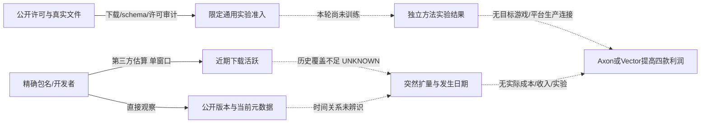

# 四款游戏公开扩量证据与价值预测实验可行性审计

2026-11-19 · 第65号。本轮更换方法：A线只看外部产品与扩量痕迹，B线只审计许可明确的公开实验数据；不做SDK逆向、泛化模型架构搜索或生产请求。

**结果：四款身份全部核验，四款都有近期下载量的第三方估算，但0款取得足以确定“突然扩量起点”的连续历史覆盖。9个候选中，3个数据发行物实际下载、许可可支持受限通用研究；0个满足手游真实D7/D28收入、跨游戏价值迁移或安装前价值排序的完整要求。E0/E1/E4仅LIMITED替代，E2/E3 STOP；没有原始手游实验获得GO。**

没有授权投放成本、成熟游戏cohort或平台训练数据。本轮不执行大规模或小规模模型训练，不报告模型增益、真实ROAS或两家平台相对优胜；停止于65号审计。

## 1. 身份消歧与版本时间：四款均可可靠对应

| 游戏 / 精确包名 | 当前Play开发者 | 既有APK证据 | 当前版本/更新字段 |
|---|---|---|---|
| Car Race / `com.dino.race.master` | iKame Games - Zego Studio | 原版1.348.2 / MAX13.6.4 | AppBrain称1.349.0/11-04；当前Play更新11-12；不能强行视为同次发布 |
| Meowdoku: Brain Puzzle Games / `com.oakever.meowdoku` | Oakever Games | 1.25.1 / MAX13.2.0 | AppBrain仍1.25.0/11-13；Play11-16，保留目录滞后/分区等未知 |
| Rotate Rings / `com.nebula.rotaterings` | Nebula Studio（原页双空格） | 1.2.2与1.2.4，同签名旧证据；新版MAX13.6.2 | AppBrain1.2.4/11-16，Play11-16；日期一致也不证明实际用户覆盖 |
| Jewel Coloring / `color.number.paint.pixle.art.sort.jigsaw` | TaTa Game Technology Limited | 1.24.1 / MAX13.6.3 | AppBrain1.24.1/9-17，Play9-17 |

【直接观察】新Play JSON-LD的名称、author与包名URL；AppBrain canonical也含精确包名。既有样本SHA256/版本只复用[SAMPLE_CATALOG](SAMPLE_CATALOG.json)，不修改/重复下载APK。表内SDK是既有审计状态，不是本轮推定接入日期。[身份表](public-evidence/GAME_IDENTITY_REGISTRY.csv)、[原始来源目录](public-evidence/EXTERNAL_SOURCE_CATALOG.md)

**首次出现日期必须分层：**本地已核验公开商店观察可追至2026-11-18，并不代表实际首次上线。AppBrain称Car自2021-09、Meow自2026-04、Rotate自2026-07、Jewel自2026-02可用；这是【间接迹象】历史元数据声明，未独立核原始发布。当前“Updated on”也不是版本首发/SDK上线/远程规则生效日期。同名赛车、转环、猫谜题或填色产品一律不合并。

## 2. 外部扩量：出现了活动线索，尚未证明突然跃迁

| 游戏 | AppBrain累计估算 | AppBrain近30天估算 | 近30天占累计（派生比例） | 最终等级 |
|---|---:|---:|---:|---|
| Car Race | 3.8亿 | 360万 | 约0.95% | 【第三方估算】近期活跃；突然扩量UNKNOWN |
| Meowdoku | 3600万 | 930万 | 约25.8% | 【第三方估算】近期量较集中，值得追踪；突然扩量UNKNOWN |
| Rotate Rings | 1600万 | 850万 | 约53.1% | 【第三方估算】近期量最集中，值得追踪；突然扩量UNKNOWN |
| Jewel Coloring | 1400万 | 80万 | 约5.7% | 【第三方估算】近期活跃；突然扩量UNKNOWN |

原始来源：四个按包名跳转到canonical的AppBrain页面，采集2026-11-19；页面原文和response哈希、聚合元数据片段见[来源目录](public-evidence/EXTERNAL_SOURCE_CATALOG.md)。比例是四舍五入估算数的算术，不是独立观测，也不等于增长率。**不能将30天量/累计量解释成相对上月增长，或据此宣称四款都在突然扩量。**不确定区间、估算算法/数据截止水位未公开。

Google Play当前下载档位分别为100M+、10M+、10M+、10M+，属于【直接观察】商店累计门槛；不能与AppBrain估计混成日度数据。当前榜单/摘要不构成历史排名，也不代表付费投放国家或实际盈利。

### 实际覆盖与缺失

- **下载/排名：**本轮每款只取得一个页面快照和“last 30 days”总量，约对应观察前30天，但供应商准确起止水位未知。未取得前一相同窗口、逐日下载或连续国家榜单；AppBrain历史提示登录，停止。商店“自某月上线”的声明不是从该月起完整历史覆盖。
- **真实付费素材：**仍无同包名稳定creative ID＋广告主＋日期/地区的完整记录。复用旧研究的五款访问边界；本轮额外Google查询Rotate包名、Meta/TikTok查询Meow。Meta403，Google/TikTok为壳/通用页，无可核匹配，不声明穷尽全部平台或国家。
- **版本：**Rotate Aptoide公开API仍给1.2.2 added=2026-11-10 01:00:40，历史版本页403即停止；这是入库日期。既有1.2.2→1.2.4差分证明新增国家×安装日收入事件，AF/Firebase版本在该跨度仍相同；**没有生产生效日期，不能和滚动下载窗口建立因果顺序**。[05号](05_历史版本策略演进.md)
- **素材/国家/运营变化：**当前商店图文不能冒充历史付费素材。没有完整更新/实验/国家预算日志，无法确认重大运营变化或是哪一网络导量。

完整事件表（含UNKNOWN空日期和覆盖边界）见[EXTERNAL_UA_TIMELINES.csv](public-evidence/EXTERNAL_UA_TIMELINES.csv)。没有检索到广告≠没有投放，排名上升≠盈利，素材数量≠花费，估算下载≠真实归因安装。

## 3. 时间关系与四类竞争解释

每款均比较H1素材/市场、H2价值优化、H3变现/留存、H4归因/外部市场，见[逐案矩阵](public-evidence/COMPETING_EXPLANATIONS.md)。

**目前能支持的只有：**身份明确、当前近期量估算存在、部分版本元数据/代码发生变化。Rotate是唯一已有签名一致的原包历史差分案例，但缺增长变点和规则生效日，无法确定谁先谁后；Meow与Car当前目录/Play时间冲突进一步阻止强拼时间线。

**目前不能辨识：**下载来自新素材、自然传播、商店推荐、国家组合、预算扩大、收入目标，还是其他原因；不能据SDK接入或规则精细度判断Axon/Vector利润贡献。H1—H4均未获可区分的因果验证，也未整体被否定。

## 4. 公开数据：看到了真实文件，也看到了不能做什么

| 数据 | 许可/实际取得 | 有用之处 | 缺失的关键条件 |
|---|---|---|---|
| DS65-01 UCI Online Retail | CC BY4；实际下载ZIP并读541909行 | 真正的交易数量、GBP单价和时间，可做已观察客户未来7/28天发票金额 | 无游戏/安装/全访问零收入分母，无as-of到达时间、广告成本；不是手游LTV |
| DS65-03 Open Bandit官方仓库样本 | 官方项目Apache2，限该repo发行样本；实际10000曝光、38点击 | 有曝光时间、动作/位置及真实logging propensity，可研究点击策略OPE | 无安装、价格、收入或完整RTB机会；38点击不足支撑稳健效果结论 |
| DS65-04 KuaiRand-Pure | 实际47432272字节归档；包内CC BY-SA4 | 非货币行为/随机曝光，具时间和历史线索 | 一款视频App；无IAA/IAP/游戏ID/广告价格；静态统计as-of未证 |

这是**3个可用于限定研究的数据发行物，不是3个手游价值数据集**。许可均需按范围保留署名/版权、修改说明及适用再分发条件；不收集自然人身份或跨源匹配。KuaiRand门户写BY4，但归档LICENSE为BY-SA4，本轮保留包内较严格条款，不无条件放宽。

其余6个候选：Online Retail II与352同一商家并重叠、未重复下载；Criteo两集有NC限制且无手游真实价值，当前商业研发不擅自认作符合；iPinYou原地址超时且原数据许可未核；第三方mobile_games_LTV仅有数据声称、无核验原始出口和数据授权；Zenodo多游戏收入预测框架虽MIT代码可下，**README明确收入panel为不可再分发商业估计，发行物只有代码与公共事件日历**，不能拿摘要当真实数据。

【直接观察】UCI API声称无缺失，但实际CustomerID缺135080行；还存在5268完全相同行与退款/非正金额问题。OBD README的`action_prob`在实际CSV叫`propensity_score`。这些差异说明只读摘要/文档不足以准入。

逐候选必需字段、可下载状态、许可、零收入范围、价格、时间与成熟标签均见[DATASET_CATALOG.csv](public-experiments/DATASET_CATALOG.csv)及[许可审计](public-experiments/DATASET_LICENSE_AUDIT.md)。原发行物SHA256与结构统计见[audit](public-experiments/audit/ASSET_VERIFICATION.json)，未运行下载包代码。

## 5. E0—E4准入结论

| 实验 | 状态 | 现在允许的受限问题 | 必须停止的原目标 |
|---|---|---|---|
| E0 安装前上下文 | **LIMITED** | OBD曝光上下文→点击，时间/动作支持审计后仅通用方法 | 安装概率、安装前真实D28价值排序；没有安装/收入标签 |
| E1 同App历史价值 | **LIMITED** | UCI已观察零售客户→landmark后7/28天发票金额 | 手游全安装IAA/IAP D7/D28价值，未买者/未安装分母不能补造 |
| E2 跨游戏聚合先验 | **STOP** | 无 | 无多游戏真实价值cohort；不得把国家/视频/广告campaign当game_id |
| E3 跨游戏共享模型 | **STOP** | 无 | 无多游戏收入/适配样本；两游戏公共日历不是收入panel |
| E4 固定分数预算/报价 | **LIMITED** | OBD固定分数的点击策略IPS/SNIPS等OPE，满足支持假设才算 | 无真实价格/机会/收入，不报告货币预算、真实/因果竞价ROAS或利润 |

**原始手游问题全部未通过GO。**LIMITED表示问题已经缩小到别的、可解释的研究场景，不代表原问题“差一点就验证”。模型本轮尚未训练，表中允许指标不是已产生结果。[准入矩阵](public-experiments/EXPERIMENT_ADMISSION_MATRIX.csv)

## 6. 下一轮可执行方案与优先级

[实验协议](public-experiments/EXPERIMENT_PROTOCOL.md)已定义时间外切分、28天标签成熟/隔离、同数据量/训练预算、零值/长尾校准、国家层及bootstrap；OBD限定单位置/动作支持和稀疏点击，不能把边际propensity当联合slate概率。available_at普遍缺失，不能认证生产bid-time。

**下一轮最值得先做外部线的有界补证：Rotate，其次Meow。**它们有较高近期下载集中度，Rotate另有可核历史版本变化。只寻找合法公开、精确包名、至少前后各4周的同口径历史量/排名及日期化素材；没有覆盖或遇登录即停，不重复SDK或架构搜索。若只能未来连续采样，应明确它只建立未来基线，不能重建此前扩量。

**若选择66号方法实验：**E1零售未来发票金额是现有最贴近真实“金额预测”的限定任务；E4点击OPE可检验评估纪律，但不是预算/ROAS。二者只能验证通用机制，不能证明跨游戏迁移、身份增益或Axon/Vector生产效果。E2/E3与真实竞价利润等待合格公开或授权游戏/机会数据，不用合成panel填结果。

## 7. 两条独立证据链与最终回答

1. **可可靠追踪几款？**身份/当前快照4/4；已证突然扩量起点0/4。Meow/Rotate有值得追的估算集中度线索，不能升格付费扩量。
2. **多少真正可用数据集？**3个已下载且许可支持限定通用研究；满足本项目完整手游价值/多游戏迁移/安装前价值问题的0个。代码包、链接或论文声称不计入。
3. **E0—E4？**LIMITED、LIMITED、STOP、STOP、LIMITED；无原目标GO，无真实ROAS或平台增益结果。
4. **下一轮投入？**优先有界补Rotate/Meow公开历史覆盖；若不可得即停止扩量因果深挖。可另选E1做独立金额预测方法验证，必须接受它不能回答四款盈利原因。

停止细则见[STOP_CONDITIONS](public-evidence/STOP_CONDITIONS.md)。00—64与原关系对象保留；仅追加本轮观察、准入与未知连接。商业许可、完整标签和服务端生产断点没有因公开数据出现而消失。
