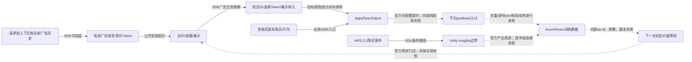

# Axon / Vector：训练与竞价的数据连接证据

2026-11-20。本轮以60—63、53—59号的原文和代码为起点，只补字段时序、公开数据可得性和明确反证。**没有新增逐事件生产接收、训练集列血缘或真实平台消融证据，不能声称恢复内部模型。**

## Axon：最强可证连接及排除项

【官方公开证实】AppLovin《About AppLovin’s Axon AI》直接说明模型持续训练/优化，使用设备与网络信息、应用/广告/其他数字属性互动、MAX赢输通知，以及广告主选择共享的自有数据；按该广告主的展示价值出价。官方同时明确排除敏感个人信息、竞争者报价和竞争者用户数据。复用CGS51/S01/S24：nongame/applovin-axon-about.txt:L54—73，原URL及SHA256在[REUSED_EVIDENCE](game-industry69/REUSED_EVIDENCE.json)。

MAX请求里出现某网络名称/胜负统计，不允许推断Axon取得竞争者全部出价或私有用户历史。广告主选择共享的数据与“自动抓到所有游戏自然量”也不是一回事。AppsFlyer/Adjust的all-source/organic、事件mapping、收入开关证明可配置入口；未证明四款游戏开启及平台接收，更没有字段级模型消费表。CGS49/50/52。

【官方公开证实】AppLovin商业模型文章原文称Axon2预测未来多日expected value distributions并用于实时资本配置；MA60S01：model-architecture/public/al-business.txt:L31—34。该段重点解释游戏用户对电商/订阅等非游戏offer的价值评估，不能机械推广成每个手游目标具有相同预测头。没有公开分布族、标签成熟作业、损失函数、模型参数或风险调整报价公式。

【SDK代码证实】MAX广告前的context/signal、广告后的事件与持久队列路径已证。EventService能力和默认事件表不能升级成原游戏显式向Axon发送了所有行为/价值。四游戏业务边仍以20—22、49为准，未新增其直接发送Axon自定义价值事件的生产证据。

## Vector：同App预启动历史与跨游戏知识

【官方公开证实】Unity ROAS best practices明确建议活动前至少两周提供Unity SDK额外数据及相应unattributed post-install postback，帮助训练、改善初始预测和缩短学习；不计入学习阈值。Attributed/unattributed/organic、purchase/ad_revenue值与窗口有具体要求。CGS42/43/47/48；原文见vector/doc-roas-campaign-best-practices.txt:L36—70及其来源URL。

这里未归因给Unity可包括其他广告网络与自然量，不代表“没有归因”，更不代表把其安装算成Unity投放成果。共享要由广告主与MMP配置且符合授权/隐私；Lifetime postback窗口不是能任意回填SDK集成前全部历史的证明。

【官方公开证实】Unity文章[D7 vs D28 IAP ROAS campaigns](https://unity.com/blog/d7-vs-d28-iap-roas-campaigns)（2026-06-25）写：

> “It uses both attributed data and unattributed data, like cross-game behavioral patterns and aggregate cohort insights, to distinguish between these player types at the moment of bid decision.”

MA60S17/CT62S02；model-architecture/public/unity-d7-d28.txt:L208—223，SHA256 `9aca03187f001a9cdfcbb4e4386d8e81b66791007dd571e55f90cb68d271688a`。这是明确的官方bid-time用途说明，但不区分聚合先验、共享模型参数或个人跨游戏历史分别贡献多少。原文的付费时间分布统计不是对这些特征的因果消融。

【官方公开证实】IAP/D2C购买数据帮助丰富Vector的产品用途声明已有S21；【SDK代码证实】IAP5.5.1→Insights的protobuf、身份门控、gateway/native分支见53—55。**这两段之间仍缺：producer具体字段→接收/标准化→训练dataset列→模型版本的授权服务端血缘。** UGS Analytics collect、Unity Ads gateway与Insights不能混成同一个接收接口。

【无法确认】LevelPlay每项ILRD/竞价字段被Vector哪个训练任务实际使用、何时可用、权重如何、是否与IAP事件去重、某目标App后台开关及真实效果。LevelPlay/Unity Ads隶属同生态不够证明每个用户事件默认进入Vector。

## 四种机制保持分离

| 机制 | Axon证据 | Vector证据 | 是否必须跨App个人ID |
|---|---|---|---|
| A 同一目标App自然量/跨渠道历史 | 自愿共享与all-source契约；具体预启动消费未知 | 官方明确预启动数据训练建议与共享配置 | 不必；但同App事件仍需合法的安装/收入关联契约 |
| B 跨游戏聚合cohort/相似产品先验 | 公开材料相容，具体生产路径未确认 | 官方明确aggregate cohort insights，但粒度与权重未知 | 不必 |
| C 跨游戏共享参数/表示/迁移 | 架构可能性；没有明确生产参数共享契约 | 跨游戏模式文案相容；不能据此确定embedding/共享参数实现 | 不必个人联结，产品局部匿名样本也可能共享规律 |
| D 合法跨游戏个人历史 | 标识与互动类别提供能力线索；生产身份join/特征消费未知 | 可选标识与跨游戏文案不足以恢复个人join；具体实现未知 | 定义上需要合法个人关联；不是A/B/C成立的必要前提 |

Unity历史交易研究**明确跨游戏不能关联个人**，这是对那份研究数据的实际限制；不能倒推Unity所有广告产品都绝无跨应用数据，也不能从当前IAP/Ads同包ID否定论文的匿名化边界。Uken一次摘要字段同样不能证明有跨游戏个人图谱。

## 安装前特征和安装后标签如何连接

不同证据等级不能连起来自动变成一条全已证生产链。接收接口存在、同包ID、请求ID、展示回调、收入累加与模型消费是不同结论。下一次机会使用已到达历史，不允许同次机会使用未来安装后的收入。

## 新增连接与仍须停止的位置

本轮新增明确关联片段：Unity operative event的eventId与impressionOpportunityId/trackingToken分别赋值，随后进入持久工作项；AppsFlyer收入四字段与Adjust收入参数写包重核。它们细化已有客户端边，不是新增恢复闭源特征库、训练接口或平台投放事实。

真正新增的强反证：Unity交易原数据只在内部、不可由作者共享，且跨游戏用户不关联；公开R样本为合成；Uken参与者明确无再分发权限；MAG原始数据身份尚未匹配。这些足以阻止把公开文献样本当作现成真实训练集。

现阶段最值得寻找的是**授权的数据消费契约**与真实游戏cohort，不是更多相同SDK字段。跨游戏共享规律不必依赖个人图谱，理论上足以帮助冷启动；现有资料仍不能量化其独立增益或比较Axon/Vector优劣。
