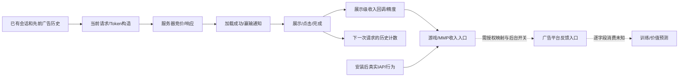

# 广告请求前输入、展示后收入与归因：字段时间线

2026-11-20。复用20—59、63号已核验实现，新增少量精确片段审计，不重复下载SDK。**客户端可以证明字段赋值/构造和条件；不能证明生产送达、身份匹配或模型训练消费。**

完整24行字段表含来源、生成时间、序列化、接收方、隐私/触发、证据ID与未知：[CSV](game-industry69/SDK_FIELD_TIMELINE.csv) / [JSON](game-industry69/SDK_FIELD_TIMELINE.json)。复用代码/文档220条逐文件重算哈希：[REUSED_EVIDENCE](game-industry69/REUSED_EVIDENCE.json)；这不是220条新增发现。5条新片段：[CODE_EVIDENCE](game-industry69/CODE_EVIDENCE.json)。原包版本/哈希沿用cross-sdk/SDK_MATRIX.json和各官方包provenance。

## 统一时序：必须分清“当前广告”与“下一次广告”

实线是可核验客户端或协议阶段关系，不表示本次真实生产发送。展示计数/收入属于已发生广告后，却可能在下一次广告前已知；绝不能把当前广告的未来收入提前当成其已知输入。来自另一广告主游戏的未来D28收入更不能倒灌成安装前特征。

## MAX：广告前能看到什么

【SDK代码证实】MAX13.6.4 `a6.g/i/run`将collector/context、适配器`signal_data`及可选mediation_stats写入私有请求并调度。原位置CGS32/33：client-growth/java/max-1364/com/applovin/impl/a6.java:L103/L164。`a6.ad_info/user_data`还可含先前请求、先前加载/赢家网络、队列信息与受控用户数据，CGS34:L221—268。

`MediationServiceImpl.collectSignal`→网络适配器→signal回调，缓存/初始化/超时有独立条件；`g5`按TTL和格式/广告位范围缓存，过期不复用。Google QueryInfo与Unity Token内部内容不能从外层字符串直接还原成模型特征。CGS23—31含类、行号、源码SHA256；MAX Unity适配器只观察到传格式，不能因此补上未赋值的placement等可选项。

【SDK代码证实】`ars/ar/ttdasi_ms`有会话/安装范围和默认开关；其中计数加1不是美元收入。umsm默认false，生产远程配置未知。已有广告会话历史不等于所有App、关卡、IAP或跨游戏个人历史。MAX作为中介产生/收集请求，也不等于Axon已经消费每项请求字段训练。

## Unity Ads与LevelPlay：信号/Token和竞价响应

【SDK代码证实】Unity Ads4.17.0 `AndroidBuildHeaderBiddingToken.invoke`读clientInfo、timestamps、session/limited token、静态/动态设备、pii/TCF、可选格式/广告位、中介参数、token wins/starts/sequence和campaignState；`CommonGetHeaderBiddingToken`将protobuf转base64并加版本前缀。4.18.1所选反编译路径确认同类外层字段，不证明所有实现相同。CGS01/02/22。

`AndroidGetAdRequest.invoke`还写机会ID、placement、会话计数、campaignState和TCF，CGS21。campaignState按opportunity组织、可移除，部分data/dataVersion由广告播放器opaque数据赋值；不是已解码完整用户行为。CGS04/06/07/08。

`AllowedPii`/平台返回状态决定广告ID、App Set ID、Firebase Analytics App Instance ID能否序列化。**FId桥调用getAppInstanceId，不能改写成FirebaseInstallations.getId。** 缓存getter可预热，序列化受门控不等于此前getter一定没执行。CGS09—16。

【SDK代码证实】LevelPlay9.5的`q3/g2/Q1`执行网络级token/bidding map并保留失败/超时；9.4的`q2`解析price、adMarkup、serverData、loadTimeout及通知字段。接收竞价价格与展示收入是不同阶段；未完整解码每个provider的opaque信号，CGS39—41、LP-response-notices。

## 收入、广告来源及展示关联

| 数据 | 实际产生/可见时间 | 字段/接收方及证据 | 限制 |
|---|---|---|---|
| MAX price/revenue metadata | 价格或预估可随响应/加载到达；有效收入回调属于展示生命周期 | `c3.getRevenue/getRevenuePrecision`，MAX-revenue-response；返回值可0/-1 | 不可笼统说所有revenue字段“只在展示后生成”；预估价不等于已实现展示收入 |
| MAX ILRD回调 | 对已发生展示回调 | MaxAd收入、precision、network、ad unit/creative供游戏使用 | 保留exact/estimated/publisher_defined；不等于银行结算净额 |
| LevelPlay metadata/ILRD | auction/load与展示回调分别处理 | `LevelPlayAdInfo.getAuctionId/getAdNetwork/getRevenue/getPrecision`；9.3/9.4/9.5所选API代码 | getter只证能力，不能代替回调实际触发/四游戏启用证据 |
| 赢标/展示/点击通知 | 拍卖/加载/渲染/互动不同时间 | OpenRTB request id/impid与nurl/lurl/burl/imptracker | nurl不等于收费展示；多个tracker不应多次计账 |
| Unity operative event | 调用时构造，内容随播放器事件而定 | `GetOperativeEventRequest.invoke`：eventId、opportunityId、trackingToken、type、additionalData、sid；GI69C01 | 关联字段可证；additionalData内容与具体事件类型仍需实际caller证据，不把它当美元收入 |
| Unity operative queue | repository有事件后 | `OperativeEventObserver.invoke`→UniversalRequest→persisted job，异常fallback；GI69C02 | 只证实现；重试、清缓存或回调完成不代表本次生产成功接收 |

## MMP、Firebase、IAP和代理值

【游戏代码证实】Rotate原`g8.a`（rotate-rings/static/java/classes2.dex/g8/a.java:L100—126，XS43）将double收入构成`AFAdRevenueData(network, APPLOVIN_MAX, USD, d)`并调用logAdRevenue；另外发ad_revenue2、ad_revenue4。不能把三路相加为三份收入。AppsFlyer6.17.5构造器四字段见GI69C03；后台是否向Unity/AppLovin转发及去重未知。

【SDK代码证实】Adjust5.8.1 `AdjustAdRevenue`写revenue/currency/network/unit/placement；PackageBuilder写`ad_impressions_count/ad_revenue_network/ad_revenue_unit/ad_revenue_placement`等，GI69C04/05。是MMP包，不是MAX直发Axon；实际业务版本仍按Car5.5/Jewel5.7原链，不用5.8.1替换其版本事实。

【官方公开证实】AppsFlyer/Adjust到广告平台的partner启用、事件mapping、收入共享、all-source/organic及窗口有独立配置。装有SDK不证明后台开关。Unity `was_conversion_attributed`区分Unity归因与非Unity归因；organic和其他网络用户可属后者，而不是MMP完全无法归因。CGS43—50。

Car真实ILRD与Firebase/Adjust、Meow GRT路由、Rotate上述收入和规则、Jewel AdWorth的业务链复用49号。GRT/AdWorth、阈值value、广告发奖、关卡、预测LTV不是实际IAP/IAA金额。Firebase事件可能记录内部规则，不能自动画成MAX EventService或Vector直达。

Unity IAP5.5.1 paid/fulfilled、订单ID、商品metadata PriceMicro与可选身份→Insights gateway/Runtime，已由53—55核验。paid+fulfilled不能重复计交易；PriceMicro来自metadata，非必然实付/净收入。IAP购买旅程ImpressionId也不是广告展示ID。**旧Unity交易论文的数据来源不能由此最新版代码倒推。**

## SKAN与AdAttributionKit：归因回传不是实时竞价输入

本轮新增Apple公开Markdown原件GI69S_apple_aa/sk。网络注册/签名广告及发布应用的广告上下文可以在展示前存在；安装/再互动后由目标App更新conversion value，系统按窗口与隐私tier回传，开发者可选择副本。原文明确不含用户/设备专属数据；细节可受阈值抑制。

`did-win`是**归因赢家**，不是RTB拍卖赢家。fine/coarse转换码不能直接当逐笔完整金额。它与MMP确定性用户事件、SDK广告生命周期是三种不同链。本轮以Apple官方契约为证，未新增四款iOS游戏实际调用证据；Android静态包不能证明其iOS接入或平台收到postback。

## 远程控制与六层证据

MAX axon_events过滤、Unity响应allowedPii/session/privacy更新、IAP远程ID允许列表和Firebase RC/ABT分别决定客户端行为；版本差分按51/55记录。IAP5.5.1 Firebase Session序列化修复不等于新增跨游戏身份图谱，配置schema不是模型版本。

本轮新增片段层级：SDK能力/请求构造代码可证；四款游戏新业务调用未新增；生产成功发送、服务端接收、字段进入训练均UNKNOWN。所有表格“已知接收方”指代码或文档指定入口，**不是生产实收日志**。只有授权的事件接收/去重/数据集列血缘材料才能继续补齐。
