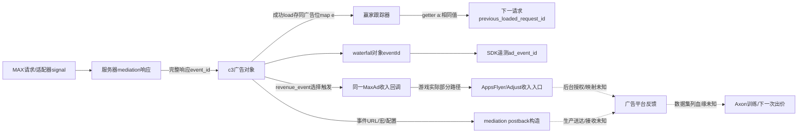

# 70号：Axon / MAX竞价数据闭环补证

2026-11-20。**新增静态关联证据：MAX成功加载响应中的event_id，经广告位范围的赢家跟踪器进入下一次请求的previous_loaded_request_id；同一个广告对象也被传给可配置收入回调。** 这补齐客户端反馈关联，不证明Axon训练消费或四款游戏真实投放。

另一个重要补充：MAX13.6.4除raw/viewability/adapter impression三个收入触发分支，还存在**click条件收入回调**和**load条件内部处理**。不能把所有收入回调都当作同一种展示时间；load内部调用也不能升级成已经给开发者发了收入回调。

## 新增关系链及原始位置

完整版本、源码SHA256、原包AAR SHA256/来源、触发条件和片段在[CODE_EVIDENCE](closure70/CODE_EVIDENCE.json)，索引在[SOURCE_CATALOG](closure70/SOURCE_CATALOG.md)。下表为MAX13.6.4，类名混淆按原包保留；没有下载新版本或运行SDK。

| 连接 | 明确赋值/调用 | 关键证据与范围 |
|---|---|---|
| 服务端响应→广告对象 | `l6`构造器把完整响应传入每个ads条目的`c3.a`；`o3`分别保存完整响应与单广告JSON；`c3.T()`通过`b("event_id")`读完整响应 | CL70C18—21；l6.java:L40、c3.java:L197、o3.java:L469。full response ID不是每个候选广告各自随机生成 |
| 成功load→赢家历史 | `l6.a(c3,int)`调用`c0().c(c3)`；`sdk.q.c`保存`e[adUnitId]=c3.T()` | CL70C22—23；l6.java:L173、q.java:L20。是加载成功/候选选择，不是收费展示 |
| 赢家历史→下一请求 | `sdk.q.a(adUnitId)`读map e；`a6.f`将其写为`previous_loaded_request_id` | CL70C23—24；q.java:L40、a6.java:L227。同广告位的明确本地赋值链 |
| 广告对象→waterfall信息 | `MaxAdWaterfallInfoImpl`构造器最后参数为`c3.T()`；存到eventId并由getEventId返回 | CL70C25—26；构造器L24、getter/完整构造L65 |
| waterfall ID→SDK遥测 | `processWaterfallInfoPostback`将getEventId写`ad_event_id`，交`R().d`；另建mwf_info POST信息 | CL70C27；MediationServiceImpl.java:L322—377。两份map和目的通道不同，不能把遥测ID自动写进另一个POST body |
| 广告对象→开发者收入回调 | `processRawAdImpression/...Viewability/...Callback`按revenue_event后缀判断，`x2.a`将同一MaxAd交onAdRevenuePaid | CL70C19、28—29；MediationServiceImpl:L409—465、x2:L466。配置与实际触发未知 |
| 广告对象→事件postback | `a(event,macros,ad)`调度g6；g6按`event+"_urls"`读该对象的URL，做宏替换及字段映射，构造POST | CL70C30—32；MediationServiceImpl:L726、g6:L31/L112。URLs可能为空；不保证每个模板明文携带event_id |

`previous_request_id`也有单独map/getter，不能因为名字接近就与成功加载的map e混同。本轮成功闭合的是**previous_loaded_request_id**。原响应ID可能在同waterfall多个候选间复用，不是天然的逐展示经济去重ID；即使再拼网络/广告位/创意/时间，也需要平台的正式唯一性契约才能用于会计。

## 图：已证客户端连接和未知模型接口

请求/响应的客户端实现与公开协议可证，不表示本研究发出了真实请求；图中服务器响应是代码消费对象。MAX是媒体侧中介，Axon是广告主价值与获客优化层，两者不能合并成一个已恢复的拍卖引擎。

## 回调阶段：本轮对69号时间线的补充

| revenue_event后缀 | 本轮观察到的分支 | 可以证明 | 不能证明 |
|---|---|---|---|
| mimp | processRawAdImpression | 同MaxAd收入回调和mimp postback构造 | 用户完整看完、银行结算、四游戏启用 |
| vimp | processViewabilityAdImpressionPostback | 可见性阶段条件回调，另发mvimp | 与raw/callback每次都各计一笔 |
| cimp | processCallbackAdImpressionPostback | 适配器回调阶段条件收入通知，另发mcimp | generic exactly-once会计承诺 |
| click | 点击handler，L683—697 | 同MaxAd经x2触发收入回调，另发mclick，CL70C38 | 所有收入回调都发生于同一展示时点，或目标游戏按点击计费 |
| load | load handler，L596—614 | 内部`u().b(c3)`处理与load postback，CL70C37 | 此方法本身没有可见x2收入回调；不能称展示前公共ILRD送达 |

69号保留不修改；其展示后回调概括在此细化为“依当前配置/事件语义核对”。响应revenue/precision可早于显示存在，`getRevenue`还可能因门控返回0/-1。预测价、记录的广告收益、财务结算净额不同。没有生产配置时，只能列出版本具备的可达分支。

## MMP与后续优化：能连到哪里

【游戏代码证实】Rotate `g8.a`把double金额传`AFAdRevenueData(network,APPLOVIN_MAX,USD,d)`并logAdRevenue，另发ad_revenue2/ad_revenue4；复用XS43。**该片段未证明将MAX event_id或Unity opportunityId转存给AppsFlyer。** 相同金额/网络/时间接近不能证明唯一经济事件join，三路更不能累加成三份收入。

Car/Meow/Jewel已证的Adjust/Firebase/GRT/AdWorth路径仍按49/69号；SDK中的收入入口和业务规则路由不是Axon直达。AppsFlyer/Adjust partner共享、all-source/organic、事件mapping和收入开关有官方契约，四游戏后台启用与实收依然未知。IAA、真实IAP、代理value、预测LTV必须分流。

【官方公开证实】Axon官方声明持续训练，使用设备/网络、应用/广告互动、MAX赢输通知和广告主自愿共享数据，按特定广告主展示价值出价；明确排除竞争者报价/竞争者用户数据及敏感信息，复用CGS51。**本轮代码的广告位历史关联不能用来越过这些排除项。**

## 展示前够不够判断用户价值

【已证实】请求前可有设备/App/广告位、隐私、适配器signal及有限的既往广告/加载历史；本轮证明前次成功加载ID确实能进入下一请求。它们有足够的结构支持统计预测的可能性，但“足以稳定识别高价值玩家”是效果结论，需要真实特征、标签、时间和独立验证。

【合理推断】历史收入若经授权归因、去重、成熟且能与过去特征合法关联，可用于学习之后的展示价值；改进价值排序和目标约束有机会改变下一次出价。没有实证不能量化收益，也不能恢复Axon具体概率/金额分解、分布、权重或公式。

【未知】当前Token内部特征、服务端补充字段、个人级关联、请求/经济事件唯一性、MMP回传接收、训练列、模型版本及真实ROAS提升。六层状态：SDK能力/所选请求构造有证；本轮无新增目标游戏业务调用、生产发送、服务端实收或训练证明。

## 实质突破与继续投入点

本轮补齐**响应event_id→赢家map→下一请求**、**同广告对象→可配置收入回调**的明确赋值链；揭示click/load与三个impression阶段不能混同。关键getter/UUID/POST构造另存4份javap视图，反编译锁/局部变量警告不作原程序语义依据。

下一份高价值材料是授权的“mediation event/经济展示→MMP去重→平台接收→训练样本列”对账契约。不是更多同名ID，也不是向生产端点发送测试请求。
