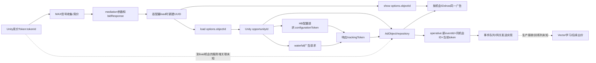

# 70号：Vector / Unity Ads竞价数据闭环补证

2026-11-20。**本轮补齐一条明确的SDK跨层关联：MAX Unity适配器的加载UUID→load/show共同objectId→Unity机会ID→广告对象→operative反馈的机会ID和当前trackingToken。** 这是一条客户端广告生命周期关联，不能升级为Vector已接收、训练、跨游戏识别个人或四款游戏已通过Unity买量。

完整主链以Unity Ads4.17.0和MAX Unity适配器4.17.0.0相配核验；适配器4.18.1.0及Unity4.18.1所选getter/config/event消费者也单独核对。后者不是所有方法/异步内部类的完全等价证明。原包、文件哈希、方法/行号和边界见[CODE_EVIDENCE](closure70/CODE_EVIDENCE.json)。

## 先纠正一个容易误接的等号

`HeaderBiddingToken.tokenId`、MAX完整响应`event_id`、适配器`biddingAdId/objectId`、Unity `impressionOpportunityId`、operative `eventId`不是一个ID的多种名字。

【SDK代码证实】collectSignal调用UnityAds.getToken；**loadInterstitialAd/loadRewardedAd阶段才另行`UUID.randomUUID()`生成biddingAdId**，之后写load和show选项。也就是说，在MAX header bidding场景，观察到的这个机会ID可在网络加载时建立，晚于原始信号收集与返回的mediation选择。不能用它证明原拍卖Token与广告事件具有同一个预先存在的ID。

没有排除服务器通过opaque markup/configurationToken另行关联的可能，但那条契约尚未知。独立随机生成不表示数学上保证绝不碰撞；可证的是**没有直接赋值相等的合同**，不能拿名字或格式相似当作join。

## 逐步还原明确赋值链

| 阶段 | 同一对象/字段如何移动 | 方法、位置与条件 |
|---|---|---|
| 适配器load | biddingAdId为新UUID；bidResponse若非空写adMarkup；同UUID写load options.objectId | CL70C01/02；UnityAdsMediationAdapter.java:L111—173；updatePrivacyConsent先行 |
| options共享键 | setObjectId把值写JSON键`objectId`；load/show继承同BaseOptions | CL70C03；UnityAdsBaseOptions.java:L8—40 |
| Unity load入口 | getOpportunityId读取同键，否则生成UUID；转ByteString并作为Load参数 | CL70C04/05；LegacyLoadUseCase.kt:L80/L203；SDK初始化/UUID与重复机会门控 |
| waterfall分支 | 同机会ID传getAdRequest再交gateway | CL70C06、CGS21；AndroidLoad.kt:L80；不是header bidding的原拍卖 |
| HB分支 | 从adMarkup取configurationToken；同机会ID写adPlayerConfigRequest；响应trackingToken写入组装的adResponse | CL70C06/07；AndroidLoad.kt:L112、AndroidGetAdPlayerConfigRequest.kt:L16 |
| 响应→对象 | AdObject保存传入opportunityId和response.trackingToken；同对象绑定viewer；成功load后按机会ID放repository并记load时间 | CL70C08/09；AndroidHandleGatewayAdResponse.kt:L100/L148—218 |
| show | 适配器show options传同objectId；LegacyShow优先读该ID；AndroidShow按机会ID取同广告并驱动player | CL70C01/02/10/11；LegacyShowUseCase.kt:L85，AndroidShow.kt:L23 |
| player反馈 | SEND_OPERATIVE_EVENT闭包持有同adObject；GetOperativeEventApi读取其opportunityId、trackingToken、可选playerServerId | CL70C12/13；CommonAdViewerExposedFunctions.kt:L156，GetOperativeEventApi.kt:L14—47 |
| 事件封装→队列 | 构造器新建eventId，同时写impressionOpportunityId/trackingToken；repository flow→UniversalRequest→持久工作项/异常fallback | 复用GI69C01/02与CGS、vector旧证据；没有执行发送 |
| 事件传输策略 | 添加shared时间/会话/隐私；TTL可丢弃，GatewayException可终止重复发送；其他结果再交response handler | CL70C15—17；发送函数代码存在不代表生产成功 |

**trackingToken可以刷新。** `updateTrackingToken`对同AdObject非空字段覆盖（CL70C14:L298—306），事件API读取调用时的当前值。不能把它当广告生命周期不变的唯一键；应保留机会ID、事件ID及token版本/时间，而不是只按token串联。

## 图：原拍卖、加载配置与事件必须分开

图中实线表示明确的代码传参/构造或适配器阶段关系，不表示曾观察真实生产网络。服务器怎样把原Token、竞价价格、markup和load配置连接，仍需接入规范/授权追踪记录；不能由这幅图自动补齐。

## 时间戳能帮助什么，不能帮助什么

UniversalRequest共享层调用`getSharedDataTimestamps()`；UTC用System.currentTimeMillis，sessionTimestamp用elapsedRealtime减SDK初始化单调时钟，CL70C15/16。load成功另写campaign加载时间。

这些是客户端请求封装/生命周期时间，**不是已核验的服务器bid_time/received_at，不保证等于底层点击/支付发生瞬间**。队列延迟、异步await、token缓存、客户端时钟偏差和刷新都需保留。时间接近只辅助对账，不能代替显式ID唯一性合同。

operative additionalData由player提供base64，事件类型是`SPECIFIED_BY_AD_PLAYER`。本轮证明关联字段和队列，不解码闭源player内部业务；不能笼统写成已恢复了每次展示/点击的金额或真实IAA账本。show invocation、show completed、reward发放、收入回调分别处理。

## ILRD / MMP收入与学习：另一条链

MAX/LevelPlay可向游戏回调金额及precision；游戏明确调用AppsFlyer/Adjust收入接口后，MMP服务端才可能按partner配置转发。Rotate XS43中的AF收入对象包含network、APPLOVIN_MAX、USD、double金额及版本附加信息，**未证明携带本链opportunityId/trackingToken或MAX event_id**。

Unity官方postback契约包含game_id、安装/事件时间、身份/来源参数、purchase/ad_revenue及was_conversion_attributed，复用CGS44/46/48。后台激活、all-source、收入映射、窗口与隐私是独立条件，SDK同包和同一次callback不能证明postback已发给Unity。IAA金额也不能改名成IAP purchase，GRT/AdWorth不能作为实际收入相加。

【官方公开证实】Unity建议ROAS活动前至少两周共享SDK额外数据及unattributed post-install postback帮助训练；D7/D28文章公开说attributed/unattributed、cross-game patterns和aggregate cohort insights用于bid decision，复用CGS42/43/47和MA60S17。它们证明产品用途披露，不提供本轮事件字段→训练列或具体共享参数/个人历史架构。

UGS Analytics、IAP Insights、Unity Ads gateway是不同入口。Unity历史交易论文不能与本链无条件合并：原研究只是iOS付费者，跨游戏ID不关联；当前IAP5.5.1有条件身份封装也不反证历史研究边界。本轮没有新增Insights→Vector逐字段生产消费证据。

## 对两个核心问题的判断

1. **展示前能有预测输入，但预测质量未证。** 设备/App/广告位/隐私、有限先前广告历史和Token可在请求前构造；HB加载机会ID有时晚于原竞价，所以不能用“展示前”偷换成“竞价前”。是否足以高质量排序需真实as-of特征、成熟收入和独立验证。
2. **展示后反馈有可追踪的客户端关联和授权产品入口。** 广告对象→事件有显式ID链，收入→MMP有部分游戏实际调用；官方披露其学习用途。服务端接收、去重、安装归因join、真实IAA/IAP成熟标签、模型重训与下一次报价仍未形成逐事件已证闭环。

本轮完成的是数据关联补证，不能据此称复现Vector、确认四游戏通过Unity导量、证明跨游戏个人图谱或获得ROAS增益。
