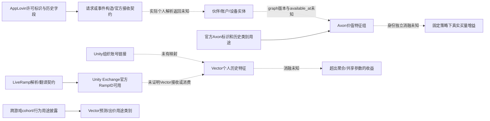

# 74号：身份特征进入价值模型的证据

2026-11-20。**部分标识和历史行为作为广告模型因素有官方说明；没有取得“解析图谱结果入Axon/Vector价值模型”的逐字段生产血缘，也没有其独立增益消融。** 本报告回答的是匹配结果如何成为模型输入，不能把“模型用了广告ID”偷换成“图谱已带来买量优势”。

## Axon与Vector分别判断

| 问题 | Axon | Vector |
|---|---|---|
| 标识/行为类别用途 | IV74S09明确Axon广告因素包含广告标识、设备/互动和部分购买历史；CGS51明确持续训练的数据类别 | MA60S17明确bid-time跨游戏行为模式、aggregate cohort insights及D7/D28价值用途；Ads字段构造另有代码 |
| 具体身份匹配输出被接收 | 多ID请求/商家事件有入口，但没有授权解析结果接收记录 | Exchange RampID有官方可用性声明；不能替代Vector接收记录 |
| 身份图谱输出进入价值特征 | UNKNOWN：缺resolved key→feature group→model version | UNKNOWN：缺UPA/RampID/个人历史→Vector列/表的映射 |
| 特征可用时间及graph/model版本 | 未公开逐列available_at、重置/撤销水位或join快照 | 同样缺失，D7/D28目标窗口不提供这些字段 |
| 超出聚合学习的独立增益 | 没有真实固定条件身份消融 | 没有真实固定条件身份消融 |

Axon依据是[公开广告说明](https://max.applovin.com/p/how-applovin-shows-you-ads)（IV74S09）及[官方模型数据说明](https://legal.applovin.com/about-applovins-axon-ai/)（CGS51）。Vector依据是[官方D7/D28文章](https://unity.com/blog/d7-vs-d28-iap-roas-campaigns)（MA60S17）。这些是厂商用途披露，未独立审计；不会因没有特征表而抹去官方已明确说明的类别用途。

模型可能直接使用设备上下文、合法广告互动和同广告主历史，可能使用聚合cohort或共享参数，也可能另用合法个人历史。**现有材料不能唯一选出架构。** 跨游戏知识不是个人级跨游戏身份的同义词；模型输出未来价值分布，也不揭示它使用哪种身份解析。

## 两条尚未闭合的数据链



图中的实线是相应范围内的代码或官方用途契约，不是特定游戏生产成功。上图没有把LiveRamp通用API等同Unity专用调用路径。

## 怎样的材料才会改变结论

一份合法可引用的匿名schema可以首先补足C_graph的部分定义：源数据purpose/namespace、实体粒度（人/设备/家庭）、维护/派生状态、解析算法版本、输入可用时间、匹配结果接收时间、隐私状态、特征组与模型版本。还需授权消费日志或独立审计，证明该模型在指定预测时点实际读到了这些结果；字段字典或样例本身仍不是生产消费。

建议字段契约，不代表厂商现有字段：

```text
source_namespace, entity_granularity, match_result_type,
graph_version, match_status, consent_purpose_version,
source_event_time, source_available_at, match_received_at,
prediction_time, feature_group_version, model_version,
feature_materialized_at, deletion_watermark, decision_trace_reference
```

不用提供联系方式、原始广告ID、模型权重或个人图谱给研究者；运营方可以在受控环境输出schema、聚合审计和不可识别的处理证明。`matchConfidence`也不能直接当“个人历史可靠率”，IV74S05明说它是级联步骤。

D另需固定数据与模型的M4对M3对照：输入仅多一组合法个人跨应用历史，保持历史记录量/时间窗、特征维度预算、源样本及控制器一致；再看独立测试误差、校准/排序，以及另行随机实验的成熟净收益。更高匹配率不自动是模型增益，更高预测精度也不自动是边际扩量利润。

## 排除与保留

可以排除的**推理方式**：返回RampID就算匹配成功；伙伴名单就算共享个人图谱；账户服务/Exchange就算Vector；含ID的SDK请求就算实际入模；将73合成增益写成厂商效果。这些不是对厂商内部不存在相应机制的证明。

不能排除只用群体统计/共享参数实现类似能力，也不能排除合法个人历史另有增量。73号D只是反例构造：在某些生成机制里群体规律接近身份模型，在另一些机制里个人历史有增量，漂移时正确链接也可能有害。它没有识别两家生产模型，更没有证明四款游戏的利润。

本轮没有新真实训练列、身份特征消融、模型版本消费日志或授权收益实验。检索受搜索渲染与正文覆盖限制，准确表述为“本项目未取得”，不能写“公开领域必然没有”。继续公开逆向的预期价值已低；恢复条件见[停止清单](74_研究边界与停止条件.md)，真实对照见[实验设计](74_图谱与群体学习对照实验设计.md)。完整18项命题见[商业价值矩阵](74_身份关联商业价值证据矩阵.csv)。
