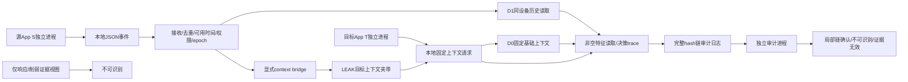

# 76号：身份图谱证据链工程验证

2026-11-20。**75号设计已落实为可运行的离线工程：两个独立Python CLI App、本地服务、证据盲化审计器，以及56行矩阵自动验收。** 不继续文献搜索、SDK扫描或统计模拟；未发真实广告请求、身份查询或生产SDK网络请求。00—75全部历史文件保留。

## 已实现的链路



route真值和服务状态保存在private fixture文件，审计器不读取；判定由事件接收、源/目标权限、可用时间、同设备/epoch、显式读取、feature→decision引用等证据交叉核对。审计器只收到公开packet，独立进程回归已覆盖。

三路由分别是：D0不查源历史；D1在允许用途及时间成立时查同设备源App；LEAK通过明确桥接把源值放入目标当前上下文。**相同广告输出可以来自D1或LEAK，只有response则不可识别；完整本地trace才能区分这两条工程路径。** D0无读取也不被升级为“已排除H3共享参数”。

## 时间、权限与可复现性

接收必须满足`event_time <= received_at <= available_at`，实际读取再要求`available_at <= prediction_time`。晚到事件不能倒灌过去，边界相等允许；日志明确区分SDK/App构造、local service接收、可用和实际读取。源事件当时无授权，后补许可不能回填；撤权后不查缓存；旧bridge过期/epoch不符拒绝，用途关闭先剥离源字段。

mock设备/安装代号只接受`mock-*`，上下文固定MOCK/本地fixture，不收集真实广告ID/账号/联系方式。scope reset清除服务可用事件且不复联；审计仍保留合成历史，不冒称真实隐私删除/模型遗忘。

固定seed760031、显式逻辑时钟、标准库JSON文件IPC；所有测试目录拒绝覆盖。源/目标/服务子进程的输入输出、退出码和stdout/stderr、hash链、审计packet/判定、矩阵case、单元服务状态和代码哈希均落盘。正式结果为`acceptance-v3`，旧开发结果不覆盖。

## 自动验收结果

| 范围 | 当前结果 |
|---|---|
| 75号56行矩阵 | **56/56通过**，原row_id和全部原文字段保留；每行具明确期望、禁止跳级及证据削弱case |
| 独立进程/反例回归 | **13/13通过**，包含相同输出异路径、只见响应、未可用、撤权、重置、其他device、去重、固定seed全ledger重放、无private审计、socket/子进程阻断 |
| 单元 | **40/40通过，0 skip**，含时间边界、未来/迟到、当时权限、缓存/bridge、schema与篡改审计 |

这些是工程验收，不是新增独立统计样本、真实模型训练或平台效果。矩阵中的跨设备账号、自然人、家庭和独立价值增益没有被伪造为正向engine实现；对应验收是**当前证据不能识别或真实标签不足STOP**。来源条件必须仍由真实授权环境另验。

## 一键运行与文件

在`D:\GrowthResearch\engineering76`：

```powershell
python -X utf8 run_demo.py --output D:\GrowthResearch\engineering76\results\new-demo --seed 760031
python -X utf8 run_acceptance.py --output D:\GrowthResearch\engineering76\results\new-acceptance --seed 760031
```

选择不存在的新目录。代码：[工程README](engineering76/README.md)、[源App](engineering76/mock76/app_source.py)、[目标App](engineering76/mock76/app_target.py)、[服务](engineering76/mock76/service.py)、[审计器](engineering76/mock76/auditor.py)。

结果：[测试报告](engineering76/TEST_REPORT.md)、[机器摘要](engineering76/results/acceptance-v3/SUMMARY.json)、[逐行矩阵结果](engineering76/results/acceptance-v3/MATRIX_RESULTS.csv)、[56完整case](engineering76/results/acceptance-v3/CASES.json)、[全局完整性校验](engineering76/VALIDATION.json)。

## 实际限制与下一步

这两个App是**独立Python CLI mock，不是Android/iOS APK**。进程分离保证本次实现的模块/证据输入独立性，没有OS/ACL沙箱；同一用户仍可读取private文件。hash链无第三方签名，不能抵御生产者重写整套证据。Python audit hook阻止本工程误联网，但不是Windows防火墙或恶意代码隔离；工程未引入生产SDK或外部依赖。

与Axon/Vector有关的个人图谱、实际接收、C_graph、独立收益D仍UNKNOWN。本轮突破是**将证据边界变成可重复执行和自动拒绝误判的代码**，不是证明厂商机制。

下一步应先审阅本地schema/日志与判定契约。若要连接平台，须取得75所列L2明确授权、指定receiver/namespace/purpose、源事件接收和实际feature-read语义，再将授权适配器接到相同验收契约；当前代码不具备也不默认允许该连接。没有授权就继续保持离线，不扩展SDK扫描或真实用户关联。
