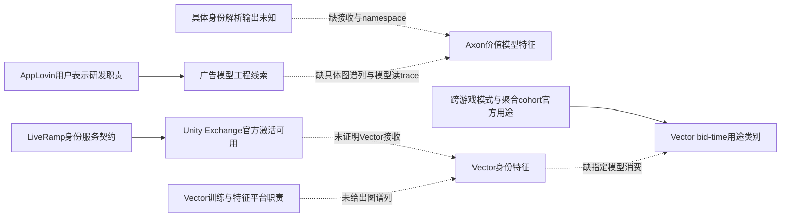

# 77号：关键证据缺口与竞争解释

2026-11-20。本轮保留6份工程正文快照，经实体去重真正新增4项（另2份为旧岗位的URL别名），但**零项生产身份图谱结论升级**。评估对象是Axon与Vector指定价值模型，不是广告行业是否普遍存在身份服务。

## 必须连接的三项及当前断点

| 公司 | 身份解析组件 | 实际接收产品 | 价值模型特征消费 | 缺口 |
|---|---|---|---|---|
| AppLovin | 特定个人/跨设备resolver、namespace及返回契约仍未知 | Axon有标识/历史类别用途；没有具体匹配结果接收审计 | 用户表示/特征研发岗位；无resolved feature读记录 | 三项尚未在同一可核对链上连接 |
| Unity | LiveRamp通用解析及Unity Exchange受众激活已有材料 | Exchange的官方可用性声明；非Vector实例接收 | Vector有跨游戏/cohort用途及具体ML团队；无图谱列消费 | Exchange与Vector之间缺接收/特征/模型桥 |

官方描述、岗位、专利、实际接收及实际消费分层保存。矩阵中的False表示“本项未证明”，不是“厂商不具备能力”；UNKNOWN保留尚未取得的事实，不把文档未提及当反证。

实线限于声明范围内的职责/契约/用途，不表示本项目观察过生产接收。虚线标示待证断点。

## 竞争解释与可区分材料

| 表面观察/工程措辞 | 图谱解释 | 同样相容的解释 | 真正有区分力的下一份材料 |
|---|---|---|---|
| user representations、rich user data | 个人图谱embedding | 设备内序列、同App特征、上下文/群体embedding | resolver输出类型→特征组的明确血缘及实际读取审计 |
| across ad and app ecosystem | 跨App个人历史被join | 各产品独立表、汇总分析、共享训练参数 | 实体粒度、namespace、join键语义与合法接收记录 |
| feature generation、production ML | 图谱列上线 | 任意训练/特征管道 | 非PII字段字典、available_at、graph/model版本及线上消费trace |
| bidding、pacing、marketplace intelligence | 图谱提高报价 | 市场价格预测、预算控制、库存/频控改进 | 固定控制器的身份特征消融；再另做策略对照 |
| RampID可用于Exchange | Vector使用个人关系 | 仅外部买方受众激活或Exchange透传 | 明确Vector接收和resolved feature物化/读取证明 |
| 专利里的应用列表与推荐 | 已部署跨游戏个人模型 | 未上线方案；OS兼容或设备库存推荐 | 独立实现/部署证据及实际产品映射，不能再靠其他专利拼接 |

这些替代解释目前没有被排除；也没有证据排除个人关联机制存在。H0/H3按75号训练来源/在线依赖分别界定，不能仅因预测相近选出唯一机制。76号D1与上下文泄漏输出相同的工程反例仍适用：观察响应变化不定位数据路径。

## 最小补证包

1. **身份与接收包**：系统/产品名、合法用途、namespace、设备/账号/人/家庭粒度、maintained/derived及匹配成败、冲突/重置/撤销、接收时间和版本。匿名schema说明能力；授权审计才说明实际接收。
2. **消费包**：源记录引用、available_at、特征组/图谱/模型版本、实际读取及decision trace。必须是指定Axon或Vector价值模型，不能用Exchange或泛称广告模型替代；时间与权限需像76号契约一样可核验。
3. **独立增益包**：合法真实成熟收入/完整分母、等样本/等容量/等计算/等策略的个人特征开关对照，并测试错误匹配与关系漂移。预测改善也不自动等于真实盈利，获客成本和增量收益需另证。

研究不需要也不申请PII、真实用户重识别或导出个人图谱。材料须可合法引用；本轮未发送申请、签NDA、查询身份或测试生产接口。

## 证据不足与真正反证

招聘未提graph只是缺失；专利未提Vector只限制其证明范围；搜索0命中和URL失败不是图谱不存在的反证。只有具明确范围/日期的排除性架构说明、授权feature lineage/消费审计或固定条件实验，才可能排除特定实现/效果。即便某模型版本未读取图谱，也不能外推所有产品、国家和时期。
