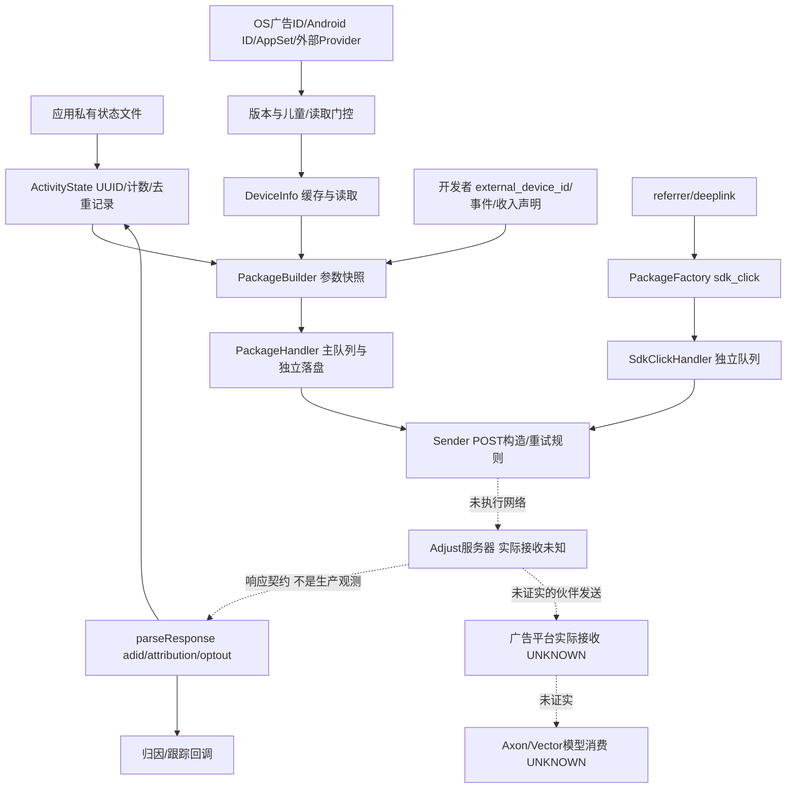

# Adjust限定源码机制验证

本轮仅静态分析OSM034/036/038三份MIT源码，未启动SDK，未发送生产请求，未读取真实第三方身份；未修改76号程序，未创建79号生产取证任务。**C_graph.Axon=UNKNOWN，C_graph.Vector=UNKNOWN，D=UNKNOWN；原生产取证STOP。** Adjust机制不归属于Axon/Vector。

方法：选取111个Java文件条目，逐链阅读并进行文本差分。2486个初始方法定位只是词法辅助，不是完整AST/调用图；Map等泛型返回方法另补定位，精确摘录见CODE_EVIDENCE.json。全部结论限于所列版本、路径和分支；未执行OS权限、网络、崩溃恢复或服务器验证。

## 调用链

图中实线只代表选定源码中可追踪的调用/数据关系，不代表运行成功。未实施广告机会ID→经济展示→收入→模型的生产闭环。

| 关系 | 已证实客户端机制 | 不应推断 | 证据 |
|---|---|---|---|
| 本地实例→事件 | android_uuid+应用token/包名+session计数+seq入参 | UUID是自然人/跨App通用ID | AM01/07/08/12 |
| OS标识→参数 | 门控读取、空值省略/回退、构包 | 同值=同人，或服务器实际匹配 | AM02–05/20 |
| 账号字符串→请求 | external_device_id传输 | 已认证账户、跨设备合并 | AM06 |
| referrer→归因返回 | sdk_click输入、响应缓存/回调 | 客户端算出归因或同人实体 | AM13/14 |
| 事件→去重/队列 | 有限本地去重，独立文件FIFO | 全局经济事件唯一性、exactly-once | AM09–11 |
| 收入字段→服务器/伙伴 | 事件参数支持声明金额等 | 真实成交、伙伴收妥、模型训练 | AM08/12及其服务端未知项 |
| 删除意图→本地门控 | forgotten状态、GDPR包、optout flush/disable | 服务器/伙伴历史删除完成 | AM15–18 |

逐路径、类/方法/行号和三版本哈希见[22项发现](已证实机制与服务端未知清单.md)及[CODE_EVIDENCE.json](CODE_EVIDENCE.json)。

## 同设备跨应用问题的回答

独立应用可能读取同一外部OS/服务标识，是否同值受OS、用户、签名、开发者/分发作用域、权限和重置规则影响；这里没有执行两App读取，也没有完整外部作用域契约。因此只能证明“有读取和携带外部标识的客户端入口”。本地android_uuid来自应用私有SDK状态，不是SDK自行创建的跨App共享标识。

AppSet路径只取getId不取getScope，不能用这一字符串判定样本的developer/device scope。AndroidID由Secure设置提供，SDK不实现OS的版本/签名/用户作用域规则。Google广告ID是广告标识而非跨设备自然人凭据。FB aid依赖外部Provider和官方签名校验，不是Adjust自建身份解析服务。
