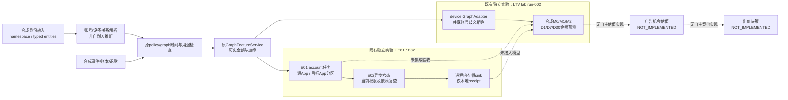

# 已验证能力链路与未接通边界

这是一张既有局部执行证据图，不是端到端集成通过图。实线代表指定实验内已有执行记录；虚线代表尚未集成或未实现，不表示可以从多个实验结果拼出真实消费链。机器版见 [02_已验证能力链路图.json](02_已验证能力链路图.json)。代码版本见 [06_历史成果与版本引用清单.md](06_历史成果与版本引用清单.md)。

## 节点逐项记录

|节点|代码/版本与实际证据|主体及权限|真实数据|边界|
|---|---|---|---|---|
|I 身份输入|MVP system.py `6542948df47ebc8d` IdentityNamespaceRegistry；run-003 V01/V02|Device/Account/App Instance/Person 类型分开；Person仅类型，不自动解析|否|合成token，不获取广告ID或真实个人值|
|R 关系解析|同版 DeterministicIdentityResolver/ConfidenceAwareRelationshipGraph；V03—V07|本地合成签名回执、typed边、范围/用途；账号≠人|否|same_device仅显式合成事实；概率候选不闭包；没有真实身份分辨质量|
|E 事件和经济来源|同版 TemporalEventLinker；V09—V12、R04—R06|来源/经济主键、revision、签名金额、币种；原事件入库政策|否|只有明确经济主键才能去重；request/impression字符串不自动成为经济唯一键|
|P 权限/时间|同版 ConsentAndDeletionManager、graph.active；V08/V14—V17、R17/R20|收集时与使用时政策、独立控制库、关系有效及可用时间|否|不是法务授权的自动证明；没有真实同意采集与源真实性审计|
|F 历史特征|同版 GraphFeatureService.compute/read；run-003与lab ENGINE_PROBES|account/device/app_instance查询；lineage、version、observation区分|否|全局版本保守失效，无生产时延/扩展性验收|
|LD lab特征消费者|lab adapter.py `9644cbac69dfab4f`、extraction.py `84778d18238aff49`；run-002 3600次查询及TIME_PERMISSION_AUDIT|device-not-person；多账号拒绝、原用途；缺失位与金额分开|否|负净历史/无账本/非USD被lab适用性层拒绝；不等于原账本丢失负值或E01不支持负值|
|LP 自主模型|lab model.py `a6d2f7f50ee8c480`、run_experiment.py `cc40db779925d5a7`；已有参数、32400条预测|同样本与成熟标签、时间切分、训练预算；graph列进入M2|否|这些是旧运行数量，不是本轮重新训练；没有身份独立商业收益或IAA+IAP联合模型|
|A E01任务分区|adapter.py `9138d4615c1ffae2`；正式38项|target install+原auth receipt+account+purpose；只读批准来源；X7/Y3/B99反例|否|同值namespace不合并；范围不足UNSUPPORTED_PARTITION；reread不可跳过|
|Q E02异步交接|machine.py `d58b95bd766322fe`；正式30项，十类场景|原outbox、E01回执/bundle、policy+graph；本地发送开关只收紧|否|prepare后仍最终复查；未知一致性边界拒绝；没有E03优化|
|S 假sink|同版 MemorySink.accept；T06/T09/T18及错误反例|同进程幂等receipt，不是真实身份服务接收方|否|本地ACK不是第三方交付；未证明重启恢复或外部删除|
|V 机会估值|无自主已实现代码；原MVP checksum与lab prediction不构成它|未定义已验收的广告机会主体/因果价值契约|否|收入预测不能直接作为展示带来的增量价值；没有机会成本/拍卖条件/归因口径|
|B 出价决策|无自主已实现代码与测试trace|未获任何真实投放授权|否|不存在预算/出价控制、实际拍卖交互与盈利对照|

## 哪些边不能连

1. E01输出不是lab当前的输入。E01支持账号分区、有符号金额与观察状态；lab仍使用device金额log特征及可用位，对负值和共享账号另有适用性拒绝。二者规则各有任务范围，没有同一模型输入适配和统一时间审计，不能直接替换。
2. E02接收的是原outbox的合成事件引用，不是“异步特征已入模”的证明。其sink没有调用lab，receipt也不引用lab模型版本或预测。
3. lab输出的是合成未来收入预测，未建立广告机会反事实价值、实际价格或竞价决策引用。MVP consume_local虽有decision_ref，实际只是checksum probe，不能填补这条边。
4. 局部哈希链能核对本地记录一致性，不证明外部来源真实或独立见证。对厂商生产链的缺口仍按78号门槛，不能用此图替代。

完整目标因此为PARTIAL。现有各局部验收继续有效；不存在可引用的 E01→E02→lab→机会估值→出价 统一运行。

**C_graph.Axon=UNKNOWN；C_graph.Vector=UNKNOWN；D=UNKNOWN；原生产取证STOP。**
