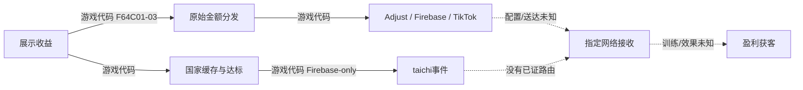
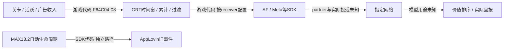
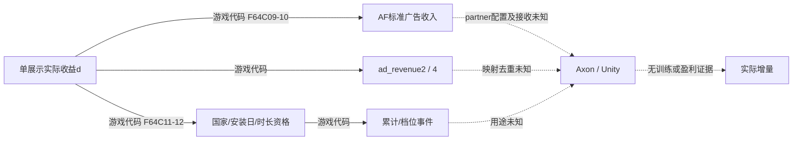
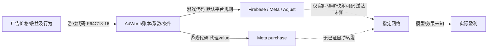

# 四款游戏最终审计与竞争性解释

2026-11-19。与[64号最终报告](../64_普通游戏盈利跃迁最终机制判断.md)配套，可独立阅读。IAA=向玩家展示广告产生的收入；IAP=玩家真实购买；代理value=开发者规则形成的优化信号，不能未经对账作为收入。真实IAA在这里首先指广告展示收益接口的业务金额，仍保留exact/estimated/publisher-defined及结算差异，**不等于已核银行净收入**。

来源编号的原文件、类/方法、版本与SHA256见[final64证据目录](final64/SOURCE_CATALOG.md)。官方声明、SDK实现、实际业务调用、生产送达、服务器接收、模型训练是不同证据层级。实线为静态/契约范围，虚线为未证连接。

## 1. Car Race · 1.348.2 / MAX13.6.4

| 审计项 | 最终判断与证据 |
|---|---|
| 实际SDK/MMP调用 | 【游戏代码证实】MAX/Metica展示收益桥及Adjust/Firebase/TikTok分发；不是仅SDK名称存在。`AdMeticaDefault.OnShowRevenuePaid` RVA0x32deaf0、`AdRevenueTracking.ImpressionSuccessEvent` RVA0x32c2988。[F64C02/03；C05/C06] |
| 真实IAA链 | 展示收益回调→实际金额→独立收入报告；`IAAController.OnAdRevenuePaidEvent` RVA0x24401f8同时处理总额/缓存。[F64C01] 生产到账、precision、MMP与媒体账单对账未取到 |
| IAP链 | 【游戏代码证实】schema/购买确认方法；【无法确认】真实成交、验单/退款/净额账本。不能将可调用API写成支付结果。[02号C08/C09] |
| 行为/代理链 | 关卡、会话、激励次数；国家taichi门槛是已实现收入的分桶/达标事件，**不是未来预测**。默认US/T1/T2/T3金额0.50/0.30/0.20/0.03，实际缓存超额全部报出后清零。该路径Firebase-only。[F64C01；03号] |
| 去重及会计风险 | 同一经济收入既有ILRD又有阈值副本；两者不能加总。缓存清零不是送达ACK；不证明后台重复计算或正确去重。远程默认值不等于生效值 |
| 同App历史入口 | 【官方公开证实】Adjust→Axon可配all sources，Unity也有partner契约；【无法确认】该游戏授权/启用/回填/生效窗口。[CT62S08；57号] |
| MAX直发与模型消费 | SDK landing等自动事件链已证；Car通用MAX/Metica桥不证明具体关卡/taichi调用它。结构化Axon在13.6.4存在，不证明业务可达/送达。Axon/Vector训练消费未证。[F64C17/18；20号] |
| 成本与成熟收益 | 【无法确认】实际指定平台campaign成本、成熟净D28收入、边际ROAS、增量净收益。无独立证据将增长归因两家平台 |

**竞争性解释：**最强的是“已有真实价值反馈基础”，而非“国家阈值驱动Axon增长”。M1玩家选择、M2全来源学习、M4变现和M5素材市场都相容；M3无四款级辨识证据。若收益改善仅发生在固定自然量/同一UA cohort的变现随机组，优先支持M4；若平台未收该阈值则排除该条特定输入解释，不能连带排除原始ILRD路径。

**最小补证：**①当前收入partner映射/来源开关/投递接收；②ILRD与taichi的独立事件语义、幂等/精度/远程生效版本；③相同素材/国家的成熟支出收益及随机UA×变现对照。无需真实用户广告ID。

## 2. Meowdoku · 1.25.1 / MAX13.2.0 / GRT1.3.2.0

| 审计项 | 最终判断与证据 |
|---|---|
| 实际业务与SDK | 【游戏代码证实】Godot Tracker→UniKit/Learnings/GRT；GRT `BaseGrtEvent.sendEvent` L66—94过滤后→`BridgeManager.sendEvent`→接收端。接收列表可配置，不能把全部工厂处理器当生产全开。[F64C05/07/08；M01—M05] |
| 真实IAA链 | 广告收入桥/GRT；`LTVManager.getLTV/increaseLTV` L50—65累计`sp_key_ltv`已实现收入。收入金额的原始precision及最终结算未核，不是未来LTV模型。[F64C04] |
| IAP链 | 订阅/购买漏斗与可选IAP规则类型有代码；无真实支付返回、验单、退款及净额事件账本，不以订阅点击或工厂枚举填补。[02号M01；F64C07/08] |
| 代理事件 | 安装时间窗×关卡/活跃分钟；来源/国家/livingDay过滤；IaaFbRoas可增量，LtvEvent可累计/once。名含Fb不代表仅发Meta，接收端由配置选。[F64C04—08；03号] |
| 去重与口径 | 累计value与增量value混加会重复；本地once/lastReportLTV不等于服务端事务ACK；广告完成/奖励不是收入；当前GRT表缺失使实际输出量不可算 |
| 同App历史入口 | AF全来源/organic与partner共享契约可配置；四款实际开关和训练样本未知。不要把unattributed当无法归属或跨游戏个人画像。[57号；MA60S14] |
| MAX直发及消费 | 13.2无新版结构化Axon；有SDK自动旧事件。所查DEX未建立GRT→EventService显式链；不能据此排除服务端MMP或native/反射。[F64C17/18；20号] |
| 成本与成熟收益 | 无实际Axon/Vector成本/成熟净回报/代理消融，不能判断GRT是否比简单D0收入更有预测力 |

**竞争性解释：**有证据支持“早期参与与收益分层意图”。更密集代理是否有益取决于真实目标及映射；如果GRT代理只是在已有广告次数/收入上重复编码，不能预设模型得到新信息。M2同App全来源是平台能力，M1/M4仍相容；没有特征/反馈对照不能分配因果。

**最小补证：**①生效GRT JSON/规则版本/receiver/单位；②AF partner配置及真实投递；③成熟D28按D0行为→再加D0真实收入→再加GRT的时间外/授权holdout比较，固定广告策略并保留零收入玩家。

## 3. Rotate Rings · 1.2.4 / MAX13.6.2 / AppsFlyer6.17.5

| 审计项 | 最终判断与证据 |
|---|---|
| 实际业务与MMP | `SDKManager.handleAdRevenue` L386、异步upload L802；`g8.a.adRevenue` L100—123明确调AF `logAdRevenue`，金额USD/d，mediation为APPLOVIN_MAX。[F64C09/10] |
| 真实IAA | 标准AFAdRevenueData直接赋值；还有ad_revenue2和ad_revenue4，不能假定三份独立收益。监听/重试与后台是否重复入账须另验 |
| IAP | 代理档位/命名不是已验证商店支付；无实际IAP订单、验单退款及净额账本。[03/49号] |
| 行为/代理/达标 | 国家×安装day0—6比较R>T，每天一次value=累计R；美国首日≥900秒及≥0.45收益资格；首次插屏资格及固定档位。`ta.d.j`L4405国家表是门槛非CPI/预测。[F64C11/12] |
| 去重与口径 | 同经济展示多路副本，跨日累计R重叠，固定档位/累计/单次金额混用是三种不同风险；不能从风险推断后台已实际重复计收 |
| 同App历史入口 | AF→网络的all-source/事件/专用ad_revenue契约；四款partner配置、金额开关、历史共享和接收未证。[57号、RV61S03] |
| MAX与训练 | APPLOVIN_MAX枚举证明中介来源，不证明获客。13.6.2有结构化分支但无已建立业务直达链；模型消费未知。[F64C17/18；20号] |
| 成本收益 | 无指定获客平台成本、成熟去重净收益和实验。不能把精细国家阈值表当投放或盈利证据 |

**竞争性解释：**最强静态证据是标准真实收益到AF入口，以及开发者按早期资格分层；不等于知道广告平台实际选了哪条目标。M1/M2/M4/M5都相容；一个可检验反例是“只改报表映射后ROAS上涨，而独立净收益未变”，这会反驳真实盈利改善而非仅反驳模型。

**最小补证：**①AF三路收入及规则事件映射/幂等/接收；②展示经济事件与跨日累计分账、precision/币种/时间；③固定国家/素材/广告策略的成熟成本收益与目标切换holdout。

## 4. Jewel Coloring · 1.24.1 / MAX13.6.3 / AdWorth10.2.3默认配置

| 审计项 | 最终判断与证据 |
|---|---|
| 组件与实际入口 | 【游戏代码证实】Bulldog初始化AdWorth，原生库规则/账本/系数/路由；不是Adjust标准模块的同名功能。商业所有权未知。[F64C19；09号D02] |
| IAA价值来源 | 广告展示价格/价值进入本地多key账本，真实ILRD、估计/默认bidder价格回退需分开；不能把全部AdWorth数值当结算收入。[F64C13/16；09号] |
| IAP | 默认514按广告价值调用Meta logPurchase；它是代理而非真实付费。未取得真实商店验单退款/净额账本。[F64C13—15] |
| 行为与代理 | 默认90规则/31权重表，登录/时长/最高关/插屏/eCPM/展示率参与；normal、interval、x100等金额语义。来源表和国家条件能力存在，默认90未引用来源表且无直接国家条件。[F64C13；09号] |
| 路由与状态 | Firebase/Meta/Adjust输出；`sendMsgToPlatform`RVA0x1a44350调用后更新本地状态，不是远端ACK；未建立AdWorth→MAX显式业务路由。[F64C14/15/17/18] |
| 去重/会计 | 多key可能复用同经济收入；系数、倍率、累计与间隔不可相加；代理purchase不入真实IAP；没有后端幂等证明，不推断后台实际错误 |
| 同App历史入口 | Adjust全来源共享可配，但只覆盖实际映射事件与条件；不能把Meta/Firebase事件自动画到Adjust或AppLovin。[CT62S08；20/57号] |
| 生产与成本收益 | 无热更生效表、指定模型消费、实际Axon/Vector成本成熟净收入和增量；规则复杂不能证明模型成熟或投放成功 |

**竞争性解释：**更丰富的开发者代理可能提供早期信号，也可能只是重复已实现广告收益/参与度，甚至与广告强度共同引入偏差。它不需要跨App图谱才能执行；默认来源权重未启用不能被扩展为“线上绝不使用”。M1与M4、远程策略及素材变化仍不可辨识。

**最小补证：**①实际热更/路由/输出单位；②广告价格与真实ILRD及结算精度、代理purchase分账和Adjust投递；③成熟真实收入下代理增量、广告强度及留存的受控对照。

## 5. 横向裁决

| 能力或结果 | Car | Meow | Rotate | Jewel |
|---|---|---|---|---|
| 真实展示收益业务入口 | 已定位ILRD | 已定位收入桥/累计 | 已定位AF标准金额 | 已定位价格/价值账本，精度/回退需另分 |
| 开发者早期代理/门槛 | 国家缓存、关卡/激励 | 时间窗参与/GRT | 国家安装日/复合资格 | AdWorth多条件/系数 |
| 所指代理直接到MAX Axon | 未建立 | 未建立 | 未建立 | 未建立 |
| 同App全来源共享 | 官方可配置，启用未知 | 同左 | 同左 | 仅已映射Adjust路径可配置，其他端不自动转发 |
| Axon/Vector实际训练 | 无证据 | 无证据 | 无证据 | 无证据 |
| 指定平台实际盈利扩量 | 无成本/成熟收益证据 | 同左 | 同左 | 同左 |

**最终结论：**能比较的是客户端信号设计，不能排名真实买量能力。最值得自建的机制是语义准确的真实收入账本、可靠幂等和授权MMP回传、少量可解释早期代理与成熟LTV验证，以及获客×变现分开实验；不能照抄国家金额或把广告收益伪装purchase，也无需为此先建跨App个人图谱。[10号、61—64号；MA60S10、RV61S03]
