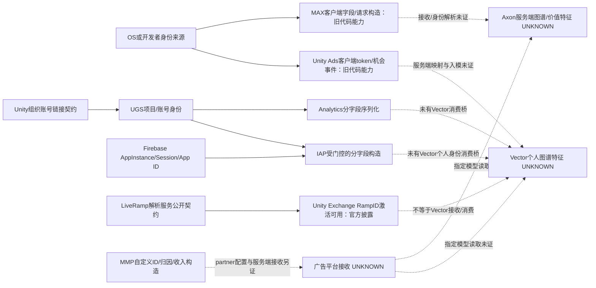

# 身份字段及调用关系图：复用证据，不新增代码分析

2026-11-20。已逐行复用[30字段矩阵](IDENTITY_FIELD_REUSE_MATRIX.csv)与[10条调用映射](CALL_RELATION_REUSE_MATRIX.csv)。来源编号、原始scope、权限、生命周期和模型未知边界保留；[原始证据记录](REUSED_SOURCE_REFERENCES.json)保存文件/哈希/版本/位置。没有把同一公司或同包ID自动连成个人图谱。

## 字段与实体粒度

| 字段组 | 既有可证范围 | 禁止推断 |
|---|---|---|
| GAID/AAID/IDFA、App Set ID、IDFV、Android ID | 各有OS、设备/发布者/签名/安装作用域及隐私条件；部分SDK有读取/请求构造 | 永久人ID、跨设备自然人、所有发行商共享 |
| Installation ID、Firebase FID/App Instance ID | 安装/应用实例等不同组件身份；Firebase App ID本身是项目/App上下文 | FID、会话、项目ID彼此相同或跨应用个人键 |
| Customer/Publisher/External User ID、UGS Player ID、UPA账号 | 开发者显式命名空间、UGS项目身份、组织账号链接的各自契约 | 任意Unity游戏都自动互通；账号等于自然人；不同MMP实际设置同值 |
| hash email/phone、IP/网络/设备属性 | 特定入口的构造或用途披露，受许可/同意门控 | 哈希天然匿名、网络相似即同人、已有完整fingerprint服务 |
| token/request/event/waterfall/opportunity/tracking/attribution ID | 请求、机会、事件、会话或归因的局部关联 | 经济展示唯一账本主键、真实跨设备身份、token已解码模型特征 |
| RampID、UID2及Pixel字段 | 各自公开契约/入口和范围；Exchange激活可用性属特定产品 | 已成功个人匹配，或Axon/Vector实际读取相应结果 |

30字段不是30个生产入模特征。字段矩阵中的E1/E2/E3/E4、实际上传/匹配/入模false只是“未证明”，不是厂商不存在能力。

## 产品隔离的证据链图

实线仅表示各边注明的旧代码能力或官方契约，不是本项目观测到的生产发送/接收。广告机会上下文、模型输入、归因、收入四种时点分开；安装后收入不能倒灌同次安装前机会。

## 已知明确调用映射与不能混同之处

ID01/02：Authentication PlayerId→Analytics unityPlayerID、ExternalUserId→Analytics UserId及InstallId回退，不说明字段互等。ID03—06：IAP5.5.1的Firebase/UGS/Analytics身份分字段与权限/远程门控，不能把旧5.4.0可构造字段升级为实际发送。

ID07：MAX adapter event_id→Google placement_req_id是请求关联，不是人级匹配。ID08：MAX consent/doNotSell→Unity隐私字段是布尔配置传递，不证明初始化成功。ID09：Adjust的Facebook AttributionIdProvider aid→fb_id是受签名检查的归因字段，不是Facebook账号ID。ID10：Singular customUserId setter是开发者控制入口，不证明目标游戏实际设置或与其他ID相等。

本轮主结论：可复用的是字段作用域、明确接口映射和反误判边界；**没有恢复Axon/Vector闭源身份图谱或生产特征消费链。** 新的解析/实际接收/读取仍按78号十组契约验收。
