# Identity Resolution Graph参考架构

本轮是公开技术研究和自主架构设计，不是厂商生产逆向复原。未安装/运行解析库、SDK、服务或模型；未访问身份接口、投放端点、真实个人记录；76号程序不改、不重跑。**C_graph.Axon=UNKNOWN；C_graph.Vector=UNKNOWN；D=UNKNOWN；原生产取证STOP。** 第三方开源能力、协议和论文都不归属于Axon或Vector。

## 最小实现选择

先采用关系型持久化保存不可覆盖的关系修订、事件账本、outbox与授权水位，必要时增加图索引；不要求从专用图数据库起步。候选配对评分是可插拔的离线步骤，默认关闭真实个人概率解析。认证账号边、概率候选边、外部解析声明分层存储，禁止统一硬合并成“人ID”。

上述为研究者取舍，不是从Axon/Vector披露中恢复出的架构。Splink/dedupe只是配对/聚类候选；Feast只是特征存取候选；它们不提供完整授权、删除、经济账本或生产消费证明。

```mermaid
flowchart TD
 NS[Namespace Registry] --> IN[合法接入与用途门控]
 CD[Consent and Deletion Manager] --> IN
 IN --> DR[Deterministic Resolver]
 IN --> PR[可选概率候选 非默认个人合并]
 DR --> RG[Confidence-Aware Relationship Graph]
 PR --> RG
 IN --> EL[Temporal Event Linker / 经济账本]
 RG --> FS[Graph Feature Service]
 EL --> FS
 CD --> RG
 CD --> EL
 CD --> FS
 FS --> LC[自有LTV消费者接口 未实现]
 LC --> CR[接收/非空消费/决策独立回执]
 RG --> PA[Provenance and Audit]
 EL --> PA
 FS --> PA
 CD --> PA
 CR --> PA
 PA -. 不能推出 .-> V[Axon/Vector实际消费 UNKNOWN]
```

| 组件 | 输入 | 输出 | 约束 | 依赖/测试来源 |
|---|---|---|---|---|
| Identity Namespace Registry | issuer/tenant/app/partner、entity_type、标识作用域契约、生成/重置规则、legal_policy_ref | NamespaceRef(version,scope,allowed_entity_types,comparison_domain,retention_class)或UNKNOWN_SCOPE | 先注册命名空间；相同裸值跨issuer不得匹配；OS scope不由参考系统猜测；party-specific ID翻译需独立许可 | 无其他状态依赖；被所有接入/解析/特征查询调用；V01/V02；来源SIR14/15、IV74S02、AM01–06 |
| Deterministic Resolver | 合法auth receipt、设备/安装别名、账号namespace、用途、发生/可用时间、撤销epoch | 类型化RelationProposal/Decision：ESTABLISHED_ACCOUNT_RELATION、ABSTAIN或CONFLICT；不输出自然人真值 | 验证issuer/audience/signature/有效期/replay；输入external_device_id不足以认证；登出不等于人身份拆分 | NS与Consent；可选概率候选只进入图审议，不绕过权限；V03/V04；来源SIR14/15、IG72S02/03、AM06 |
| Confidence-Aware Relationship Graph | 合法proposal、评分/校准版本、关系类型、cannot-link、时效及来源 | EdgeRevision、MembershipSnapshot、ConflictRef；未校准置信度明确标识，不伪造单一簇概率 | 保留原始边和时间版本；先约束后连边；account/device/person/household不同relation不能自动互推 | NS、Consent、Audit；独立异步solver不直接写经济账本；V05–V08；来源SIR01–09/18/19 |
| Temporal Event Linker | event_instance/installation/session、source receipt、引用ID、收入修订和多时钟 | EventRevision、AttributionEdge、LedgerEntry和EXPLICIT_JOIN/AMBIGUOUS/UNLINKED状态 | 事件、机会、候选、展示、订单、收入条目分键；不以同IP/时间近似链接；迟到事件不能回填已发生决策 | NS、Consent、Audit；可引用RG但不改写事件原始身份；V09–V12；来源AM07–15、EC78S01 |
| Graph Feature Service | Query(as_of,read_at,purpose,consumer_product/model,entity_scope,policy_epoch)及图/事件快照 | FeatureBundle(values/missingness,lineage,versions,available_at,eligibility)；与ConsumerReceipt分离 | 关系/事件/物化及实际online availability均须当时可用；当前撤销先拒读；缺值不冒0；feature read不等于模型消费 | NS、RG、EL、Consent与Audit；Feast仅候选底座；V13/V14/V18；来源SIR11–13、EC78S01/04 |
| Consent and Deletion Manager | 授权/撤销/删除/保留策略事件、entity/purpose scope、effective时间及发布水位 | PolicySnapshot/deny epoch、InvalidationPlan、per-sink deletion receipts与未完成列表 | 先阻断读用再清关系/队列/特征/副本；训练数据和已训参数影响另做；不以TTL代替删除 | NS/Audit，横贯全部组件；不依赖图服务可用才能拒绝请求；V15–V17；来源AM15–20、SIR17、EC78S01 |
| Provenance and Audit Log | 来源声明、原件/hash/签认、接收/关系/特征/消费者引用、权限及覆盖范围 | AuditEnvelope及COMPLETE/PARTIAL/UNTRUSTED/NOT_IDENTIFIABLE验收；只输出有依据的范围 | 哈希不证明来源真实；不同系统引用要有权利方映射；日志不含原始身份，删除后保留最小合法审计元数据 | 基础设施；生产验收沿78F01–F10、76原则，不改76审计器；V18–V20；来源SIR17、EC78S01/04 |

## 数据契约与时态

完整字段见[REFERENCE_CONTRACTS.json](REFERENCE_CONTRACTS.json)，它是拟议设计，不是厂商schema。IdentityKey至少包含tenant、issuer、namespace版本、实体粒度、scoped token引用与token key版本；不能使用裸字符串全局join。token化/哈希只是受控假名化，不能称匿名，也不授权跨用途复用；密钥轮换需显式旧新映射权限，删除后不得借映射恢复退出的身份。

关系使用双时态：valid_from/to表示业务有效区间，recorded_at/superseded_at表示何时知道该版本。另记指定接收产品的available_at。2026-11-10才发现的关系不能因valid_from回填到11-01，就用于11-05的历史竞价特征。发生时间、接收时间、图谱可用时间、特征物化时间和实际消费者可用时间分开；时钟误差超过可核验范围则返回UNKNOWN。

对每个查询同时检查：关系和事件在as_of前已知且有效；特征在当时可用；实际read_at时用途仍被允许、epoch未撤销。为历史实验在今天重查旧图仍须满足当前授权，不能靠旧快照绕过撤销。缺失字段必须给原因，null不自动当0或通过。

## 更新与一致性

事务内接受事件幂等键并写outbox，重试attempt不新建经济事件。图变更生成影响集，先提高deny/invalidation水位阻止旧特征消费，再异步重算membership与缓存；新快照发布需水位一致。无法确认最新epoch时fail closed，返回不可用或明确无图谱的授权上下文基线，而非继续读旧个人历史。

事件账本保留源身份和修订，不因图簇合并改写原始事件。归因结果是有来源的边，收入条目是账本实体，安装分母是观察契约；三者不能互相替代。所有输出携带来源、规则、数据、graph/model/feature和权限版本。

## 复核与测试方法

[ACCEPTANCE_TEST_DESIGN.csv](ACCEPTANCE_TEST_DESIGN.csv)列出V01–V20，均为未执行测试设计。先验证命名空间、认证、冲突、撤销、迟到和缺证拒识，再谈匹配质量或性能。未知是证据状态，NO_MATCH是经过合法充分输入的解析结果；两者不得混用。证明来源/接收/消费不足时只报告NOT_IDENTIFIABLE，不能构造假生产日志补齐。
